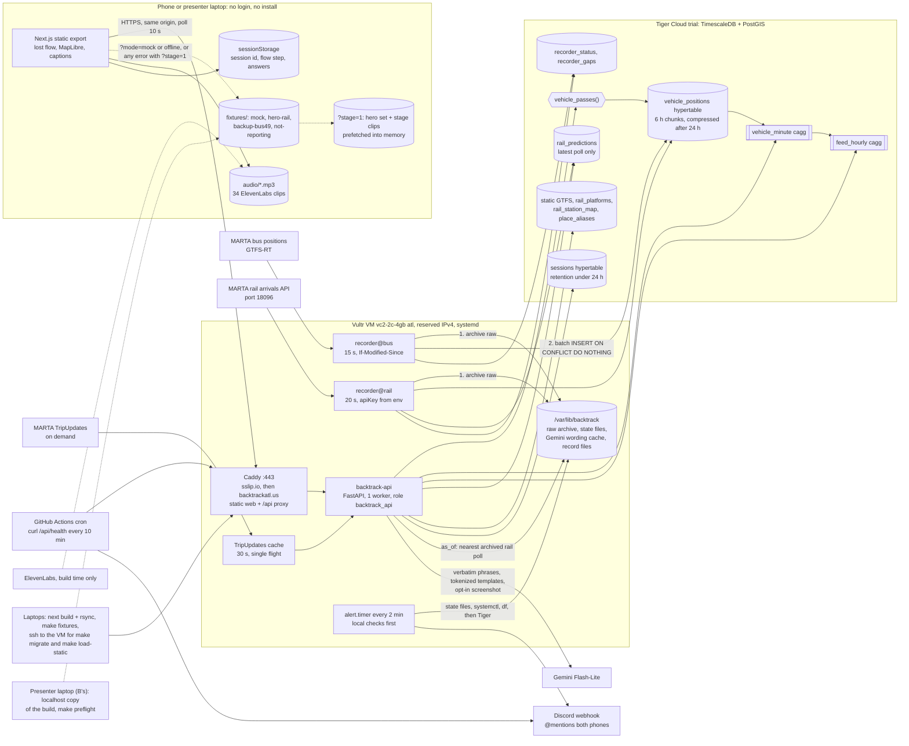

# Backtrack: architecture decision record

Hacklanta '26, team of 2. Written Thursday night, Oct 8, 2026. **Planning only: no repo, no code before Fri Oct 9, 8:30 PM.**

Sources of truth: `PLAN.md`, `CLAUDE.md` and `PREP-REPORT.md` (the verified feed, rail, GTFS, contact, event and tool facts). This record merges the lead architect's draft ("One Box, Fixtures First"), three red-team reviews (operations, matching correctness, people and schedule), three judge lenses (build risk, stage and track, correctness) and the four original proposals.

> **Changes after kickoff (Oct 9, team decisions). These override anything below.**
> - **Cut:** breathing and calm-mode exercises (the orb, the calm audio clips, "Skip, I'm fine"), and Find My
>   screenshot upload (`POST /api/findmy`, the `read_findmy` stage tool, FindMyUpload, wb_13, the stale-dot buttons and
>   the screenshot hero beat). Riders won't do either. Gemini now has two uses: `/parse` and the report wording.
> - **Product name:** "bring it home" (lowercase, as in the logo), domain bringit.casa. Navy `#14213D`, orange
>   `#EF5B2B`. Internal code names stay `backtrack_*`.
> - **Gemini over REST** with hard deadlines (4 s text), model `gemini-3.5-flash-lite` (measured 0.65 to 0.73 s);
>   no `google-genai` dependency.
> - **Migration 007** gives `vehicle_passes` an `as_of` horizon; 005 and 006 stay reserved.
> - **Reunion planner (Oct 10):** every way back to the item, soonest first, from tonight's measurements of real
>   MARTA behavior (`docs/reunion-measurements.json`): section 7.9, `api/backtrack_api/reunion.py`, and
>   `POST /api/sessions/{id}/reunion` (6.2 endpoint 10a). The plan carries it as `reunion`. The bus walk-ahead meet
>   is tightened to the measured rule: margin at least 180 + 120 s and the bus at most 10 min away (decision 9, 7.8).
>   After review and an Oct 9 backtest: a walk to a bus stop ahead on its current trip is only that meet, the evening
>   rule goes by the train's arrival at its turn, a skipped GTFS slot is low, a turned train is never estimated via a
>   second turn, a train session is never planned on a later service day, boarding a train keeps the station margin,
>   loop routes are not "at the end" at their start, and the meet never runs on an assumed place (7.9).

Conventions:
- H0 = Fri Oct 9, 8:30 PM ET. All times are Eastern.
- A = Person A (data and backend). B = Person B (frontend, voice and pitch).
- "Sketch" means planning text that gets written for real after kickoff.
- App copy says "meet it"; only pitch copy says "catch it" (prep section 10 lint).

---

## 1. Recommendation in 8 bullets

1. **One Vultr VM, one Tiger Cloud service, one origin.** The VM (vc2-2c-4gb in Atlanta, on a reserved IPv4) runs Caddy, which serves the static Next.js export and proxies `/api`. It also runs a one-worker FastAPI, two copies of one simple recorder (bus every 15 s, rail every 20 s) and a local health check. Tiger holds every table. Nothing else runs anywhere except a 10-minute outside health check from GitHub Actions.
2. **The recorders are the simplest and best-guarded code in the repo.** Every poll is archived raw to disk before the database sees it, then batch-inserted with `ON CONFLICT DO NOTHING`. A poll only counts as healthy if it carries live rows and newer data. A hung or dead Tiger never stops polling, and the archive drains itself back in when Tiger returns. Alerts reach both phones through Sleep Focus, and still fire if the VM itself dies.
3. **Matching is one PostGIS function over one hypertable, plus Python arithmetic.** The function interpolates each vehicle's path between pings, keeps real stops as time intervals, and returns every pass near the stop the rider remembers. Python ranks with soft penalties, scheduled vehicles that were not reporting, and a "none of these" option, so confidence stays honest at 56 to 58% night bus coverage. Gemini never ranks.
4. **Meet plans use live ETAs only, with margins sized for a person rather than a train.** Trains need 120 s plus a 30 s optimism pad plus step-off or platform time, at shared platforms only, within 20 min. Buses need 180 s against a 1.0 m/s walking model (0.7 m/s with the mobility toggle). The card withdraws itself as soon as the data says the meet stopped being possible.
5. **Gemini cannot introduce a fact.** It returns verbatim phrases from what the rider said, reads a Find My screenshot, and rewords two strings around opaque tokens. Every card is worded from a reviewed copy table, and every number comes from the database, static GTFS or the verified contact list.
6. **Fixtures first.** Mock data and offline replay share one code path from hour 1. The hero sets are real API responses recorded server-side during Saturday's ride. The first real end-to-end run lands at H8 (Sat 4:30 AM), the field-test prerequisites are deployed by 1:15 PM Saturday, and everything freezes at H24 (Sat 8:30 PM).
7. **One rehearsed stage path.** The presenter (B) drives a 2:30, taps-only replay of Saturday's ride on the laptop. It runs the real engine on recorded history, with the whole hero set already in memory, so any network failure flips to the same screens under a "Replay" chip. Nothing on stage calls Gemini or needs a microphone.
8. **Why this beats the alternatives here.** It won two of three judge lenses, scoring 144 against 135, 106 and 101. It has the fewest moving parts, the earliest real slice and the strongest offline story. It is also the only design that keeps the pitch on "the one vehicle you were on, found after the fact" rather than a live map of every bus, which transitLedgerATL already showed.

---

## 2. How we chose

### 2.1 The four angles

| Proposal | Angle | Its bet |
|---|---|---|
| **One Box, One Table, Fixtures First** | Demo-first and buildable by two people | One VM, a static export, one simple recorder, and mocks that double as the offline demo |
| Contract-First Parallel | Maximize A and B parallelism | Joint contract and fixtures at H0, additive-only changes, fixture tests on both sides |
| Reliability-first ("disk first, label everything") | Never lose data, label every degraded state | Two VMs, a shadow recorder, a spool, a watchdog, a service worker |
| Prize-and-track-first | Put every sponsor on the critical path | Public status page, nextjs-auth0, a fleet chart, a QR code for judges' phones |

### 2.2 Judge tally

Each lens scored 6 criteria at 10 points each (60 maximum).

| Lens | One Box | Contract-First | Reliability-first | Prize-first | Lens winner |
|---|---|---|---|---|---|
| Build risk (can two people build it in 36 h) | **46** | 40 | 22 | 21 | One Box |
| Stage and track (will it win the room) | **51** | 47 | 44 | 43 | One Box |
| Correctness (hard rules and verified facts) | 47 | **48** | 40 | 37 | Contract-First |
| **Total** | **144** | 135 | 106 | 101 | **One Box** |

One Box lost correctness by one point because its station-wait meet card had no 2-minute margin. That is a rule fix (decision 9). Contract-First's weaknesses were structural: its first integration ran while the backend owner slept, its first slice was bus only, it used a service worker on borrowed phones, and it flipped endpoints with a build-time flag.

### 2.3 What we grafted from each runner-up

Only ideas a judge named made it in.

- **Contract-First:**
  - the pytest that loads every fixture into its pydantic model
  - the H3 real-density replay snapshot for B
  - migration 001 holding only the recorder tables, with additive-only changes after it
  - the 30 s train optimism pad plus 60 s step-off
  - the not-reporting fixture set
  - "track the vehicle, not the trip" through the same block
  - the confidence cap during a recorder gap
  - verbatim number checks on intake
- **Reliability-first:**
  - coverage-aware confidence, counting scheduled vehicles that were not reporting
  - `/preflight`
  - a source label on every response
  - the slow-walk (mobility aid) toggle
  - the push alert
  - capture % from counted feed versions
  - kill -9 and wrong-DB drills after the first slice
- **Prize-first:**
  - collapsing repeated rail coordinates
  - meeting only at shared platforms
  - the line "N passed nearby, one fits"
  - the footer proof strip
  - B handling H0 infrastructure
  - fixed cut checkpoints
  - a keyed recent-passes helper
  - the item description never leaving the phone

### 2.4 What the red team changed

The three red teams filed 51 issues: 10 that could sink the demo, 30 that judges will poke, and 11 polish. Every sinks-demo and judges-will-poke fix that was cheap is built into this record. The few that were declined or modified are listed with reasons at the end of section 9. These changes moved the architecture most:

1. **One stage path.** The stage path is REPLAY only. The presenter drives it on the laptop, taps only. The clue uses an exact time and "Very sure", written from the field-test choreography. The hero set sits in memory and takes over on any network error.
2. **`as_of` is correct for "now" and meet plans.** Under `as_of`, the API reads the archived rail poll nearest that moment and never touches live tables. The draft would have shown Sunday's data under a Saturday banner.
3. **Recorders judge health by content and survive messy failures.** A poll counts only if it has at least one live row and the data clock moves. Recorders survive hung database connections and drain their own archive back in. They are watched from inside and outside the VM, and the alerts get through Sleep Focus.
4. **Matching honesty.**
   - Pass timing is role-based and treats dwells as intervals.
   - Bus riders get a direction question.
   - Pass segments can span gaps, with a penalty.
   - Rail gets its own "scheduled but not reporting" term, counted only when a recorder gap or a train dropout makes it real (decision 7).
   - Line and direction penalties are stronger at hubs.
   - "Matched" is shown only at Medium or High.
5. **A Saturday reorder.**
   - The field-test prerequisites are deployed by 1:15 PM.
   - No deploys before the ride.
   - Record mode runs server-side.
   - Auth0 is cut at kickoff.
   - Tiger compression and caggs move to right after the ride.
6. **Security.**
   - Two least-privilege DB roles.
   - A pre-commit secret hook.
   - Log redaction.
   - A record token that never shows in the address bar.

---

## 3. Diagram



### What runs where

| Piece | Runs on | Owner | Starts how | If it dies |
|---|---|---|---|---|
| Caddy (TLS, static web, `/api` proxy) | VM | B | systemd, enabled at boot | Restarts in 5 s. Stage keeps going from the in-memory hero set |
| `backtrack-api` (FastAPI, 1 worker) | VM, 127.0.0.1:8000 | A | systemd. Starts without the DB and returns 503 until ready | Restarts in 5 s. The alert restarts it after 2 failed health checks |
| `backtrack-recorder@bus`, `@rail` | VM | A | systemd template, `StartLimitIntervalSec=0` | Restarts in 5 s, logs a restart gap, and drains the archive itself |
| `backtrack-alert.timer` (health check) | VM, every 2 min | A | systemd timer | GitHub Actions still pages both phones |
| Raw archive, state files, Gemini wording cache, record-mode files | VM disk, `/var/lib/backtrack` | A | n/a | Vultr snapshot at H24, and the archive is copied to A's laptop |
| Tiger service (every table) | Tiger Cloud trial, region picked at H0, nearest to atl | A | managed | Recorders keep archiving. The API returns 503, and the stage uses the in-memory set |
| Static web build | VM (`/srv/backtrack/web`) and the presenter laptop (localhost) | B | rsync and a symlink swap. `python3 -m http.server` on the laptop | Offline tab on the presenter laptop |
| Outside health check | GitHub Actions scheduled workflow in the public repo | A | cron every 10 min | n/a |
| Discord webhook | Discord | A | n/a | Both teammates also check `/health` on waking |
| ElevenLabs | B's laptop, build time only | B | `make_audio.mjs` | Clips are committed. Nothing runs at runtime |
| Gemini | Google, called only by the API | A | per request | Templates and rules |
| Domain | tech.study, then an A record to the reserved IP | B | when a promo code appears | `<ip-with-dashes>.sslip.io` stays live |

---

## 4. Decisions

### Decision 1. Process topology

**Choice.**
- **The VM.**
  - One Vultr vc2-2c-4gb in `atl`, Ubuntu 24.04, 1 GB swap, deployed on a **Vultr Reserved IPv4** created at H0, so a rebuilt VM keeps the same address and sslip.io name.
  - After the H0 `apt upgrade`, unattended-upgrades and `apt-daily-upgrade.timer` are disabled until Monday.
  - B creates the VM at H0 while A creates Tiger.
- **Five systemd units:**
  - `caddy`
  - `backtrack-api` (uvicorn, 1 async worker on 127.0.0.1:8000)
  - `backtrack-recorder@bus` and `backtrack-recorder@rail`
  - `backtrack-alert.timer`, a oneshot every 2 min with `TimeoutStartSec=60`
- **Unit settings.** Every unit has `After=` and `Wants=network-online.target`, and uses `Restart=always`, `RestartSec=5` and `StartLimitIntervalSec=0`. B enables only Caddy at H0. The app units come from A's `/deploy/units` stubs (pushed in the first 10 min) and stay disabled until A's first `make deploy-recorders` or `make deploy-api` enables them, because an enabled unit with no code behind it would restart every 5 s forever.
- **Database.** The Tiger Cloud 30-day trial is the only database (region picked at H0, nearest to atl). The VM disk holds only the raw archive, state files, the Gemini wording cache and record-mode files.
- **Web.** The web app is a Next.js static export (`output: 'export'`). It is built on a laptop, rsynced to `/srv/backtrack/web`, and served by Caddy on the same origin as `/api`.
- **MARTA** is polled only from the VM.
- **Presenter laptop.** It keeps a copy of the build on localhost.
- **Outside watcher.** A scheduled GitHub Actions workflow in the public repo is the only thing watching from outside.

**Why.**
- **Fewest things to break.** That is why both the build-risk and stage judges ranked this design first.
- **Prize fit.** The whole product (web, API, recorders) is on Vultr, and the database is cleanly on Tiger.
- **Forced anyway.** Port 18096 and the missing CORS header force server-side rail polling.
- **Sizing.** A static site cannot crash or run out of memory. The second core keeps a TripUpdates parse or a replay query from delaying a recorder poll, and leaves room for an emergency build. On the $100 credit it costs pennies.
- **One worker** keeps the TripUpdates cache, Gemini cap and breaker shared.
- **Ops red team.** Enabled units, a restart policy without a start limit, and the reserved IP close its reboot and rebuild holes.

**Rejected.**
- **Two VMs:** lowest build-risk scores, and units plus alerts already isolate.
- **`next start` on the VM:** another runtime, and out-of-memory risk during builds.
- **Vercel:** a second host, a CORS split and a weaker Vultr story.
- **Self-hosted Timescale:** muddies the Tiger prize, and we would own the backups.
- **docker compose:** not installed on either laptop.
- **1c plans:** less headroom.
- **Two uvicorn workers:** per-worker caches and caps.
- **A shadow recorder:** more to watch than two people can.

### Decision 2. API language, framework and owner

**Choice.**
- **Stack and owner.** FastAPI on Python 3.12, managed with uv, owned only by A. It is written into CLAUDE.md at H0 and never revisited.
- **Thin layer.** SQL finds passes. Python ranks them, parses times, resolves places and builds plan facts.
- **Starts without the DB.** The resolver loads lazily, and every DB route returns `503 db_unavailable` until Tiger answers.
- **Libraries, one job each:**
  - `fastapi` and `pydantic`: the pydantic models are the server side of the contract.
  - `uvicorn`.
  - `psycopg[binary,pool]`: an async pool of at most 5, `check=AsyncConnectionPool.check_connection`, and DSN keepalive and timeout parameters (decision 3). Whether the trial has a pooler is unverified; the pool max is 5 regardless.
  - `httpx`: timeouts. Its logger and httpcore's run at WARNING, so the rail key never reaches journald.
  - `gtfs-realtime-bindings` 3.0.0.
  - `google-genai`.
  - `python-multipart`: the screenshot upload.
  - `pytest`.
- **Repo layout:**

| Path | Holds |
|---|---|
| `/worker` | recorder, connectors, loader, backfill, healthcheck, timeutil |
| `/api` | the API |
| `/db/migrations` (001 to 005), `/db/seeds` | migrations; seeds for aliases, the station map and destinations |
| `/data/contacts.json` | verified contacts |
| `/contracts/api.ts` | the TypeScript contract |
| `/web` | the frontend |
| `/deploy` | Caddyfile, units, scripts, `env.example`, runbooks, pre-commit hook |
| `/tests` | tests |

**Why.**
- It is the same language as the recorders and the GTFS loader, which was prep's lean.
- Static GTFS quirks (leading spaces, hours over 24) are easiest in Python.
- One person owns all the data code.
- A static export has no runtime for Next route handlers.

**Rejected.**
- **Next route handlers:** they need a Node runtime and put backend code in B's tree.
- **A Node API:** two backend languages for one person, and the npm bindings are only 2.2.0.
- **OpenAPI codegen:** it needs A's server running, and the fixture tests catch drift anyway.
- **pandas, rapidfuzz, a date library:** not needed.

### Decision 3. Recorders, supervision and alerts

**Choice.**

**Shape.**
- One program, `worker/recorder.py SOURCE`, with one connector per source (`connectors/bus.py`, `connectors/rail.py`).
- It runs as the systemd template `backtrack-recorder@.service` with `MemoryMax=400M`.
- It joins nothing, maps nothing and imports nothing from `/api`.
- It connects as `backtrack_rec` with one connection and no pool.

**Polling.**
- **Bus:** GET every 15 s with If-Modified-Since. A 304 only updates `last_poll_at`. A 200 with a newer `header.timestamp` counts as a new version.
- **Rail:** GET every 20 s, always sending `apiKey` from `MARTA_RAIL_API_KEY` through httpx `params={"apiKey": key}`, so no source line holds a key.
  - It keeps only `IS_REALTIME='true'` rows.
  - It writes one position row per TRAIN_ID, taken from that train's smallest-WAITING_SECONDS row.
  - A blank DIRECTION becomes NULL.
  - Unknown station names are stored raw and logged.

**What counts as a healthy poll (ops red team).**
- **Rail:** the body must be a JSON array with at least one live row.
- **Bus:** the feed must have at least one entity.
- **Overnight:** in the no-service window an empty payload is normal. The windows are hardcoded by weekday (prep section 6: weekend buses start at 5 AM, weekend trains at 6 AM, weekday trains at 4:45 AM):
  - bus: 1:30 to 5:15 AM Sat and Sun, 1:30 to 4:45 AM weekdays;
  - rail: 1:30 to 6:15 AM Sat and Sun, 1:30 to 5:00 AM weekdays.
- **Otherwise:** the poll counts as failed, and the first 200 bytes of the body, redacted, go into `last_error`.

**For each new payload, in this order:**
1. **Archive it** to `/var/lib/backtrack/raw/{bus|rail}/YYYY-MM-DD/HHMMSSZ.{pb|json.gz}` (UTC names). Rail is skipped when its hash is unchanged. That is about 35 MB/day for bus and 20 to 25 MB/day for rail (estimates, checked at H2).
2. **Insert it** in one transaction: `executemany INSERT ... ON CONFLICT (mode, vehicle_id, ts) DO NOTHING` plus the `recorder_status` upsert. Rail also upserts `rail_predictions` and deletes rows older than 2 min.
3. **Write the local state file** `/var/lib/backtrack/state/{source}.json`: last poll, last OK, last rows, newest data time, last archive file inserted, and `db_ok`.

`ts` is `vehicle.timestamp` for buses and EVENT_TIME for rail, never poll time, so re-ingest never duplicates rows.

**Gaps.** A `recorder_gaps` row opens when:

| Reason | Condition |
|---|---|
| `feed_frozen` (bus) | `header.timestamp` has not advanced for 75 s |
| `feed_frozen` (rail) | the payload is unchanged, or the newest EVENT_TIME has not advanced, for 60 s during service hours |
| `http` or `timeout` | polls fail for 60 s |
| `empty` | polls return no live rows during service hours |
| `db` | inserts fail |
| `restart` | on startup, covering the time since the state file's last OK |

The row closes when data flows again. Gaps that happen while Tiger is down are held in the state file and written later.

**When Tiger is slow or gone (ops red team).**
- **Timeouts.** Every DSN carries `connect_timeout=5&keepalives=1&keepalives_idle=10&keepalives_interval=5&keepalives_count=3&tcp_user_timeout=15000`. The recorder DSN also sets `options=-c statement_timeout=10000`.
- **Never block polling.** On any OperationalError the recorder closes the connection, sets `db_ok=false`, and keeps polling and archiving. It tries one reconnect at most every 30 s, never in a loop that delays a poll.
- **Self-healing drain.** When the DB answers again, and also at every startup, the recorder replays every archive file newer than the state file's last inserted file, oldest first, through the same insert. `ON CONFLICT` makes this idempotent, so a restart in the middle of an outage heals without anyone awake.
- **Manual backfill.** `python -m worker.backfill --since` remains for manual use, followed by `refresh_continuous_aggregate` for that window.

**Alerts.** `worker.healthcheck` runs every 2 min as root.
- **Check order:**
  1. Local truth: each state file's poll age and rows age, `systemctl is-active` for each unit, and free disk.
  2. `127.0.0.1:8000/api/health`.
  3. Tiger, as `backtrack_ro` with `connect_timeout=5`.
- **When it pages:**

| Condition | Response |
|---|---|
| Recorder not polling for 3 min | Page now |
| No rows inserted for 5 min during service hours | Page now |
| API down | Page now |
| API health fails twice in a row | Also `systemctl restart backtrack-api` |
| Tiger unreachable while archiving is fine | Page only after 30 min |
| Under 2 GB of free disk | Page |
| The check itself throws | Page "healthcheck failed: <type>" |

- **Rate limit:** each alert class posts at most once per 15 min, and every post @mentions both teammates.
- **Outside the VM:** a scheduled GitHub Actions workflow curls `/api/health` every 10 min and posts to the same webhook, which is stored as a repo secret. This covers a dead VM.

**Uptime counter.**
- `first_started_at` is set once and never reset.
- The positions count comes from `feed_hourly` (from `recorder_status.rows_inserted` before migration 005).
- Bus capture % = `versions_new / (elapsed seconds / 30)`. Rail shows poll-OK %.

**Changes and drills.**
- **`make deploy-recorders`:** A only, and only when `/worker` changed. It watches `recorder_gaps` for 2 min afterwards (the gap watch is added at H8.5) and refuses after H24 without `--force`. Its first run enables the recorder units.
- **Drills:**

| When | Drill | Pass condition |
|---|---|---|
| H8 | Alert delivery, both phones in Sleep Focus | Both phones buzz |
| H9 | A third unit, `recorder@drill`, with a bad DSN and its own archive directory | Polling and archiving start before any DB call |
| H8.5 (Sat 5 to 6 AM, no trains running) | `kill -9` | The unit restarts and logs a restart gap |
| H8.5 (Sat 5 to 6 AM, no trains running) | `sudo reboot` | `/health` green and archive files landing within 2 min |
| H22.5 | iptables DROP (not REJECT) on the Tiger port for 20 min | Archive files keep landing every 15 s, and the backlog drains afterwards |

**Why.**
- CLAUDE.md says the recorders never stop, so they get the least logic and the most supervision.
- Prep verified the 30 s cadence and free 304s; the dedupe key and archive sizes are estimates, checked at H2.
- The ops red team showed the draft handled only clean failures. A half-open TCP connection would have stopped archiving for about 15 min. A rail feed answering 200 with no trains would have looked healthy all day.
- Counting content instead of HTTP status, and measuring freshness by the data's own clock, fix both.

**Rejected.**
- docker compose.
- One process for both sources.
- A SQLite or NDJSON spool: the archive already is one.
- A shadow recorder.
- Writing block or direction at insert time: it couples the recorder to the loader.
- A feed_versions hypertable.
- Recording TripUpdates: about 2 GB/day.
- 30 s polling.
- Speed filters, or dropping CANCELED buses.
- Treating HTTP 200 as success.

### Decision 4. Data model, roles and the Tiger story

**Choice.**

**`vehicle_positions`.**
- One hypertable with 6 h chunks and PK `(mode, vehicle_id, ts)`.
- Columns: ts, mode, vehicle_id, label, route_short, trip_id, trip_canceled, direction (rail only), next_station (raw API name), destination, bearing, lon, lat, polled_at.
- **Positions are plain lon/lat doubles.** That keeps `last()` inside a cagg safe, compresses well, and lets PostGIS build geometry inside the matcher.
- **Indexes:** the PK (which serves "latest position of X") and `(mode, ts DESC)`. There is no spatial index on positions, because every query is time-bounded first and measures distance to computed pieces.
- **Compression after 24 h** (segmentby `mode, vehicle_id`, orderby `ts DESC`). At 9:30 AM Sunday, Friday night is visibly compressed, while Saturday's 3 to 5 PM ride is about 17 h old and still uncompressed.

**Static GTFS: services 3, 4 and 5 only** (22,460 trips, about 1.04 M stop_times).
- `gtfs_stop_times`: `arr_s` and `dep_s` as integer seconds from service-day midnight.
- `gtfs_stops`: norm_name and a GIST index.
- `gtfs_trips`: route_short_name, direction_id, block_id, shape_id and headsign. Bus direction, block and shape are always read from here by trip_id.
- `gtfs_shapes`, `gtfs_calendar`, `gtfs_calendar_dates`.
- An `active_services(date)` function.
- `gtfs_stop_routes`: which routes and directions (with headsigns) serve each stop. This drives the route buttons and the bus direction question.

**Rail tables.**
- `rail_station_map`: 38 STATION names (6 differ from GTFS) plus the title-case DESTINATION spellings seen in polls, with a `kind` column.
- `rail_platforms`: line, direction, seq, parent and platform stop ids, coordinates, and `is_terminus`. The loader derives it from the longest trip per line and direction. It records where two lines share a `platform_stop_id`.
  - `is_terminus` marks only the full-run ends. Short turns (Red at Lindbergh after about 9 PM on weekdays, Green at Vine City or King Memorial, special-schedule turnbacks) are caught at read time: a platform counts as a terminus for a pass when `is_terminus` is true **or** the train's DESTINATION, mapped through `rail_station_map`, equals that station at that time.
  - A pytest replays a Friday-night Red turning back at Lindbergh.
- `rail_predictions`: the latest poll only.

**Also:** `place_aliases` (with a `multi` flag for names that cover several places), `recorder_status`, `recorder_gaps`, and `sessions` (a hypertable with 1 h chunks and retention under 24 h).

**Continuous aggregates.**
- `vehicle_minute`: the last position per vehicle per minute. It feeds the replay city layer.
- `feed_hourly`: hierarchical, built on `vehicle_minute`. It feeds the positions counter and the coverage line.
- Each gets one full refresh at creation.

**Roles (ops red team).**

| Role | Can do | Used by |
|---|---|---|
| `backtrack_rec` | Write the recorder tables | The recorders |
| `backtrack_api` | Read everything, write sessions | The API |
| `backtrack_ro` | Read only | Healthcheck, Tiger MCP. (`make recent` goes through the API with `STAGE_KEY`.) |

The `tsdbadmin` DSN lives only in A's password manager. The static tables (`gtfs_*`, `rail_station_map`, `rail_platforms`, `place_aliases`) are owned by `tsdbadmin` and written only by `make migrate` and `make load-static`, which A runs on the VM inside tmux after `read -s TIGER_DSN_ADMIN && export TIGER_DSN_ADMIN`. The admin DSN is never written to `/etc/backtrack/env` or shell history.

**Staged migrations.**
- **001 (H0.3):** extensions, roles and the recorder tables only.
- **002:** rail_predictions.
- **003:** static tables.
- **004:** `vehicle_passes()` and sessions.
- **005 (H20.5, after the ride):** compression and caggs, after a Context7 or Tiger MCP syntax check.
- Every file runs through `make migrate` in autocommit, statement by statement, and everything after 001 is additive.

**The Tiger story.** Every Tiger feature named in the MLH prize does real product work:
- a real hypertable taking about 500k rows a day (estimate; the footer shows the measured count);
- a compression ratio measured live and shown in the footer;
- hierarchical caggs the product reads;
- a PostGIS spatiotemporal function on the raw hypertable with chunk exclusion, shown with its timing in "How we know";
- a retention policy that enforces privacy inside the database.

**Why.** The schema follows the verified facts:
- The feed's `route_id` is the short name, hence the column name `route_short`.
- The feed's `direction_id` is unreliable.
- Parent station points sit 113 to 170 m from the platforms.
- 49% of stop_times rows are holiday-only.
- Interlining puts the route on each row, not on the vehicle.
- A least-privilege role keeps one leaked DSN from dropping the weekend's history.

**Rejected.**
- Separate bus and rail tables.
- A geography column on positions.
- Resolving stations or blocks at insert time.
- A GIST index on positions.
- Compressing after 12 h: the ride would be compressed at judging.
- Daily chunks.
- A rail prediction history table: the raw archive is one.
- A retention policy on positions.
- Applying the whole schema at H0.3.
- One shared admin DSN.

### Decision 5. Place resolution

**Choice.** A deterministic resolver held in FastAPI memory, loaded from `gtfs_stops`, `gtfs_stop_routes`, `place_aliases` and `rail_station_map` (about 7k stops). It works in this order:

1. **"Use my location".** Coordinates are used once, in memory. The resolver returns the 3 nearest stop clusters (GIST KNN, with same-name stops within 300 m grouped), along with their routes and lines. Rail riders see the nearest stations. `?near=<alias>` stands in for GPS on stage and in tests, and the replay banner discloses it.
2. **Exact match in `place_aliases`** on the normalized phrase. There are about 60 hand-written rows, plus all 38 station names in both GTFS and API spellings. Aliases flagged `multi` ("gsu", "georgia state", "the airport", "tech") always ask a confirming tap with 2 or 3 choices.
3. **Rail station names.**
4. **Fuzzy stop names.** Expand abbreviations (ST, AVE, @), drop filler words, then score with stdlib `difflib` token-set ratio. Accept only a score of at least 0.8 with a 0.1 lead; otherwise show the top 3 plus "Pick on map". This step is added after the slice.
5. **Map pick.** A long press snaps to stops within 300 m.
6. **Route context.** A known route plus a landmark becomes that route's stops within 400 m. For example, "the 49 near Peachtree Center" becomes Courtland St @ Ellis St.

**Directions.**
- **Bus (matching red team).** After the route tap, if the anchor stops serve both directions of that route, one question appears with the two headsigns from `gtfs_stop_routes` ("Toward North Ave Station", "Toward ..."), plus "Not sure". The answer drops the other direction's stops.
- **Rail.** Direction buttons for each line are built from the DESTINATION values seen in the last 2 h plus the GTFS headsigns, so "To Lindbergh" exists when that is what the sign said.
- **Rail anchors** are the platform for the stated direction, or both platforms if the direction is unknown.

Anything that did not come from a tap or a single-place alias is shown back for a confirming tap. Gemini returns only the rider's phrase. Only this resolver produces coordinates.

**Why.**
- It satisfies "no model may invent a location" and is unit-testable offline.
- It handles the verified traps: duplicate names, platform versus parent distance, and route 49 being the only bus near Peachtree Center.
- Prep found 1,669 stop names shared by 3,430 stops (prep section 4), so a name alone often can't fix the direction. Direction has to be asked, not guessed.

**Rejected.**
- Gemini or a geocoder producing coordinates.
- pg_trgm: unverified on the trial.
- A client-side gazetteer.
- rapidfuzz.
- Parent station points.

### Decision 6. Time handling

**Choice.**

**Storage and code.**
- Store `timestamptz` (UTC) everywhere.
- One module, `worker/timeutil.py`, uses zoneinfo America/New_York and is shared by the recorders and the API.
- Every function takes `now` as a parameter (decision 13).

**Client.**
- Every time is formatted with `Intl.DateTimeFormat` and `timeZone: 'America/New_York'`, never the device zone.
- Relative buttons resolve against server time, never the phone clock.

**Buttons and windows.**

| Button | Center | Half-width |
|---|---|---|
| Under 10 min | now − 5 | ±5 |
| 10 to 30 min | now − 20 | ±10 |
| 30 to 60 min | now − 45 | ±15 |
| 1 to 2 h | now − 90 | ±30 |
| Over 2 hours | now − 240 | ±120 (120 to 360 min ago) |
| Not sure | now − 90 | ±90 |
| Pick a time | the picked time | 0 |

- W = max(half-width, sureness), with sureness Very sure 5, Pretty sure 15, Rough guess 30 and Not sure 60 min.

**Clock phrases.**
- A bare clock phrase with no am/pm resolves to the most recent past occurrence within 12 h.
- A picked or explicit am/pm time that lands in the future rolls back **24 h**, not 12 (matching red team).
- The confirm screen always shows the day when it is not today, for example "Got off around 11:50 PM last night (Sat)?".

**Rail EVENT_TIME.** Format `%m/%d/%Y %I:%M:%S %p`, localized to New York, then converted to UTC. NEXT_ARR is ignored. ETA = poll time + WAITING_SECONDS.

**GTFS service day.**
- Midnight is noon minus 12 h of the service date.
- An instant T is checked against service(D) at `secs` and service(D−1) at `secs + 86400`.
- For a known trip_id, the service date is whichever of D and D−1 runs its service_id with midnight + `arr_s` closest to T.
- Blocks are joined on `(service_id, block_id)`.
- TripUpdates after midnight use the absolute `arrival.time` epoch and are never rebuilt from `start_date`.

**pytest cases:**
- "3:10" at several values of now, plus the 12 h rollback;
- a picked 11:50 PM at 12:20 AM, which rolls back 24 h;
- the midnight wrap;
- `' 4:40:00'` = 16800 and `'26:11:00'` = 94260;
- EVENT_TIME in AM and PM;
- the service(D−1) lookup at 00:30 Saturday;
- a trip started at 11:40 PM Saturday, read at 12:20 AM Sunday;
- the 24:15 TripUpdates trip.

The copy lint also asserts that one fixed instant formats as New York time.

**Why.**
- CLAUDE.md requires New York parsing and a test.
- Prep verified the leading spaces, the values past 24 h and the after-midnight quirk.
- An injected `now` makes every rule testable, and it makes replay possible.

**Rejected.**
- Storing local times.
- Trusting the device clock or zone.
- A date library.
- Gemini timestamps.
- Rebuilding times from `start_date`.
- A 12 h rollback for picked times.

### Decision 7. Matching engine

**Choice.** Section 7 has the step-by-step logic and SQL.

**Anchors and windows.**
- Intake becomes 1 or 2 anchors: `{role: alight|board, points[], t_center, W}`.
- Points are platform or child stops, narrowed to one direction when the rider answered the direction question.
- Alight comes first, because the walk-back asks where and when you got off.
- The search window is t_center ± (W + 3 min).

**One query per mode.** `vehicle_passes(mode, anchors, window, radius 400 m, max_gap 600 s, dwell 90 s)` returns every piece of every vehicle's path within 400 m:
- **points;**
- **real stops held as intervals:** a run of identical coordinates lasting at least 90 s, such as a terminus layover;
- **moves:** straight segments between consecutive fixes, with the interpolated closest-approach time and the gap they span.

Shorter runs of repeated rail coordinates are stale reports and count at their first sighting.

**Pass events (Python).** For each vehicle and anchor:
1. Find the closest distance d\*.
2. Keep pieces within d\* + 50 m.
3. Split them where time jumps by more than 5 min, so out-and-back trips become two passes.
4. Each pass gets an interval [t_in, t_out].
- **"Got off" uses t_in and "got on" uses t_out** (matching red team).
- At a terminus platform (`is_terminus`, or the station the train's DESTINATION names at that time, decision 4), a clue inside the interval counts as dt = 0, because people do step on and off parked trains there.
- A candidate needs d\* ≤ 150 m.

**Cost.**
- c = Σ (dt/W)² + (d\*/150 m)².
- A missing second anchor costs 1.0, and board < alight ≤ board + 90 min.
- **Soft penalties, never filters:**

| Condition | Penalty | Exception |
|---|---|---|
| Bus route differs | +1.0 | Waived if the rider's route appears on that vehicle in any ping in the 90 min before the pass (interlining). The card then says "Route 23, continuing as 46" |
| Explicit direction answer differs (bus `direction_id` from gtfs_trips by trip_id; rail N/S/E/W) | +2.0 | Skipped at terminus platforms and for interlined passes |
| Rail line differs, and both lines use this anchor's `platform_stop_id` | +0.3 | |
| Rail line differs, separate platforms | +2.0 | |
| Bus more than 300 m off its trip shape (checked for the top 5 only) | +1.0 | Skipped within 3 min of a trip_id change, and when the feed marks the trip CANCELED (flagged "feed lists a canceled trip" instead) |
| The pass relies on a move across a gap longer than 120 s (bus) or 180 s (rail) | +(gap_s/300)² | The match is also capped at Medium |

- **The rider's own train** (from `on_vehicle`) is never a candidate.

**Coverage terms.**
- **Bus:** scheduled trips at the anchor stops in the window, across service D and D−1, filtered by route and direction if given, whose `(service_id, block_id)` had no vehicle passing within 400 m in the window.
- **Rail:** scheduled passes at the anchor platform with no live pass on that platform within 4 min, counted **only** when (a) a rail `recorder_gaps` row overlaps the window, or (b) a train on that line dropped out (no row for more than 120 s) inside the window. Otherwise rail unreported mass is 0.
  - Why: the static timetable is wrong on special-schedule days (prep section 4: Red and Gold every 24 min after 9 PM on Fri Oct 9, track-work cuts on about 80% of weekends), and every live rail row carries a TRAIN_ID. Without the condition, every unmatched static pass would be phantom mass and would quietly drop the stage clue from High to Medium (section 7.6).
  - A pytest runs a clue against Friday-night (special-schedule) history and asserts no phantom rail candidates.
- Each costs (dt_sched/(W + 3 min))² + 0.5, plus the same line and direction penalties.

**Confidence.**
- p_i = exp(−c_i/0.5) / (Σ live + Σ unreported + exp(−1.0/0.5) for "none of these").
- Anything costing 1.0 or more (no better than "none") is left out of the denominator.
- A recorder gap overlapping the window caps p at 0.6.

**Levels.**
- **High** if p1 ≥ 0.75 and p1 − p2 ≥ 0.4, where p2 is the larger of the second live candidate and the total unreported mass.
- **Medium** if p1 ≥ 0.5.
- **Low** otherwise.

**Statuses,** evaluated in this order (the first that applies wins):

| # | Status | When | What the rider sees |
|---|---|---|---|
| 1 | `no_match` | No live candidates and no schedule candidates | The plan without a vehicle |
| 2 | `not_reporting` | No live candidate with c < 1.0, but schedule candidates exist | "That bus isn't sharing its location right now. Here's a plan based on its schedule." Streetcar: "The streetcar doesn't share its location. Here's a plan from its schedule." |
| 3 | `ambiguous` | The second live candidate has p ≥ 0.25 | A tie-break card. The plan and report name both |
| 4 | `matched` | High or Medium | The match |
| 5 | `uncertain` | Anything else, including Low | "We couldn't pin down the exact one yet", the top 3 with times, one separating question, and no single bus number on the form |

"One fits what you remembered" appears only at High or Medium.

**Context line.** "{N} {trains | buses | buses and trains} passed within 400 m of {place} between {T1} and {T2}." It counts distinct vehicles for the mode asked.

**Mode.** If the mode is unknown, both modes run and merge. Streetcar has no live data and always takes the schedule path (`not_reporting` with the streetcar copy, or `no_match`); `vehicle_passes` only ever sees bus or rail.

**Evidence.** Each response carries per-anchor evidence, the context count, stats (positions scanned, vehicles considered, query ms) and the SQL text.

**Tuning.** All constants are tuned once at H20.5 on real cases (the stop 210555 log, the field-test train logs and the rides) plus synthetic clues. The pitch quotes only the measured "correct vehicle in X of Y real cases".

**Why.**
- It is deterministic SQL plus arithmetic, per the hard rule.
- Interpolation catches a bus that passes a stop between 30 s pings.
- Dwell intervals fix the 49's layover at North Ave Bay A and terminus departures.
- The coverage terms keep a lone wrong bus from reading High when 42 to 44% of night buses are invisible.
- The matching red team replayed the draft's formulas on the static timetable. "Pretty sure" at Five Points came out Low in 72 of 72 runs. An exact time with "Very sure" came out High in 72 of 72. The stage clue (decision 21) follows from that.

**Rejected.**
- PLAN 6.3's 120 m point radius.
- A 60 m segment radius.
- DISTINCT ON the closest pass.
- Next-station flips as passage events.
- Along-track km projection. It stays the fallback only if field-test rail t_pass errors exceed 60 s.
- Keeping the last row of every short repeat run, which re-creates the late bias.
- Hard filters.
- Learned rankers.
- Any Gemini role in ranking.

### Decision 8. Where is it now (live and replayed)

**Choice.** `GET /api/vehicles/{mode}/{id}/now` reads the latest row at or before t (now, or `as_of`) within 2 h, using a backward PK scan, so an id or TRAIN_ID reused on another day never leaks in.

**Freshness reference.**
- **Live:** `recorder_status.last_header_ts`, the newest feed data.
- **`as_of`:** the newest ts for that mode in [as_of − 120 s, as_of]. Under `as_of`, nothing reads `rail_predictions`, the TripUpdates cache or `recorder_status`.

**States.**

| State | Rule | Copy |
|---|---|---|
| `live` | ref − ts ≤ 120 s, and t − ts ≤ 150 s, and t − ref ≤ 90 s (so a frozen feed cannot look live) | |
| `at_terminus` (rail) | The latest fix is within 100 m of a terminus platform of its line, or of the station its DESTINATION maps to (short turns, decision 4) | "It is at the end of the line at {station}. Staff there can check it." |
| `dark` | t − ts > 10 min | Mode-aware: "This {bus/train} stopped sharing its location N min ago. Report it now with the {bus/train} number." |
| `stale` | Anything else | "Last seen N min ago." |

**Bus next stops.**
- **Live:** TripUpdates is fetched on demand with If-Modified-Since, parsed off the event loop, and cached 30 s behind a single-flight lock, indexed by vehicle_id.
  - Keep stops with `arrival.time ≥ t` that lie ahead of the bus's projected position on its trip shape.
  - Append the next trip in the same `(service_id, block_id)`.
  - A trip missing from TripUpdates is "unknown", never "canceled".
  - With no TripUpdate: static stop_times labeled "schedule only", and no meet.
- **`as_of`:** static stop_times for the trip's service date, labeled "schedule only".

**Rail next stations.**
- **Live:** the train's `rail_predictions` row. ETA = poll time + WAITING_SECONDS, valid up to DESTINATION. Names map through `rail_station_map`, with a raw-name fallback. DELAY is never shown.
- **`as_of`** (matching and schedule red teams):
  - `rail_predictions_at(as_of)` opens the newest archived rail poll at or before `as_of` (within 5 min) from the same disk.
  - It keeps that TRAIN_ID's live rows and computes ETAs from that file's poll time, dropping any before `as_of`. That is about 25 lines.
  - With no file: `next_stops: []` and meet reason `no_eta`.

**Meet check.** `/now` accepts `meet_place_id` and `remaining_walk_s` and returns `meet_ok` (decision 9).

**Polling.** The client polls every 10 s while visible. Under `as_of` it advances `as_of` by the elapsed wall time, so the replayed train moves.

**Why.**
- Prep measured rail ETAs within 60 s for 96 to 98% of trains 0 to 2 min out, and absolute TripUpdates arrivals on 76 to 79% of stop updates.
- Stale buses stay in the feed.
- Both red teams found the draft's REPLAY path read Sunday's live tables under a Saturday banner. The archive is already the history we need.

**Rejected.**
- Projecting along shapes ourselves.
- SSE or websockets.
- Recording TripUpdates.
- Showing DELAY.
- Calling a vehicle live because it is still in the feed.
- A prediction history table.

### Decision 9. Meet plans

**Choice.** The rules live in `api/meet.py`.

**Ground rules.**
- A meet card is never offered on stale, schedule-only or block-linked ("probably the same bus") data.
- It always sits beside the bag-staff and report cards.

**Train, rider at or near a station.**
- The bag train's live predictions must include that station, ahead of it, in its direction.
- reach_s = 90 s at the station, otherwise walk_s + 90 s.
- Feasible if ETA − now − reach_s − 30 s ≥ 120 s and ETA − now ≤ 20 min.

**Train, rider on another train (the origin story).**
- **Which train the rider is on** comes from one tap: "Which train are you on now?" lists live trains on the bag line's track, same direction, as "{Gold} to Airport, next stop West End". That is every line sharing a `platform_stop_id` with the bag line in that direction (Red and Gold on the Airport to Arts Center trunk, Blue and Green from Ashby to Edgewood-Candler Park, per the schedule's platforms), each labeled with its own line.
- **GPS only preselects** a button when `coords.accuracy ≤ 100 m` and the fix is under 30 s old. Tunnels give coarse or stale fixes (matching red team).
- **Meet stations** are stations in both trains' upcoming predictions, in the same direction, where both lines share the `platform_stop_id`, per `rail_platforms`. For Red with Gold that means the Airport northbound departure platform through Arts Center (the Airport southbound arrival platforms are separate: Red 906837, Gold 906647). Lindbergh has separate per-line platforms, so the set ends before the split by construction.
- **Feasible at S** if ETA_bag(S) − (ETA_rider(S) + 60 s step-off) − 30 s ≥ 120 s and ETA_bag(S) − now ≤ 20 min. Pick the earliest feasible S in the rider's order.
- **If the bag train reaches the first shared station first, it is ahead.** The plan shows a tell-staff card with facts only. "Meet it on its way back" appears only if a later prediction shows that TRAIN_ID in the other direction.
- Stations whose names don't map are left out.

**Bus.**
- The rider's location is a fresh, accurate fix or a chosen stop.
- For each upcoming stop of a live bus within 1.5 km straight line: walk_s = 1.3 × distance / v + 60 s, where v = 1.0 m/s, or 0.7 m/s with "I walk slowly or use a mobility aid".
- Feasible if ETA − now − walk_s ≥ 180 s + 120 s, ETA − now ≤ 10 min and walk_s ≤ 15 min. Pick the earliest feasible stop.
- **Measured on Oct 9 (`docs/reunion-measurements.json`, bus `walk_ahead_intermediate`, n=62,772 rider moments).** Walking ahead to a stop on the current trip was truly possible in only 0.8% of moments. With the 3 min margin alone, predicted-feasible walks failed 14 to 19% of the time (optimistic predictions win the pick). The 2 min buffer and the 10 min horizon together gave 14 recommendations and 0 misses. The withdraw check below keeps the 180 s floor: the buffer is for deciding. For buses the walk that works is to the end of the line during the layover (7.9).

**Two candidates.** `/plan` takes up to two vehicle_keys and offers a meet only at a station and time that work for both: "Wait at West End southbound for the 3:58 or the 4:05." For two trains that means one platform: both heading the same way, and both lines stopping at the same `platform_stop_id` there (never Lindbergh, or the Airport southbound, for a Red and Gold tie). Otherwise the tell-staff card names both trains.

**Staying true (matching red team).**
- While a meet card shows, each `/now` poll carries `meet_place_id` and `remaining_walk_s` (the plan's walk minus the elapsed time, so the client never resends location).
- `meet_ok` turns false when the vehicle stops being live, passes the place, or the margin drops below the floor while the rider is still on the way. Once `remaining_walk_s` reaches 0 the rider is in place, and the card stays while the vehicle is live and still coming (otherwise every meet that went to plan was withdrawn in its last 150 s).
- The client then swaps in "Too far to meet right now" plus tell-staff.

**Copy.**
- Walk there and wait back from the edge.
- Front, middle or back of the platform, from the car answer.
- Between 10 PM and 5 AM, add "If you're alone, ask station staff to help."
- Nothing promises that MARTA holds a vehicle or contacts a driver.

**Why.**
- The 2 min floor comes from CLAUDE.md.
- The 30 s pad covers the measured 18 to 22 s optimism of rail ETAs.
- Step-off and platform time make the margin real for a person.
- Live ETAs are required because the static rail timetable is wrong on special-schedule days.

**Rejected.**
- Static timetable math, including Prize-first's "median run time" fallback.
- A hand-coded split-station table.
- A routing API.
- Any meet on stale data.
- Picking one train when the match is a tie.

### Decision 10. Plan generation

**Choice.** `POST /plan` returns ordered cards, each with `{kind, step, facts, fact_sources, actions, evidence, source}`.

**Card order:**
1. **safety,** if "taken" is Maybe or Yes: wb_12 copy, plus MARTA Police and 911 from contacts.
2. **bag_staff,** for any transit loss. For a train loss it includes tracks_01 ("If it fell onto the tracks, don't go after it. Tell station staff.").
3. **meet,** or **too_far** plus **tell_staff.**
4. **keep,** the vehicle summary.
5. **report:** MARTA's form field labels with values, plus a Copy action.
   - At `uncertain`, the bus number is blank and the candidates go in a note ("possibly one of 1405, 1412 or 1433").
   - **A TRAIN_ID is a run number, never a railcar number** (prep section 3), so it never fills `rail_car_number`. It goes in `form_fields.train_run`, rendered in the description as "MARTA train run {405}, from MARTA's public feeds". `rail_car_number` is filled only from the optional "Saw a car number inside? [Type it] [No]" question after wb_10.
   - The form's vehicle fields appear only under the Complaints or Praise reasons, and which Reason fits a lost item is unverified, so `contacts.json` marks the form Reason "confirm on Friday's call".
   - When wb_13 found a tracker screenshot, an `airtag_share` action adds: "Using an AirTag? In Find My, use Share Item Location (iOS 18.2 or later) and paste the link into your report."
6. **call:** weekday hours, or the after-hours text with the next opening computed in New York time. Until Friday's call confirms the office opens on Mon Oct 12 (Columbus Day), it reads "usually opens the next weekday at 8:30 AM". After hours, an `ics` action offers a reminder: a client-built calendar data URL for the next weekday at 8:30 AM ET, plus "On a borrowed phone? Write it down."
7. **item extras.** Wallet: freeze cards, and ask the office what ID it accepts. Phone: mark it lost from this device.
8. **police_property,** only if it was confirmed by phone on Friday.

- **Wallet or theft first** (PLAN: "freeze cards first"). When the item is a wallet, or "taken" is Maybe or Yes, the order is safety, bag_staff, freeze_cards, then the rest.
- **safety_footer** renders on every plan screen.
- **`place_call` cards** (the Somewhere else path) are built on the phone from `copy.ts`, never by `/plan` (decision 12).

**Wording.**
- Card text is rendered client-side from `copy.ts`, the reviewed prep section 10 table, with facts filled into slots.
- Gemini words only two strings, the report email body and the call script, around opaque tokens (section 8).
- One call returns both strings as `{email_body, call_script}` under one 2.5 s budget. Each string is validated separately and falls back to its own template; whatever isn't back by then also falls back.

**Contacts.** Phones and hours come only from `/data/contacts.json`, each entry with a `source_url` and `verified_at`. Friday's Lost & Found call (prep section 12) adds two questions: "Open Mon Oct 12?" and which form Reason a lost item should use.
- Never a Lost & Found address.
- Never a See & Say link.
- No promise that MARTA will hold a vehicle or contact a driver.

**Why.**
- It makes "Gemini can't introduce a time, number, station or phone" structurally true.
- Safety copy is never reworded.
- Copy edits need no API deploy.
- Offline mode needs only facts.
- A Low result no longer puts one wrong bus number on MARTA's official form.

**Rejected.**
- Gemini writing whole cards (PLAN 6.6).
- Fact-checking free text after the fact.
- Separate wording calls per string (one call returns both).
- Dropping Gemini from the plan.

### Decision 11. Gemini usage

**Choice.** At most 2 calls per session (`/parse`, and one wording call that returns both strings), all server-side over Gemini's REST API with the standard library and a hard deadline. No `google-genai` dependency.

**Model.** `GEMINI_MODEL`, default `gemini-3.5-flash-lite`. It answered a structured JSON call in 0.65 to 0.73 s on Oct 9 and kept the `[[TOKENS]]` intact; `gemini-3.5-flash` took 5 to 9 s. Output is structured JSON: `responseMimeType` `application/json` plus a `responseSchema`, and the server checks each answer against that schema again.

**Reliability.**
- One client per API process (`create_app` builds it from the settings; `None` without a key). Every failure is `None`, never an exception, and every caller has a rule-based fallback.
- A hard 4 s deadline per call: the request runs in a helper thread we stop waiting for. The key goes in the `x-goog-api-key` header, never a URL, and is registered with the redactor.
- No retry on a 429. A 60 s circuit breaker after a 429, or after two calls in a row with no answer (a timeout or a network error), so an offline server stops spending its cap.
- **Two caches.**
  - Wording-template entries only: an LRU keyed by `sha256(model + prompt + template)`, **persisted** to `gemini-cache.json` in the data dir and loaded at startup. The tokenized templates hold no values, so nearly every wording call hits the cache. Each entry is checked by the validator when it is stored, when it is loaded and when it is served.
  - `/parse` results: memory only, 1 h TTL (every access sweeps out expired entries, and the app sweeps every 5 minutes), never written to disk.
  - A pytest loads `gemini-cache.json` and asserts it holds only template-wording keys.
- `GEMINI_DAILY_CAP` (default 200), counted per New York day in `gemini-daily.json` in the data dir, so a restart doesn't reset it. `/parse` never takes the last fifth of it, which stays for wording.
- With a key, a background thread warms the wording cache at startup, richest templates first. It never blocks startup, stops at the breaker or after two templates in a row get no answer, and never takes the half of the daily cap kept for `/parse`.
- `/parse` is rate-limited per client address by a small in-memory token bucket (`429 rate_limited`).
- `make preflight` calls `/plan` once on a stage session to prove the cache is warm.

**The two uses.**
1. **`/parse`,** only for typed or spoken clues.
   - TellMe asks only for where and when: "Tell us where and when. You'll pick what you lost on the next screen."
   - The schema is enums plus verbatim phrases.
   - The validator drops any phrase that is not a substring of the normalized input, and any number not present verbatim. The route must exist in `gtfs_routes`.
   - Phrases go to the resolver and the time parser, and the rider confirms by tap.
   - Before anything is logged or cached, the server removes every phrase the validator didn't map to a place, time, route, line, direction or car field.
   - The fallback is a regex parser. Taps never call Gemini.
2. **Wording** of the report email and call script around tokens, in one call that returns both under the 2.5 s budget (decision 10). Each string is validated on its own (section 8 item 4) and falls back to its own template.

**Data sent.**
- Sent: where-and-when clue text from TellMe, with emails (typed or dictated forms too) and digit runs of 7 or more (across spaces, dots, dashes, commas, slashes and invisible characters) redacted; tokenized templates with no values.
- Never sent: coordinates, session ids, item text typed on the item screens, or contact details.

**On stage, nothing calls Gemini.** The persisted wording cache serves plans even with no key.

**Why.**
- Two visible uses for the Gemini prize, each with a fallback.
- REST with our own deadline: the SDK's timeouts bound socket reads, not the whole call, and it is one more dependency for two calls.
- Free-tier inputs may be read by people, and limits are unpublished, so data is minimal and nothing on the critical path waits on Gemini.
- An in-memory-only wording cache would have been wiped by any restart right before judging (ops red team). Rider-derived results stay in memory, so nothing a rider typed outlives the 24 h rule.

**Rejected.**
- Gemini for matching, ranking or coordinates.
- Gemini timestamps.
- Agent loops.
- Streaming.
- Retries on a 429.
- The `google-genai` SDK.

### Decision 12. Frontend

**Choice.**

**Setup.** Next.js App Router with `output: 'export'`, TypeScript and CSS modules, built with the frontend-design skill. One page (`/`) holds a client state machine (`flow.ts`) that follows the prep section 10 question graph, plus three new screens:
- the bus direction question, with headsigns;
- "Which train are you on now?", shown when the rider answered "On another bus or train";
- after wb_10, the optional "Saw a car number inside? [Type it] [No]", which fills `rail_car_number` on the report card, on the phone.

**Components:**
- CalmMode and BreathOrb.
- Question: 56 px or bigger buttons, "Question n of about m", and "Not sure" everywhere.
- TellMe: mic plus textarea, at the expo table only. It asks "Tell us where and when. You'll pick what you lost on the next screen."
- Results.
- ContextLine: "N passed nearby, one fits", with "one fits" only at High or Medium.
- MatchMap, Replay, LiveVehicle, PlanCards, ReportCard, FindMyUpload.
- ProofFooter: positions logged since Friday, capture %, compression ratio, "running on Vultr", "data from MARTA's public feeds", "Voice: elevenlabs.io", and the web git sha. The copy lint matches banned words as whole words (run, runs), and "running on Vultr" and "train run" (the report's run-number line) are on its allowlist.

**Somewhere else (client only).** `not_marta` leads to up to 3 tapped or typed places, most recent first. Each becomes a `place_call` card from `copy.ts` with a generic call script. No API call, no Gemini, and typed place names stay on the phone. B builds it in 30 min at H20.5 to H22.5. It stays out of the stage script (PLAN 7.2's café beat is dropped, section 12).

**Map.**
- MapLibre GL JS 6.13.0, lazy-loaded on the results screen.
- **Online:** the OpenFreeMap positron basemap (no key).
- **Offline and stage (`?stage=1`):** an overlay-only style with no tiles and no glyph server. It shows our own GeoJSON: rail lines and stations, faint downtown bus-route shapes that stand in for streets, and the matched route shape. Labels are HTML markers.

**Replay.**
- It opens zoomed on the 400 m circle around the rider's stop, with the time-window clock, never on a city view.
- The client interpolates positions, but updates the map source only 10 to 15 times a second, and animates only the matched marker at 60 fps. That keeps a mid-range Android smooth.
- It plays the window in about 8 s, fades non-candidates, locks on (or highlights both on a tie), then moves to "now".
- `prefers-reduced-motion` jumps to the final frame.

**Live updates.** `/now` is polled every 10 s while the page is visible, and paused while hidden. On the plan screen
`POST /api/sessions/{id}/reunion` is polled every 20 s while the screen is open and visible (paused while hidden,
backing off 40, 80, 160 s on errors), with the rider's taps and, while they walk, the live fix in that request's
body only (see "Reunion on the plan screen" below).

**Runtime parameters** (read at runtime, never at build):

| Parameter | Effect |
|---|---|
| `?mode=live\|mock\|offline` | Where data comes from |
| `?set=` | Which fixture set |
| `?case=` | A mock variant |
| `?stage=1` | Prefetch the hero set and stage clips into memory; overlay map; voice only calm_01 and res_01, everything else as captions; flip to the in-memory set on any error |
| `?near=<alias>` | Stand-in for GPS |
| `?start=match\|report` | Open a fixture set at a given beat |
| `?record=<token>` | Read once and moved out of the URL (decision 13) |

B develops with `next dev` on localhost:3000 against the VM API. CORS is allowed for localhost only.

**Session.** `sessionStorage` holds the server UUID, the current flow step and the tap answers, so a reload resumes the same step. On the results or plan screen, a reload calls `GET /api/sessions/{id}` instead of re-POSTing, so the session and its `deletes_by` stay the same. A 404 (past retention) starts over.
- It is cleared when the tab closes, and "Clear now" clears it.
- No cookies and no localStorage. The app is an installable PWA (as built, Oct 10): `app/manifest.ts`
  (`/manifest.webmanifest`: "bring it home", standalone, navy theme, 192 and 512 icons plus maskable ones, a
  "Recorded example" shortcut) and `public/sw.js`, registered in production builds only, whose precache list and
  version `scripts/build_sw.mjs` writes into `out/sw.js` at build: the app shell, the font, icons, `geo/` and every
  fixture set, cache first, versioned caches, a new build taking over once every tab is closed. `/api/*` is never
  intercepted or cached, so live answers and the rider's data never touch the cache. With no connection the
  installed app runs the recorded hero set (web/README "The installed app").
- `contacts.json` and `copy.ts` ship in the bundle, so the report card renders with no server.

**Accessibility:**
- captions for every clip;
- `aria-live` announcements on each step and on the match;
- the map mirrored as text;
- line colors always paired with text;
- an 18 px base font and high contrast;
- text-only results if WebGL fails;
- the slow-walk toggle;
- it works with location denied;
- a mic disclosure: "Your browser's speech service hears this."

**Phone-size test.** `make e2e` is one Playwright script at 390x844. It taps the hero path on `?mode=offline&set=mock` through to the report card and runs the copy lint on the rendered text. B runs it before every `/web` merge to `main`, and it is part of the H22.5 stage-path check. It adds `@playwright/test` as a dev dependency only. Why: CLAUDE.md already requires Playwright to test the lost flow at phone size after UI changes.

**Why.**
- A static export removes the server runtime and becomes the offline artifact.
- Runtime query parameters keep live, mock, offline and stage on one build.
- `sessionStorage` makes "nothing stays on this phone after you close this page" literally true.
- Resuming the step survives the iOS tab discards the ops red team flagged.

**Reunion on the plan screen (as built, Oct 10).** Step 2 of the plan is "Ways to get it back", in the meet's place
in the route whatever card the API put there (meet, wait_return, meet_end, switch_platform, too_far). The main card
is the reunion's `recommended` option, never a `low` one: one plain sentence per kind, the time with the window for an
estimate ("About 3:53 PM, between 3:48 PM and 4:01 PM"), a Live / Estimate / Timetable chip, "Leave by" with a calm
countdown, the steps and the platform hint, and walking directions to the stop's own coordinates only (Apple Maps on
iPhone, iPad and Mac Safari, Google Maps elsewhere; only where the rider walks). The other feasible options follow,
soonest first; "Why not other ways" turns every reason id into a calm sentence; with nothing to offer it says so,
puts the most telling reason first and points at telling staff and the report, which always stay. With a meet, the
meet card stays the main card. The poll replaces the section in place: a changed recommendation is announced through
the polite live region, a flicker to "nothing recommended" that still offers the same way (a bus fix just past fresh)
is held while that way's time stands (two minutes at most), a kept answer stops offering a way whose time has gone
by, and the page keeps the reader's place when the section changes height above them. The map pins the best way
beside the vehicle and the rider's dot (laptop pane, or on a tap inside the step on a phone; one map either way).
Every word is `copy.ts`; `web/README.md` "Ways to get it back" has the detail.

**Rejected.**
- Leaflet: plan B only if MapLibre fails on day one.
- Mapbox.
- A service worker for live data (the PWA's worker caches the app's own files and the recorded sets only).
- SSE or websockets.
- Build-time endpoint flags.
- Per-frame GeoJSON `setData` for every vehicle.
- State libraries and UI kits.

### Decision 13. Fixtures, offline replay, `as_of` and record mode

**Choice.**

**One code path.** In mock and offline modes, `api.ts` maps each call to `/fixtures/<set>/<endpoint>.json`. Each fixture directory has one writer:

| Set | Writer | Source |
|---|---|---|
| `mock` | B | Hand-written at H1.25. B refreshes it at H7 by running `make snapshot`. `?case=not_reporting\|ambiguous\|uncertain` picks variants |
| `hero-rail`, `backup-bus49`, `not-reporting` | A | Record mode or `as_of` sessions |

Every set has a `meta.json` with its label, `as_of`, recording time, git sha and the exact taps.

**As built (Oct 10).** Every set is recorded, none hand-made: `web/scripts/snapshot.mjs` replays each set's taps
through the API under `as_of` (the deployed API answers as_of reads too) and writes the response bodies as they came
back; `mock` is a copy of `hero-rail`. The sets are `hero-rail`, `backup-bus49`, `not-reporting`, `late-rail` (Red
402 after 9 PM: no way back can be promised) and `mock`. One set's layout:

```
web/public/fixtures/<set>/
  meta.json                         { set, label, as_of, recorded_at, git_sha, taps: [...], plan_frame }
  health.json  places-nearby.json  places-search.json  directions.json  trains-nearby.json (rail)  parse.json
  session.json  session-<case>.json                  ?case=<case> answers the first POST
  replay.json
  plan.json  plan-<variant>.json                     variant from the plan's user: on_vehicle | at_station | place
  reunion.json  reunion-<variant>.json               POST /reunion with the same body as that plan
  reunion/<variant>/000..017.json                    the reunion poll, as_of + 20 s per frame ("default" = plan.json's body)
  now/<mode>-<id>/000..035.json                      /now, as_of + 10 s per frame, with the meet check when there is a meet
```

In fixture modes the plan and the reunion poll pick their variant from the `user` they send (falling back to the
default), the reunion poll reads frame 001 on its first call (000 is what the plan carried) and one more per 20 s of
visible time, `/now` one per 10 s, each holding its last frame. `web/contracts/fixtures.test.ts` checks every file
against the contract and that every set has its reunion and parse answers. `web/README.md` "Fixtures" lists what
each set shows.

**`as_of`.**
- Every API function takes `now` as a parameter.
- `as_of` works on sessions, directions, trains/nearby, now, replay and plan. It runs the real engine against recorded history under a "Replaying Sat Oct 10, {time}" banner. A judge who taps differently gets a real answer.
- Under `as_of`, rail "now" and meet read the archive (decision 8).

**Record mode.**
- **The token.** The client reads `?record=<token>` once, keeps it in `sessionStorage`, removes it from the address bar with `history.replaceState` so it never appears on film, and sends it as `X-Record-Token` on `POST /sessions`.
- **The server task** (ops and schedule red teams). When that session gets its match, the API starts one server task. It has one worker, so there is one writer. Every 10 s for 6 min, the task runs the now and plan logic for the **top 3 candidates** (ranked by the v0 rules, since coverage terms and role-based pass times land after the ride) and writes the results to `/var/lib/backtrack/fixtures/<session>/`, whatever the phone is doing:
  - `now/<mode>-<id>/000..035.json`;
  - `plan-<mode>-<id>-000..035.json`.

**`make fixtures SESSION=… SET=…` never deletes.**
- It rsyncs with `--checksum` into `web/public/fixtures/<set>/`, runs `test_contracts` on the copy, checks that `now/…/000` to `035` all exist, and exits non-zero on any miss.
- `meta.json` stores `plan_frame`, the frame at which the rider opened the plan. `make fixtures` copies `plan-<mode>-<id>-<plan_frame>.json` as `plan.json` and checks that its meet eta equals the matching `next_stops` eta in `now/<mode>-<id>/<plan_frame>.json`.
- Then it copies the set to B's laptop.
- After tuning, A regenerates `session.json` and `replay.json` with `as_of`, which is deterministic on history, and keeps the now and plan files of the candidate that matches ground truth.
- `make fixtures-purge` deletes the server copy only after the set is committed and pushed (Sunday after judging).

**Stage prefetch.** `?stage=1` loads the hero set (about 40 small JSON files) and the stage clips into memory as blob URLs at page load.
- `api.ts` flips to that set for the rest of the session on **any** fetch error, non-2xx response or 4 s timeout, and shows the chip.
- Now and plan come from the set only if the live session's top vehicle_key equals the hero's. Otherwise the screen shows "Replay: position at {time}".

**Offline.**
- Audio comes from `/public/audio`, the map uses the overlay style, and speech input is hidden.
- The presenter laptop serves the build with `python3 -m http.server -d web/out 3000`. Localhost is a secure context.
- A chip reading "Replay of Sat Oct 10 ride" shows whenever fixtures are in use, and the presenter says it aloud.

**Why.**
- The offline demo exists from hour 1, because it is the same mechanism B uses for mocks.
- Recorded fixtures stay honest if judges inspect the repo.
- Recording on the server means a hidden tab, a camera switch or the engine's first pick cannot leave holes in the hero set.
- A non-destructive copy means a Wi-Fi drop cannot destroy the only copy of a ride that can't be redone.

**Rejected.**
- Service-worker caching of API answers (as built Oct 10, the PWA's worker precaches the build and the recorded sets only; `/api/*` is never cached).
- PMTiles or baked PNG basemaps.
- A local Postgres copy.
- Hand-made demo data presented as real.
- A `/demo` picker page.
- Client-driven recording.
- A `make fixtures` that deletes.

### Decision 14. Voice

**Choice.**

**Generation.**
- At kickoff, Thursday night's ElevenLabs smoke test decides the path.
- **If the API works:** B generates the 34 clips from the prep section 10 table at H6.5 to H7 with `web/scripts/make_audio.mjs` (plain fetch). Settings: Multilingual v2, speed 0.9, one voice, silence trimmed.
- **If the free plan refuses API calls:** B generates about 15 clips first in the web UI (calm mode and the stage path), makes plan_01 to plan_04 screen-only as prep allows, skips trimming (the breathing runs on the app clock), and does the rest Saturday at 9 AM.
- Clips are committed as `web/public/audio/<clip_id>.mp3`. `ELEVENLABS_API_KEY` stays only on B's laptop.

**Playback.**
- One `HTMLAudioElement`, unlocked by the "I lost something" tap, with the next clip preloaded.
- Captions are always on, and there is a mute toggle.
- Dynamic values are never voiced.
- With `?stage=1`, only calm_01 and res_01 play aloud.

**Speech input.**
- The Web Speech API on one screen, used only at the expo table.
- The mic is hidden when the API is unsupported, permission is denied, or the app is offline.
- The free plan needs "elevenlabs.io" in the title of anything published, so the demo video title includes "voice: elevenlabs.io" (unless an MLH code upgrades the plan).

**Why.**
- CLAUDE.md allows pre-generated clips only.
- The full set uses 12.6% of free credits.
- Static files can't fail at runtime.
- On stage, about 13 voiced screens would have blown the time cap (schedule red team).

**Rejected.**
- Runtime TTS.
- A read-aloud call script.
- Server-side speech-to-text.
- Spoken intake on stage.
- Browser `speechSynthesis`, except as the last resort, which loses that prize.

### Decision 15. Auth0

**Choice.** **Cut at kickoff** (open decision 1). The lost flow never had login, and PLAN puts Auth0 first in the cut order. The schedule red team showed that Saturday's critical block needs the hours.

**If the team overrides the cut:**
- `@auth0/auth0-spa-js` (exact version pinned at kickoff), with PKCE and in-memory tokens.
- One "Save this report" button on the final plan screen.
- PyJWT against Auth0's JWKS on `GET`/`POST /api/saved`.
- A `saved_reports` hypertable with 30-day retention (migration 006).
- Go/no-go at H22.5, hard cut at H24, and a test login on Devpost.

**Why.** It is the least valuable prize, and it costs about 2 h in the tightest block of the weekend.

**Rejected.**
- `@auth0/nextjs-auth0`: it needs a Next server runtime.
- Any login inside or before the lost flow.

### Decision 16. Privacy

**Choice.**

**Session scope.**
- A server-issued random UUID lives only in `sessionStorage`, along with the flow step and answers. Closing the tab ends it. "Clear now" calls DELETE and clears storage. The screen states the automatic deletion time.
- `sessions` is a hypertable with 1 h chunks and a retention policy (`drop_after` 22 h 30 min, running every 15 min). The database removes every session in under 24 h (worst case 23 h 45 min), even if the API is down.

**Stored:** tap answers, resolved place ids, item category, direction, the on-vehicle train key, walking speed, `as_of`, and the match result.

**Never stored:**
- **GPS, including accuracy and fix age:** used in memory per request.
- **Free text:** parsed in memory and dropped.
- **The item description:** it never leaves the phone (typed item text is never sent; free-text clues are reduced to place/time/route phrases). Gemini sees only `[[ITEM]]`.
- **Find My screenshots:** memory only, downsized and EXIF-stripped on the phone.
- **Gemini results for `/parse` and `/findmy`:** memory only with a 1 h TTL, never on disk. Only value-free wording templates are persisted.
- **Audio:** handled by the browser's speech service, and the mic says so.
- **Names and phone numbers.**

**Logs.**
- Caddy logs without remote IP or query strings.
- The uvicorn access log is off.
- App logs never print intake.
- The httpx loggers run at WARNING, and `apiKey=` is redacted before anything reaches `last_error` or Discord.

**Never leaves the server:** the DB DSNs, `GEMINI_API_KEY`, `MARTA_RAIL_API_KEY`, `STAGE_KEY`, `RECORD_TOKEN`, other sessions (no list endpoint, unguessable ids) and bulk vehicle data.

**Record-mode exception.** Record mode is used only for the team's own field-test sessions. It is token-gated, the token never appears in the URL bar, its files are purged after the hero set is committed, and the README discloses it.

**Why.** It follows the CLAUDE.md privacy rule, prep's warning about the Gemini free tier, and the borrowed-phone story. Deletion enforced by Tiger is more reliable than a cron job and is a better Q&A answer.

**Rejected.**
- An app-level cron DELETE.
- localStorage resume.
- Storing user location.
- Cookies.
- A service worker that caches API answers (the PWA's worker, Oct 10, caches only the app's own files and the recorded sets).

### Decision 17. Deployment and secrets

**Choice.**

**Domain.**
- B, or A if A gets a code first, claims `backtrackatl.us` at tech.study when a GoDaddy Registry promo code appears, and points an A record at the reserved IP.
- Until then, and as the permanent fallback: `<ip-with-dashes>.sslip.io`.

**Caddy.**
- Auto-HTTPS on both hosts. A global `email` is set so the ZeroSSL fallback can register (verify with Context7).
- gzip on.
- Proxies `/api/*` to 127.0.0.1:8000 and serves everything else from `/srv/backtrack/web` (a symlink to the current release).
- HTTPS is live from H0.5, because geolocation and the mic need a secure context.

**Secrets.**
- `/etc/backtrack/env` (mode 640) is loaded through `EnvironmentFile`. A fills it on the VM over SSH with `sudoedit`. Secrets move only through a shared password-manager vault; never chat, Discord or git. B takes `RECORD_TOKEN` (field test) and `STAGE_KEY` (presenter laptop) from the vault.
- Keys: `TIGER_DSN_REC`, `TIGER_DSN_API`, `TIGER_DSN_RO`, `GEMINI_API_KEY`, `GEMINI_MODEL`, `GEMINI_DAILY_CAP`, `MARTA_RAIL_API_KEY`, `STAGE_KEY`, `RECORD_TOKEN`, `DISCORD_WEBHOOK_URL`, `DISCORD_USER_IDS`.
- The vault holds every value, so rebuilding a dead VM needs nothing from it. The `tsdbadmin` DSN is the exception: it stays in A's password manager and is typed with `read -s` (decision 4).
- `ELEVENLABS_API_KEY` stays on B's laptop. Nothing secret goes in `/web`.
- **Env files.** A root `.env` (gitignored) holds the laptop variables, documented in a checked-in root `.env.example`: `ELEVENLABS_API_KEY`, `STAGE_KEY`, `TIGER_DSN_RO`. `/deploy/env.example` documents the VM file.
- **Pre-commit hook** (`/deploy/hooks/pre-commit`, installed by both at H0). It matches secret values, not names, so the documented rail URL and the `postgres://tsdbadmin:<pw>@...` shape in `env.example` and the README still commit:
  - `apiKey=[A-Za-z0-9-]{8,}`
  - `postgres(ql)?://[^<\s:]+:[^<@\s]{6,}@`
  - `AIza[0-9A-Za-z_-]{30,}`
  - `discord(app)?\.com/api/webhooks/\d+/`
  - `xi-api-key["':\s]+[A-Za-z0-9]{20,}`

  The rail connector builds its request with httpx `params={"apiKey": key}`, so no source line holds a key. A tests the hook against `env.example` and the README at H0.
- `.gitignore` covers `.env`, `*.env` and `deploy/env`.
- **Rotation runbook** in `/deploy`:
  - Tiger password reset, edit the env, restart the API and both recorders (explicitly allowed after the freeze);
  - regenerate the Gemini key;
  - recreate the webhook;
  - rotate `RECORD_TOKEN` after the field test.

**Commands (one owner each):**

| Command | Owner | What it does | Guard |
|---|---|---|---|
| `make deploy-api` | A | ssh, `git pull --ff-only`, `uv sync --frozen`, unit tests, restart the API. Never runs migrations. Its first run enables the API unit | Refuses after H24 without `--force` |
| `make migrate` | A | On the VM inside tmux, after `read -s TIGER_DSN_ADMIN && export TIGER_DSN_ADMIN`: applies new migration files as `tsdbadmin` in autocommit, statement by statement. Only 001 (H0.3) runs from A's laptop, before the VM exists, under the same rule | The admin DSN is never written to the env file or shell history |
| `make load-static` | A | Same shell: curls the GTFS zip and loads the static tables (TRUNCATE + COPY in one transaction) | Same |
| `make deploy-web` | B | `next build` locally with the sha stamped into the footer, rsync to a new release directory, swap the symlink | From H1 a plain rsync plus symlink swap. Guards added at H8: refuses a dirty tree, any branch but `main`, and anything after H24 without `--force`. No web deploys after Sun 7:00 AM |
| `make deploy-recorders` | A | Decision 3 | Refuses after H24 without `--force` |
| `make rollback-api`, `make rollback-web` | A, B | Previous sha plus restart; symlink swap back | |
| `make check` | both | pytest (including `test_contracts`), the tsc fixture check and the copy lint | Run before every merge to `main` |
| `make e2e` | B | One Playwright script at 390x844: the hero path on `?mode=offline&set=mock` to the report card, then the copy lint on the rendered text (decision 12) | Before every `/web` merge to `main`, and in the H22.5 stage-path check |
| `make preflight`, `make recent` | A, on B's laptop (the presenter laptop) | Call the keyed endpoints through the API with `STAGE_KEY` from that laptop's `.env`. Neither touches the database directly | |
| `make fixtures`, `make fixtures-purge` | A | Decision 13. (`make fixtures-stats` is not built; see section 13) | |

**Infrastructure.**
- ufw allows 22, 80 and 443. Both SSH keys go on the VM at H0. Logs go to journald.
- At H24: a Vultr snapshot, and the raw archive rsynced to A's laptop (about 100 MB).

**Why.**
- One everyday command per person, and neither can take down the other's part.
- Building on the laptop avoids running out of memory on the VM.
- sslip.io takes the domain off the critical path, and the reserved IP keeps that name valid across a rebuild.
- Least-privilege roles plus the hook mean a slip at 2 AM cannot cost the weekend's history.

**Rejected.**
- CI/CD pipelines.
- A container registry.
- Building on the VM.
- Paying for a domain.
- A stage control page in the web app.
- A single admin DSN on the VM.

### Decision 18. Contracts between A and B

**Choice.**

**The contract.**
- From H0.5 to H1.25, B writes `contracts/api.ts`: TypeScript types for every request and response in section 6.
- A reviews it in 10 min at H1.25 and mirrors it in pydantic.
- After H2, changes are additive only: new optional fields, never renames or removals. Each change lands as a one-file commit both people pull.

**Drift checks** (`make check`, no codegen):
- `tests/test_contracts.py` loads every JSON under `web/public/fixtures/*/` into its pydantic model.
- B's check imports every fixture with `satisfies` against its TS type under `tsc`.
- `make check` runs before merges, not inside `deploy-api`, so a stale mock can never block an API hotfix.

**Fixture timeline.**
- **H1.25 to H2:** B hand-writes the mock set from prep facts: route 49, Courtland St @ Ellis St, the North Ave and Peachtree Center platforms, and a 4xx Red train. It includes not_reporting, ambiguous and uncertain cases.
- **H3:** B places A's `snapshot_fixture.py` output, a real-density `replay.json` from Friday-night rows, into mock.
- **H7:** B runs `make snapshot` into mock.

**Live switch-over, by endpoint:**

| When | Endpoints |
|---|---|
| H3 | health, places |
| H5.5 | sessions (POST, plus `GET /sessions/{id}` reusing `session.json`), directions |
| H7 | now, replay, trains/nearby |
| H9.5 | plan |
| After the ride | preflight, parse, findmy |

Every response carries `source`, and the UI chip makes a mock impossible to mistake for live.

**Ownership.**
- A: `/worker`, `/api`, `/db`, `/tests`, the values in `contacts.json`, and the hero, bus and not-reporting fixture sets.
- B: `/web`, `copy.ts` and its lint, `/web/public/audio`, and the mock set.
- Shared: `/contracts` and `/deploy`.
- Each person works in their own git worktree and branch, per CLAUDE.md.

**Why.**
- B never waits on A.
- The two-way test catches shape drift.
- Single-writer fixture directories remove the merge conflicts the schedule red team predicted.

**Rejected.**
- OpenAPI codegen.
- GraphQL.
- A shared package.
- 11 endpoints × 5 scenarios of fixtures before the recorder starts.
- B owning Python.

### Decision 19. Build order, first slice and freeze

**Choice.** Section 10 has the full table.

**Order of work.**
- Recorders first: bus on Vultr by about 9:45 PM, rail by about 10:30 PM Friday. A laptop recorder covers the gap if the VM is late.
- Static load at H2, API at H3, matching from H3.5 to H5.5, now and replay by H7.

**First real end-to-end run at H8 (Sat 4:30 AM).** Phone over HTTPS, taps, a real match on Friday-night history, a static-highlight map, live position and the report card.
- **Time box:** if it isn't working by H9.5, B sleeps anyway and A sleeps by H10.5, and the slice finishes once both are up.

**Before sleep.**
- `/plan` rules land by H9.5, so all four never-cut items exist before the first sleep.
- The alert is proven to wake both phones before the first sleep.

**Saturday.**
- B's 9:00 to 10:00 AM block includes a backup ride on route 49 (section 10).
- A's 10:00 AM to 1:15 PM block is only what the ride needs: record mode, multi-line `/trains/nearby`, `on_vehicle`, the train meet and `meet_ok`. The last deploy is at 1:15 PM, followed by a dry run.
- Field test 3:00 to 5:00 PM.
- From 5:00 to 8:30 PM: fixtures, Tiger compression and caggs, then the ranking pieces moved off the morning (coverage terms, the gap cap, role-based pass times, `at_terminus`, the schedule-only path) ahead of tuning, then wording and preflight, with `/parse` decided at H22.5. The full REPLAY stage path runs again at about 8:15 PM, after the last deploy.

**Freeze.** Feature, recorder and web freeze at H24 (Sat 8:30 PM). Submission by H35.5 (Sun 8:00 AM).

**Checkpoints, cutting in PLAN order:**

| Item | Decision point |
|---|---|
| Auth0 | Cut at kickoff |
| Find My endpoint | H18.5, evaluated first |
| Bus meet | H18.5 |
| Animated replay | H18.5 (B's real deadline, since B is in the field from 3:00) |
| Speech input | H22.5 |
| `/parse` and the fuzzy resolver | H22.5 |
| Live rail | Only if the API dies |

**Never cut:** recorders, `/sessions` match, the map, `/plan`.

**Why.**
- Matching needs history.
- The judges' realistic estimate for the slice was H8 to H9.
- The schedule red team showed the field test needs record mode, the rider's-train tap and the train meet working before 3 PM, with no unwatched deploy right before two hours away from laptops.

**Rejected.**
- PLAN section 9's first full run after the field test.
- The draft's Saturday order: Tiger features before the field-test prerequisites, and a deploy at 2:50 PM.
- An untimed "nobody sleeps".
- A freeze at H26.

### Decision 20. Demo path and failure handling

**Choice.**
- **One stage path: REPLAY.** It hits the live API with `as_of` = Saturday's ride, so the real engine runs a real Tiger query. It sits on top of the in-memory hero set, so it survives any network failure. The two differ only in a chip.
- **LIVE is table-only.** At the expo table, on request: run `make recent` at that moment, then open `/now` for that train.
- **Driver and network.** B is the presenter and drives on B's laptop (the presenter laptop, `STAGE_KEY` in its `.env`) in a phone-width window turned to the judges. The laptop is USB-tethered to the hotspot phone, never on venue Wi-Fi. The lid stays open, it's on power, and `caffeinate -dims` runs.
- **9:00 AM:** A runs `make preflight` on B's laptop, on the tether. It checks DB round trip, data age per source, archive age, TripUpdates, the Gemini state, whether the plan cache is warm, and whether the web sha matches the presenter build. It also fetches `/` and `/fixtures/hero-rail/meta.json`.
- **About 3 min before the slot:** A runs preflight again on B's laptop. A's phone keeps the alerts. Red or yellow changes nothing about the script; it only predicts whether the chip will show.
- **Sunday checklist:**
  - preflight green;
  - tether on, power bank for the hotspot phone;
  - offline tab loaded as tab 2;
  - demo phone in a no-notifications Focus, Auto-Lock Never, Low Power off, alerts channel muted 9:15 to 11:30;
  - brightness up only when called;
  - an audio test;
  - both teammates in line by 9:15.

Section 9 has the full failure table.

**Why.**
- Every failure has one predetermined response that needs no debugging on stage.
- Every fallback is labeled.
- A single script is rehearsed five times instead of two scripts rehearsed twice each.
- The live path's taps scored Medium or ambiguous on the Red/Gold trunk anyway.

**Rejected.**
- A live-only demo.
- A LIVE versus REPLAY choice at 9:10 AM, which is stale by the time the slot comes.
- An unlabeled video as the main demo. It stays as the Devpost video and the last resort.
- Judges scanning a QR code.
- Retrying on stage.
- A friend riding with a bag during judging.

### Decision 21. Stage story, track fit and differentiation

**Choice.** Target 2:30 of the 3:00 cap. Taps only, REPLAY path. B presents: narrates and taps on B's laptop.

**Hero clue.** It is written from the field-test choreography (section 10) and copied exactly. "Very sure" is honest, because the time is known from A's text.

| Time | Beat | What judges see and hear | Architecture behind it |
|---|---|---|---|
| 0:00 to 0:20 | Hook | The origin story. If the original airport Find My screenshot exists, it shows with Gemini's recorded reading ("Backpack, Airport, {14} min ago. This dot is older than when you lost it."). Otherwise the story is told with no image | Gemini vision (recorded), stale-dot rule in code |
| 0:20 to 0:30 | Why now | "Up to five business days. Closed weekends." Only if Friday's call confirms the form Reason: "MARTA's form has a field for the vehicle number, which almost nobody knows." | `contacts.json` facts |
| 0:30 to 1:00 | Intake | B frames it as a re-enactment: "We re-created the airport switch on the shared track; my teammate rode the next train with the bag." calm_01 plays, B taps Skip. Taps: Bag, On another bus or train, On a train, North Ave (first button via `?near`), Pick a time {3:47 PM}, Very sure, Red, To Airport, "{Gold} to Airport, next stop {West End}", Middle, No (car number), No, Skip. Captions on, other clips muted, and the banner "Replaying Sat Oct 10, {3:48 PM}" | `flow.ts`, sessionStorage, the resolver, `as_of` |
| 1:00 to 1:35 | Match | Map opens on the 400 m circle around North Ave with the window clock: "{N} trains passed within 400 m of North Ave between {T1} and {T2}. One fits what you remembered." Others fade, then one locks on: "Red line train {4xx}, at North Ave {3:47 PM}. How sure: High." The rider's own Gold is drawn as "your train" (replay role `own`), never as a candidate. Footer: "Matched against {N} positions recorded since Fri {9:4x PM}, {x}% of bus feed updates captured, compression {r}x, running on Vultr." One tap on "How we know" shows the SQL and its milliseconds | `vehicle_passes()` on the hypertable, `vehicle_minute`, `feed_hourly`, compression stats |
| 1:35 to 1:50 | Now and meet | The replayed now card shows the train moving with next stations. Then the meet card: "You can likely meet it at {West End} around {3:58 PM}. Stay on until {West End}, step off, wait back from the edge near the middle of the platform." | Archive-backed `as_of` now, shared-platform meet rule with margins |
| 1:50 to 2:10 | Plan | The bag-staff card, MARTA's own form fields filled with line, direction, station, time and train run number, and the after-hours card ("usually opens the next weekday at 8:30 AM"). The presenter hands a judge the demo phone, opened at `?mode=offline&set=hero-rail&start=report`: "No login, nothing installed, nothing stays on this phone." | `/plan` rules, `copy.ts`, `contacts.json` |
| 2:10 to 2:22 | Proof | 12 s of Saturday's ride: the meet happening. "Correct vehicle in {X} of {Y} real cases." | Field-test and stop-log ground truth |
| 2:22 to 2:30 | Close | "Find My shows where it was. Backtrack shows where it is. Atlanta today, any city with a transit feed tomorrow." | Connector pattern |

**Other versions.**
- **Bus variant** (written now, rehearsed once at H27, used if rail dies before the field test): Bag, Still where I got off, On a bus, North Ave Station, Pick a time, Very sure, route 49, the headsign, No, Skip. The hook still tells the train story, then: "Here is the same thing on the bus we rode Saturday."
- **Expo table, 30 seconds:** `?mode=offline&set=hero-rail&start=match`. Lock-on (8 s), now card (8 s), report card with the train run number (8 s), close line. For judges who stay: the not-reporting set ("That bus isn't sharing its location right now"), live on request, and voice TellMe.

**No bulk endpoint.**
- No endpoint returns the whole city.
- Replay is limited to the anchor bbox (about 2.5 km), at most 60 min (centered on the match's pass time) and at most 150 vehicles. The cap fills with matches first, then candidates, then the nearest others.
- `/now` returns one vehicle.
- `/trains/nearby` returns at most 12 trains on the bag line's shared track in one direction, as next station and destination.
- The keyed `/api/stage/recent-passes` covers one place, at most 30 min and at most 10 rows.

**Prior art.**
- Q&A answer: "transitLedgerATL shows where buses are now. Backtrack works backwards from what a stressed rider remembers to the one bus or train they were on, and it records the trains, which aren't in MARTA's realtime feed at all."
- The same line goes on Devpost.
- After public voting opens (Sat 8 PM), scan the gallery for other MARTA projects and adjust the pitch's first sentence.

**Why.**
- The screen must collapse a time window around one stop into one identified vehicle within the first minute.
- It runs on a laptop the judges can see, because one 6-inch phone in one judge's hand hides the replay from the others.
- The stage taps are the exact clue from the ride, which the engine scores High honestly.

**Rejected.**
- Opening on a live map of every vehicle.
- Opening on a list of lost items.
- Spoken intake on stage.
- A 20 s sponsor tour.
- Showing login or settings.
- A judge-held phone for the whole demo.
- The draft's "got off at Five Points" clue, which the re-enactment cannot honestly produce.

---

## 5. Data model

**Planning sketch. To be written at kickoff,** then syntax-checked with Context7 or the Tiger MCP before each file. Each file is applied in autocommit, one statement at a time.

```sql
-- Backtrack schema. PLANNING SKETCH ONLY: not to be run before kickoff (Fri Oct 9, 8:30 PM).
-- Tiger Cloud 30-day trial service. Staged migrations so nothing unverified can delay the recorders.
-- After 001 every migration is additive and never touches hypertable keys.
-- The runner uses autocommit, statement by statement (CALL refresh_continuous_aggregate cannot run in a transaction).

-- ===== 001 (H0.3, before any recorder runs): extensions, roles, and only what the recorders write =====
CREATE EXTENSION IF NOT EXISTS timescaledb;
CREATE EXTENSION IF NOT EXISTS postgis;   -- first PostGIS statement of the weekend; fallback in section 9
SELECT extname, extversion FROM pg_extension WHERE extname IN ('timescaledb', 'postgis');

-- Least-privilege roles. Passwords come from A's password manager, never from git.
-- If the trial refuses CREATE ROLE: one DSN for everything, protected by the pre-commit hook (decision 17).
CREATE ROLE backtrack_rec LOGIN PASSWORD '<from password manager>';   -- recorders
CREATE ROLE backtrack_api LOGIN PASSWORD '<from password manager>';   -- API
CREATE ROLE backtrack_ro  LOGIN PASSWORD '<from password manager>';   -- healthcheck, Tiger MCP (make recent goes through the API)

CREATE TABLE vehicle_positions (
  ts            timestamptz NOT NULL,       -- bus: vehicle.timestamp (never poll time); rail: EVENT_TIME as America/New_York
  mode          text        NOT NULL CHECK (mode IN ('bus','rail')),
  vehicle_id    text        NOT NULL,       -- bus vehicle.id; rail TRAIN_ID (run number: 1xx Blue, 2xx Green, 3xx Gold, 4xx Red)
  label         text,                       -- bus fleet label (probably the painted number; the stop 210555 log settles it)
  route_short   text,                       -- bus: feed route_id, which IS routes.route_short_name ('49'); rail: LINE ('RED')
  trip_id       text,                       -- bus only; direction_id, block_id, shape_id come from gtfs_trips at read time
  trip_canceled boolean,                    -- bus: CANCELED kept, those buses keep driving
  direction     char(1),                    -- rail N/S/E/W ('' -> NULL); bus NULL (feed direction_id is never trusted)
  next_station  text,                       -- rail: raw API STATION of the smallest WAITING_SECONDS row; mapped at read time
  destination   text,                       -- rail DESTINATION, raw
  bearing       smallint,                   -- bus, when present (90 to 94%)
  lon           double precision NOT NULL,  -- plain doubles: cagg-safe, compress well; PostGIS builds geometry in the matcher
  lat           double precision NOT NULL,
  polled_at     timestamptz NOT NULL DEFAULT now(),
  PRIMARY KEY (mode, vehicle_id, ts)        -- ON CONFLICT DO NOTHING dedupe key and the 'latest position of X' index
);
SELECT create_hypertable('vehicle_positions', 'ts', chunk_time_interval => INTERVAL '6 hours');
CREATE INDEX vp_mode_ts ON vehicle_positions (mode, ts DESC);   -- time-window scans for matching and replay
-- Deliberately no spatial index: every query is time-bounded first and measures distance to computed pieces.

CREATE TABLE recorder_status (
  source           text PRIMARY KEY,         -- 'bus' | 'rail'
  first_started_at timestamptz NOT NULL,     -- set once, never reset: 'recording since Fri 9:4x PM'
  started_at       timestamptz NOT NULL,
  git_sha          text,
  last_poll_at     timestamptz,              -- any completed request
  last_ok_at       timestamptz,              -- 200 with >= 1 live row (bus: or a 304)
  last_rows_at     timestamptz,              -- last poll that inserted >= 1 new row
  last_change_at   timestamptz,              -- rail: last time the payload hash changed
  last_header_ts   timestamptz,              -- newest feed data time (bus header.timestamp, rail max EVENT_TIME): freshness reference
  polls_ok      bigint NOT NULL DEFAULT 0,
  polls_304     bigint NOT NULL DEFAULT 0,
  polls_empty   bigint NOT NULL DEFAULT 0,
  polls_failed  bigint NOT NULL DEFAULT 0,
  versions_new  bigint NOT NULL DEFAULT 0,   -- bus capture % = versions_new / (elapsed seconds / 30)
  rows_inserted bigint NOT NULL DEFAULT 0,   -- positions counter until feed_hourly exists
  last_error    text                         -- <= 200 chars, apiKey redacted
);
CREATE TABLE recorder_gaps (
  source     text NOT NULL,
  gap_start  timestamptz NOT NULL,
  gap_end    timestamptz,                    -- NULL while open
  reason     text NOT NULL CHECK (reason IN ('http','timeout','empty','feed_frozen','db','restart')),
  archived   boolean NOT NULL DEFAULT true,  -- raw payloads exist on disk for this gap
  backfilled boolean NOT NULL DEFAULT false,
  PRIMARY KEY (source, gap_start)
);
GRANT SELECT, INSERT         ON vehicle_positions              TO backtrack_rec;
GRANT SELECT, INSERT, UPDATE ON recorder_status, recorder_gaps TO backtrack_rec;
GRANT SELECT ON vehicle_positions, recorder_status, recorder_gaps TO backtrack_api, backtrack_ro;

-- ===== 002 (H1.25): rail live predictions, latest poll only =====
CREATE TABLE rail_predictions (               -- about 30 to 60 rows
  train_id    text PRIMARY KEY,
  polled_at   timestamptz NOT NULL,
  line        text,
  direction   char(1),
  destination text,
  stops       jsonb NOT NULL                  -- [{"station":"FIVE POINTS","eta":"2026-10-10T15:46:10-04:00","waiting_s":95}], by eta, ends at DESTINATION
);
-- Per poll, one transaction: INSERT ... ON CONFLICT (train_id) DO UPDATE; DELETE WHERE polled_at < now() - INTERVAL '2 minutes'.
-- Under as_of the API never reads this table; it reads the archived poll nearest as_of (decision 8).
GRANT SELECT, INSERT, UPDATE, DELETE ON rail_predictions TO backtrack_rec;
GRANT SELECT ON rail_predictions TO backtrack_api, backtrack_ro;

-- ===== 003 (H2): static GTFS (services 3, 4, 5 only), rail helpers, aliases =====
-- Applied by make migrate and loaded by make load-static, both ON THE VM inside tmux as tsdbadmin
-- (read -s TIGER_DSN_ADMIN, never stored): curl the zip from itsmarta.com, then TRUNCATE + COPY in one transaction.
-- If PostGIS is missing (failure 32), a fallback 003 drops the geography columns: gtfs_stops keeps its lon/lat doubles,
-- and gtfs_shapes stores lons float8[] and lats float8[].
CREATE TABLE gtfs_routes (
  route_id text PRIMARY KEY, route_short_name text UNIQUE NOT NULL,   -- feed joins on short name ('115' = 29180)
  route_long_name text, route_type smallint, route_color text);
CREATE TABLE gtfs_stops (
  stop_id text PRIMARY KEY, stop_name text NOT NULL,
  norm_name text NOT NULL,                    -- lowercased, ST/AVE/@ expanded, filler removed (resolver input)
  location_type smallint, parent_station text,
  lon double precision NOT NULL, lat double precision NOT NULL,
  geom geography(Point,4326) NOT NULL);
CREATE INDEX ON gtfs_stops USING GIST (geom);  -- nearest stops and route-context anchors
CREATE TABLE gtfs_calendar (
  service_id text PRIMARY KEY, mon bool, tue bool, wed bool, thu bool, fri bool, sat bool, sun bool,
  start_date date, end_date date);
CREATE TABLE gtfs_calendar_dates (service_id text, date date, exception_type smallint, PRIMARY KEY (service_id, date));
CREATE TABLE gtfs_trips (
  trip_id text PRIMARY KEY, route_id text NOT NULL, route_short_name text NOT NULL,
  service_id text NOT NULL, direction_id smallint, block_id text, shape_id text, headsign text);
CREATE INDEX ON gtfs_trips (service_id, block_id);   -- blocks are joined on (service_id, block_id), never block_id alone
CREATE TABLE gtfs_stop_times (
  trip_id text NOT NULL, stop_sequence int NOT NULL, stop_id text NOT NULL,
  arr_s int NOT NULL, dep_s int NOT NULL,     -- seconds from service-day midnight (noon minus 12 h): ' 4:40:00' -> 16800, '26:11:00' -> 94260
  timepoint boolean,                          -- 87% interpolated: minutes of slack
  PRIMARY KEY (trip_id, stop_sequence));
CREATE INDEX ON gtfs_stop_times (stop_id, arr_s);  -- schedule-only and unreported candidates
CREATE TABLE gtfs_shapes (shape_id text PRIMARY KEY, geom geography(LineString,4326) NOT NULL);  -- 217 rows
CREATE TABLE gtfs_stop_routes (               -- built by the loader: which route + direction serves each stop
  stop_id text NOT NULL, route_short_name text NOT NULL, direction_id smallint NOT NULL,
  headsign text, n_trips int NOT NULL,
  PRIMARY KEY (stop_id, route_short_name, direction_id));

CREATE FUNCTION active_services(d date) RETURNS SETOF text LANGUAGE sql STABLE AS $$
  SELECT c.service_id FROM gtfs_calendar c
  WHERE d BETWEEN c.start_date AND c.end_date
    AND CASE extract(isodow FROM d)::int
          WHEN 1 THEN c.mon WHEN 2 THEN c.tue WHEN 3 THEN c.wed WHEN 4 THEN c.thu
          WHEN 5 THEN c.fri WHEN 6 THEN c.sat ELSE c.sun END
    AND NOT EXISTS (SELECT 1 FROM gtfs_calendar_dates x
                    WHERE x.service_id = c.service_id AND x.date = d AND x.exception_type = 2)
  UNION
  SELECT x.service_id FROM gtfs_calendar_dates x WHERE x.date = d AND x.exception_type = 1;
$$;   -- Fri and Mon = 5, Sat = 3, Sun = 4. Services 2 and 45 are never loaded.

CREATE TABLE rail_station_map (               -- 38 STATION names (6 differ from GTFS) + DESTINATION spellings seen in polls
  api_name       text PRIMARY KEY,            -- 'OMNI DOME', 'LINDBERGH', 'Lindbergh Center', 'Hamilton E. Holmes', 'Vine City', ...
  kind           text NOT NULL CHECK (kind IN ('station','destination')),
  parent_stop_id text NOT NULL,               -- OMNI DOME = SEC District 510039, LINDBERGH = 510024, ...
  display_name   text NOT NULL);
-- Read-time lookups fall back to the raw name in title case with no stop id, log it to last_error,
-- and leave that station out of meet intersections.
CREATE TABLE rail_platforms (                 -- derived by the loader from the longest trip per line and direction
  line             text NOT NULL,             -- RED / GOLD / BLUE / GREEN
  direction        char(1) NOT NULL,          -- N,E = direction_id 0; S,W = 1
  seq              smallint NOT NULL,
  parent_stop_id   text NOT NULL,
  platform_stop_id text NOT NULL,             -- Peachtree Center 908601 N / 907842 S; Five Points 908986 / 908976; Lindbergh per line
  is_terminus      boolean NOT NULL,          -- full-run ends only; short turns come from DESTINATION at read time (decision 4)
  lon double precision NOT NULL, lat double precision NOT NULL,
  PRIMARY KEY (line, direction, parent_stop_id));
CREATE INDEX ON rail_platforms (direction, platform_stop_id);  -- 'do these two lines share this platform?'

CREATE TABLE place_aliases (                  -- about 60 hand-written rows, /db/seeds/place_aliases.csv
  alias    text PRIMARY KEY,                  -- normalized: 'gsu', 'georgia state', 'student center', 'north ave', 'the airport'
  label    text NOT NULL,
  stop_ids text[] NOT NULL,                   -- platform or child stops only, checked against gtfs_stops at load
  multi    boolean NOT NULL DEFAULT false,    -- covers several places: always ask a confirming tap
  lon double precision NOT NULL, lat double precision NOT NULL);
GRANT SELECT ON gtfs_routes, gtfs_stops, gtfs_calendar, gtfs_calendar_dates, gtfs_trips, gtfs_stop_times,
                gtfs_shapes, gtfs_stop_routes, rail_station_map, rail_platforms, place_aliases
             TO backtrack_api, backtrack_ro;

-- ===== 004 (H3.5): the matcher's one spatial query, and sessions =====
CREATE FUNCTION vehicle_passes(p_mode text, p_lons float8[], p_lats float8[],
                               p_from timestamptz, p_to timestamptz,
                               p_radius_m float8, p_max_gap interval, p_dwell_min interval)
RETURNS TABLE (vehicle_id text, label text, route_short text, trip_id text, trip_canceled boolean,
               direction char(1), anchor_idx int, piece text, dist_m float8,
               t_pass timestamptz, t_in timestamptz, t_out timestamptz, gap_s int)
LANGUAGE sql STABLE AS $$
  WITH a AS (
    SELECT i AS idx, ST_SetSRID(ST_MakePoint(p_lons[i], p_lats[i]), 4326) AS g
    FROM generate_subscripts(p_lons, 1) AS i
  ), box AS (   -- about 2 km around the anchors: both ends of any piece within 400 m of a stop fall inside
    SELECT min(p_lons[i]) - 0.025 AS w, max(p_lons[i]) + 0.025 AS e,
           min(p_lats[i]) - 0.02  AS s, max(p_lats[i]) + 0.02  AS n
    FROM generate_subscripts(p_lons, 1) AS i
  ), raw AS (
    SELECT v.vehicle_id, v.label, v.route_short, v.trip_id, v.trip_canceled, v.direction,
           v.ts, v.lon, v.lat,
           CASE WHEN lag(v.lon) OVER w = v.lon AND lag(v.lat) OVER w = v.lat THEN 0 ELSE 1 END AS new_run
    FROM vehicle_positions v, box b
    WHERE v.mode = p_mode
      AND v.ts BETWEEN p_from - p_max_gap AND p_to + p_max_gap        -- chunk exclusion + (mode, ts) index
      AND v.lon BETWEEN b.w AND b.e AND v.lat BETWEEN b.s AND b.n
    WINDOW w AS (PARTITION BY v.vehicle_id ORDER BY v.ts)
  ), numbered AS (
    SELECT r.*, sum(r.new_run) OVER (PARTITION BY r.vehicle_id ORDER BY r.ts) AS run_id
    FROM raw r
  ), runs AS (    -- one row per run of identical coordinates
    SELECT n.vehicle_id, n.run_id,
           min(n.ts) AS t_first, max(n.ts) AS t_last, min(n.lon) AS lon, min(n.lat) AS lat,
           (array_agg(n.label         ORDER BY n.ts DESC))[1] AS label,
           (array_agg(n.route_short   ORDER BY n.ts DESC))[1] AS route_short,
           (array_agg(n.trip_id       ORDER BY n.ts DESC))[1] AS trip_id,
           (array_agg(n.trip_canceled ORDER BY n.ts DESC))[1] AS trip_canceled,
           (array_agg(n.direction     ORDER BY n.ts DESC))[1] AS direction
    FROM numbered n
    GROUP BY n.vehicle_id, n.run_id
  ), runs2 AS (   -- a run lasting p_dwell_min or more is a real stop; a shorter one is a stale repeat of its first sighting
    SELECT r.*,
           (r.t_last - r.t_first >= p_dwell_min) AS is_dwell,
           lag(CASE WHEN r.t_last - r.t_first >= p_dwell_min THEN r.t_last ELSE r.t_first END)
             OVER w AS prev_depart,
           lag(r.lon) OVER w AS plon, lag(r.lat) OVER w AS plat
    FROM runs r
    WINDOW w AS (PARTITION BY r.vehicle_id ORDER BY r.t_first)
  ), pieces AS (
    -- where the vehicle was: a point, held from t_first to t_last when it really stopped
    SELECT vehicle_id, label, route_short, trip_id, trip_canceled, direction,
           CASE WHEN is_dwell THEN 'dwell' ELSE 'point' END AS piece,
           ST_SetSRID(ST_MakePoint(lon, lat), 4326) AS g,
           t_first AS t0,
           CASE WHEN is_dwell THEN t_last ELSE t_first END AS t1,
           0 AS gap_s
    FROM runs2
    UNION ALL
    -- how it got there: a straight move from the previous run, if the gap is at most p_max_gap
    SELECT vehicle_id, label, route_short, trip_id, trip_canceled, direction,
           'move',
           ST_MakeLine(ST_SetSRID(ST_MakePoint(plon, plat), 4326),
                       ST_SetSRID(ST_MakePoint(lon, lat), 4326)),
           prev_depart, t_first,
           extract(epoch FROM t_first - prev_depart)::int
    FROM runs2
    WHERE prev_depart IS NOT NULL AND t_first - prev_depart <= p_max_gap
  )
  SELECT p.vehicle_id, p.label, p.route_short, p.trip_id, p.trip_canceled, p.direction,
         a.idx, p.piece,
         ST_Distance(p.g::geography, a.g::geography),
         CASE WHEN p.piece = 'move' THEN p.t0 + (p.t1 - p.t0) * ST_LineLocatePoint(p.g, a.g)
              ELSE p.t0 END,
         p.t0, p.t1, p.gap_s
  FROM pieces p
  JOIN a ON ST_DWithin(p.g::geography, a.g::geography, p_radius_m)
  WHERE p.t1 >= p_from AND p.t0 <= p_to;
$$;
-- Called with radius 400 m, max_gap 600 s, dwell 90 s. Python builds pass events, ranks them (section 7), and charges
-- (gap_s/300)^2 for moves longer than 120 s (bus) or 180 s (rail). Every pass is returned, never one per vehicle.

CREATE TABLE sessions (
  created_at timestamptz NOT NULL DEFAULT now(),
  id         uuid        NOT NULL DEFAULT gen_random_uuid(),
  as_of      timestamptz,                     -- replay sessions only
  record     boolean NOT NULL DEFAULT false,  -- team field-test sessions only (token-gated)
  intake     jsonb NOT NULL,                  -- tap answers, resolved place ids, item category, direction, on_vehicle key,
                                              -- walk speed. Never GPS, free text, item description, screenshots, names, phones
  result     jsonb,                           -- match result (vehicle keys, times, evidence)
  PRIMARY KEY (id, created_at));
SELECT create_hypertable('sessions', 'created_at', chunk_time_interval => INTERVAL '1 hour');
SELECT add_retention_policy('sessions', drop_after => INTERVAL '22 hours 30 minutes',
                            schedule_interval => INTERVAL '15 minutes');
-- Worst case: 22.5 h + one 1 h chunk + one 15 min job interval = 23 h 45 min, always under 24 h.
-- If schedule_interval is not accepted on this version: SELECT alter_job(<job_id>, schedule_interval => INTERVAL '15 minutes');
GRANT SELECT, INSERT, UPDATE, DELETE ON sessions TO backtrack_api;
GRANT EXECUTE ON FUNCTION vehicle_passes(text, float8[], float8[], timestamptz, timestamptz, float8, interval, interval),
                          active_services(date) TO backtrack_api, backtrack_ro;

-- ===== 005 (H20.5, right after the field test; syntax checked first with Context7 or the Tiger MCP) =====
ALTER TABLE vehicle_positions SET (
  timescaledb.compress,
  timescaledb.compress_segmentby = 'mode, vehicle_id',
  timescaledb.compress_orderby   = 'ts DESC');
SELECT add_compression_policy('vehicle_positions', compress_after => INTERVAL '24 hours');
-- Newer naming: timescaledb.enable_columnstore / add_columnstore_policy, same settings.
-- At 9:30 AM Sunday: Friday night compressed (ratio in the footer); the Saturday 3 to 5 PM ride still uncompressed.
-- No retention on positions: keep the whole weekend (the trial lasts 30 days).
-- Pitch stats: SELECT * FROM hypertable_compression_stats('vehicle_positions');  (or hypertable_columnstore_stats)

CREATE MATERIALIZED VIEW vehicle_minute
WITH (timescaledb.continuous, timescaledb.materialized_only = false) AS
SELECT time_bucket(INTERVAL '1 minute', ts) AS bucket, mode, vehicle_id,
       last(label, ts)       AS label,
       last(route_short, ts) AS route_short,
       last(direction, ts)   AS direction,
       last(lon, ts)         AS lon,          -- plain doubles: no PostGIS expression inside the cagg
       last(lat, ts)         AS lat,
       count(*)              AS pings
FROM vehicle_positions
GROUP BY bucket, mode, vehicle_id
WITH NO DATA;
SELECT add_continuous_aggregate_policy('vehicle_minute',
  start_offset => INTERVAL '3 hours', end_offset => INTERVAL '1 minute', schedule_interval => INTERVAL '1 minute');
CREATE INDEX ON vehicle_minute (mode, bucket);
CALL refresh_continuous_aggregate('vehicle_minute', NULL, now() - INTERVAL '1 minute');  -- one full refresh: Friday onward

CREATE MATERIALIZED VIEW feed_hourly        -- hierarchical cagg on the minute cagg
WITH (timescaledb.continuous, timescaledb.materialized_only = false) AS
SELECT time_bucket(INTERVAL '1 hour', bucket) AS hour, mode,
       count(*)   AS vehicle_minutes,         -- / 60 = average vehicles reporting that hour (coverage line)
       sum(pings) AS positions                -- 'N positions recorded since Fri 9:4x PM'
FROM vehicle_minute
GROUP BY hour, mode
WITH NO DATA;
SELECT add_continuous_aggregate_policy('feed_hourly',
  start_offset => INTERVAL '1 day', end_offset => INTERVAL '1 hour', schedule_interval => INTERVAL '15 minutes');
CALL refresh_continuous_aggregate('feed_hourly', NULL, now() - INTERVAL '1 hour');
GRANT SELECT ON vehicle_minute, feed_hourly TO backtrack_api, backtrack_ro;
-- After any backfill: CALL refresh_continuous_aggregate('vehicle_minute', :from, :to); then feed_hourly.
-- Backfill into a compressed chunk: backfill within 24 h, or decompress_chunk first (version dependent).
-- Fallback if hierarchical caggs or last() misbehave: replay from time_bucket on raw rows (how /replay v0 works),
-- counter from recorder_status.rows_inserted.

-- ===== 006: NOT PLANNED (Auth0 is cut at kickoff). Only if the team overrides decision 15 =====
-- CREATE TABLE saved_reports (saved_at timestamptz NOT NULL DEFAULT now(), user_sub text NOT NULL,
--   report jsonb NOT NULL, PRIMARY KEY (user_sub, saved_at));   -- report-card fields only, no coordinates
-- SELECT create_hypertable('saved_reports', 'saved_at', chunk_time_interval => INTERVAL '1 day');
-- SELECT add_retention_policy('saved_reports', drop_after => INTERVAL '30 days');   -- mirrors MARTA's 30-day hold
```

---

## 6. API contract

### 6.1 Conventions

- **Transport.** JSON over HTTPS, same origin, under `/api`, served by FastAPI behind Caddy.
- **Times.** ISO 8601 with offset. The client formats them with `Intl.DateTimeFormat` and `timeZone: 'America/New_York'`.
- **Source label.** Every response carries `source` (`"live" | "as_of" | "fixture"`) and the header `X-Backtrack-Source`. The UI shows a chip whenever it is not live.
- **`as_of`.** Read endpoints accept an optional `as_of`. The UI shows a "Replaying ..." banner when it is set.
- **Errors.** Errors return `{error, message}`.
  - `503 {error: "db_unavailable"}`: in live mode the client shows the report built from the rider's clues plus "See a recorded example".
  - With `?stage=1`, any error, non-2xx response or 4 s timeout flips to the in-memory hero set.
- **No bulk.** No endpoint lists all vehicles or all sessions.

```ts
// Shared types (contracts/api.ts is the source; pydantic mirrors it)
type ISO = string                          // "2026-10-10T15:47:10-04:00"
type Source = "live" | "as_of" | "fixture"
type VehicleKey = string                   // "<mode>:<vehicle_id>", e.g. "rail:405", "bus:2604"
type Line = "RED" | "GOLD" | "BLUE" | "GREEN"
type Dir = "N" | "S" | "E" | "W"
type Place = {
  place_id: string                         // "stop:210555" | "station:510027" | "alias:gsu"
  label: string; kind: "stop" | "station" | "alias"
  lat: number; lon: number; distance_m?: number
  stop_ids: string[]                       // platform / child stops only
  routes: string[]; lines: Line[]
  needs_confirm: boolean
}
type ErrorBody = { error: "db_unavailable" | "not_found" | "bad_request" | "rate_limited"; message: string }
```

### 6.2 Endpoints

**1. `GET /api/health`** (cached 30 s)
```jsonc
{ "ok": boolean, "now": ISO, "git_sha": string, "db_ok": boolean,
  "recorders": {
    "bus":  { "first_started_at": ISO, "last_poll_age_s": int, "data_age_s": int, "capture_pct": number, "open_gap": boolean },
    "rail": { "first_started_at": ISO, "last_poll_age_s": int, "data_age_s": int, "poll_ok_pct": number, "open_gap": boolean } },
  "positions_logged": int, "since": ISO,
  "compression": { "before_mb": number, "after_mb": number, "ratio": number } | null,
  "source": Source }
```

**2. `GET /api/places/nearby?lat=&lon=&mode=bus|rail|any`** or **`?near=<alias>&mode=`**
```jsonc
{ "places": Place[3], "source": Source }   // lat/lon used in memory only; near= is the stage and test stand-in for GPS
```

**3. `GET /api/places/search?q=&mode=&route=`**
```jsonc
{ "resolved": Place | null, "choices": Place[] /* <= 3 */,
  "method": "alias" | "station" | "stop_fuzzy" | "route_context" | "none",
  "needs_confirm": boolean, "source": Source }
```

**4. `GET /api/directions?place_id=&mode=bus&route=49`** or **`?place_id=&mode=rail&line=RED`** (with optional `&as_of=`)
```jsonc
{ "ask": boolean,                          // false when the anchor stops serve only one direction
  "options": [ { "direction_id": 0 | 1 | null, "direction": Dir | null,
                 "label": string,          // "Toward North Ave Station" / "To Airport" / "To Lindbergh"
                 "stop_ids": string[] } ],
  "source": Source }
```

**5. `GET /api/trains/nearby?line=RED&direction=S&lat=&lon=&accuracy_m=&fix_age_s=&as_of=`** ("Which train are you on now?"). It returns live trains of every line that shares a `platform_stop_id` with `line` in `direction` (Red and Gold on the Airport to Arts Center trunk, Blue and Green from Ashby to Edgewood-Candler Park, per the schedule's platforms).
```jsonc
{ "trains": [ { "vehicle_key": VehicleKey, "line": Line, "direction": Dir | null, "destination_label": string,
                "next_station": { "place_id": string, "label": string, "eta": ISO } | null,
                "distance_m": int | null,  // only with a GPS fix
                "preselect": boolean } ],  // true only if accuracy <= 100 m, fix < 30 s old, train within 600 m
  "source": Source }                       // <= 12 trains, each with its own line; no coordinates
```

**6. `POST /api/parse`** `{ "text": string, "as_of"?: ISO }` (typed or spoken where-and-when clues only; taps never call it)
```jsonc
{ "fields": {
    "item_category"?: "phone" | "wallet" | "bag" | "keys" | "laptop" | "other",
    "mode"?: "bus" | "rail" | "streetcar", "route"?: string, "line"?: Line,
    "direction_words"?: string, "car"?: "front" | "middle" | "back", "taken"?: "no" | "maybe" | "yes",
    "alight"?: { "place_phrase": string, "choices": Place[], "time_phrase": string,
                 "at"?: ISO, "day_label"?: string, "window_min": int },
    "board"?:  { /* same shape as alight */ } },
  "dropped": string[],                     // fields that failed the verbatim / substring check
  "source": "gemini" | "rules" | "cache" }
// No item words come back. Before logging or caching, the server drops every phrase not mapped to a place,
// time, route, line, direction or car field.
```

**7. `POST /api/sessions`** `{ "intake": Intake, "as_of"?: ISO }`, plus the optional header `X-Record-Token`
```jsonc
// Intake
{ "item": { "category": "phone" | "wallet" | "bag" | "keys" | "laptop" | "other" },
  "mode": "bus" | "rail" | "streetcar" | "unknown",
  "route"?: string, "line"?: Line, "direction"?: Dir, "direction_id"?: 0 | 1,
  "anchors": [ { "role": "alight" | "board", "place_id": string, "stop_ids": string[],
                 "at": ISO, "time_kind": "relative" | "picked", "window_min": int } ],
  "on_vehicle"?: { "mode": "rail", "vehicle_key": VehicleKey },
  "car"?: "front" | "middle" | "back", "taken"?: "no" | "maybe" | "yes" | "unsure",
  "walk"?: "normal" | "slow" }
// Response
{ "session_id": string, "deletes_by": ISO, "as_of": ISO | null, "record": boolean,
  "match": {
    "status": "matched" | "ambiguous" | "uncertain" | "not_reporting" | "no_match",
    "level": "high" | "medium" | "low" | null,
    "context": { "vehicles_near": int, "counted": "trains" | "buses" | "buses and trains", "radius_m": 400,
                 "place_label": string, "window": { "from": ISO, "to": ISO } },
    "candidates": [ {                       // <= 5
      "vehicle_key": VehicleKey, "mode": "bus" | "rail", "vehicle_id": string, "label": string | null,
      "route": string, "continuing_as"?: string, "line"?: Line, "direction_label": string,
      "confidence": number, "level": "high" | "medium" | "low",
      "evidence": [ { "role": "alight" | "board", "place_label": string, "at": ISO,
                      "t_in": ISO, "t_out": ISO, "distance_m": int } ],
      "flags": ("route_differs" | "line_differs" | "direction_differs" | "off_shape" | "feed_canceled_trip" | "relies_on_gap")[],
      "source": "live" } ],
    "schedule_candidates": [ { "trip_id": string, "route": string, "headsign": string, "scheduled_at": ISO,
                               "stop_label": string, "status": "scheduled" | "canceled" | "unknown",
                               "block_vehicle_now"?: { "vehicle_key": VehicleKey, "label": string,
                                                       "note": "probably the same bus" } } ],
    "coverage": { "unreported_share": number, "recorder_gap": boolean },
    "tie_break"?: { "options": [ { "vehicle_key": VehicleKey, "facts": { "line": string, "place_label": string, "at": ISO } } ] },
    "separate_by"?: { "question": "route" | "direction" | "board_place",
                      "options": [ { "label": string, "vehicle_keys": VehicleKey[] } ] },
    "stats": { "positions_scanned": int, "vehicles_considered": int, "query_ms": int, "sql": string } },
  "source": Source }
```

**7a. `GET /api/sessions/{id}`** (reload resume, decision 12)
```jsonc
// The same body as the POST /api/sessions response, rebuilt from sessions.result.
// 404 not_found once retention has dropped the session. Fixture: reuses session.json.
```

**8. `GET /api/sessions/{id}/replay?vehicle_keys=rail:405,rail:310`**
```jsonc
{ "t0": ISO, "step_s": 60, "n_frames": int, "bbox": [number, number, number, number],
  "window": { "from": ISO, "to": ISO },     // <= 60 min, centered on the match's pass time
  "focus": { "lat": number, "lon": number, "radius_m": 400 },   // the replay opens here
  "anchors": [ { "lat": number, "lon": number, "label": string, "at": ISO } ],
  "vehicles": [ { "k": VehicleKey, "label": string | null, "route": string, "mode": "bus" | "rail",
                  "role": "match" | "candidate" | "other" | "own", "p": [[int, int, int]] } ],   // [frame, lon_e5, lat_e5]; <= 150
                                            // own = the rider's train (on_vehicle), drawn as "your train"
  "match_tracks": [ { "vehicle_key": VehicleKey, "p": [[int, int, int]] } ],          // [t_offset_s, lon_e5, lat_e5]
  "route_shape"?: [[int, int]],
  "source": Source }
// City layer from vehicle_minute (raw time_bucket before migration 005); match tracks from raw rows, repeats collapsed.
// About 100 KB raw, about 30 KB gzipped by Caddy.
```

**9. `GET /api/vehicles/{mode}/{vehicle_id}/now?as_of=&meet_place_id=&remaining_walk_s=`**
```jsonc
{ "vehicle_key": VehicleKey, "label": string | null, "route": string, "continuing_as"?: string,
  "line"?: Line, "destination_label"?: string,
  "position": { "lon": number, "lat": number, "bearing"?: int }, "at": ISO, "age_s": int,
  "state": "live" | "stale" | "dark" | "at_terminus",
  "next_stops": [ { "place_id": string, "label": string, "eta": ISO, "source": "live" | "schedule" } ],   // <= 5
  "turns_around_at"?: string,
  "trip_status": "scheduled" | "canceled" | "unknown",
  "meet_ok"?: boolean, "meet_reason"?: "ok" | "stale" | "passed" | "margin",
  "source": Source }
```

**10. `POST /api/sessions/{id}/plan`**
```jsonc
// Request
{ "vehicle_keys": VehicleKey[],            // 0 to 2 (2 on a tie)
  "user": { "lat"?: number, "lon"?: number, "accuracy_m"?: number, "fix_age_s"?: number,
            "place_id"?: string, "at_station"?: boolean,
            "on_vehicle"?: { "mode": "rail", "vehicle_key": VehicleKey },
            "walk": "normal" | "slow" },
  "as_of"?: ISO }
// Response
{ "generated_at": ISO,
  "lost_found": { "open_now": boolean, "next_open": ISO },
  "meet": { "possible": boolean,
            "reason": "meet" | "ahead" | "stale" | "no_eta" | "too_far" | "not_shared",
            "vehicle_keys": VehicleKey[], "place_id"?: string, "place_label"?: string,
            "platform_hint"?: "front" | "middle" | "back", "eta"?: ISO[],
            "walk_s"?: int, "margin_min"?: int } | null,
  "cards": [ { "kind": "safety" | "bag_staff" | "meet" | "too_far" | "tell_staff" | "keep" | "report" | "call"
                     | "freeze_cards" | "phone_lost" | "police_property",
               "step": int,
               "facts": { [slot: string]: string | number },
               "fact_sources": { [slot: string]: "db" | "static_gtfs" | "contacts" | "rules" },
               "actions": [ { "type": "copy" | "tel" | "mailto" | "link" | "airtag_share" | "ics",   // the last two are added on the phone
                              "label_id": string, "value": string } ],
               "evidence": [ { "role": string, "place_label": string, "at": ISO, "distance_m": int } ],
               "source": "live" | "schedule" | "static" } ],
  "report": { "form_fields": { "route_number"?: string, "bus_number"?: string, "direction"?: string,
                               "location": string, "time": string, "rail_line"?: string,
                               "rail_station"?: string,
                               "rail_car_number"?: string,  // only from the rider's "Saw a car number inside?" answer, filled on the phone
                               "train_run"?: string },      // TRAIN_ID, a run number and never a car number: "MARTA train run {405}, from MARTA's public feeds"
              "candidates_note"?: string,  // at 'uncertain': "possibly one of 1405, 1412 or 1433"; bus_number left blank
              "email": { "subject": string, "body": string, "wording": "gemini" | "template" },
              "call_script": { "text": string, "wording": "gemini" | "template" } },
  "source": Source }
// Card text is rendered on the phone from copy.ts. Email and call script come back with every token filled
// except [[ITEM]], which the phone fills.
```

**10a. `POST /api/sessions/{id}/reunion`** (the `/plan` request body; both also take `taken` and `car`, the plan
screen's taps, for that answer only; section 7.9)
```jsonc
// Response: every way back to the item, soonest first. The plan carries the same object as "reunion".
{ "options": [ { "kind": "walk_ahead" | "shared_track" | "switch_platform" | "wait_here" | "wait_on_return" | "meet_at_end",
                 "rank": int, "recommended": boolean, "vehicle_keys": VehicleKey[],
                 "place_id": string, "place_label": string, "direction"?: Dir, "platform_hint"?: "front" | "middle" | "back",
                 "stop_lat": number, "stop_lon": number,          // the place's own public coordinates, never the rider's
                 "reunion_at": ISO, "window_from": ISO, "window_to": ISO, "leave_by": ISO | null,
                 "walk_s": int, "wait_s": int, "margin_s": int,
                 "basis": "live" | "estimate" | "timetable", "confidence": "high" | "usual" | "low",
                 "note_ids": string[], "facts": { [slot: string]: string | number },
                 "fact_sources": { [slot: string]: "db" | "static_gtfs" | "contacts" | "rules" } } ],
  "not_offered": [ { "kind": string, "reason": string } ],     // value-free reason ids: ahead, block_ends, ...
  "rider_location": "gps" | "chosen" | "assumed_alight" | "on_train" | "none",
  "computed_at": ISO, "source": Source }
```

**11. `POST /api/findmy`** (multipart: `image`, at most 6 MB, downsized to 1280 px on the phone; plus `session_id`)
```jsonc
{ "is_tracker_screen": boolean, "item_name_text"?: string, "location_text"?: string, "last_seen_text"?: string,
  "dot_age_min"?: int, "older_than_loss": boolean | null, "source": "gemini" | "cache" | "none" }
// The image is never stored or logged; location_text is display-only.
```

**12. `DELETE /api/sessions/{id}`** returns `204` ("Clear now").

**13. `GET /api/preflight`** (header `X-Stage-Key`; called by `make preflight`)
```jsonc
{ "overall": "green" | "yellow" | "red", "db_ms": int,
  "bus_data_age_s": int, "rail_data_age_s": int, "archive_age_s": { "bus": int, "rail": int },
  "tripupdates": "ok" | "down", "gemini": "ok" | "cooldown" | "off", "plan_cache_warm": boolean,
  "api_sha": string, "web_sha": string, "hero_set_version": string,
  "record_sessions": [ { "session_id": string, "files": int } ] }
// make preflight also fetches / and /fixtures/hero-rail/meta.json and goes red if web_sha differs from the presenter build.
```

**14. `GET /api/stage/recent-passes?place_id=&mode=rail&minutes=15`** (header `X-Stage-Key`; one place, at most 30 min, at most 10 rows)
```jsonc
{ "passes": [ { "vehicle_key": VehicleKey, "line": Line, "direction": Dir, "at": ISO, "dist_m": int } ] }
// Used only for the live demo at the expo table.
```

**15. Only if Auth0 is revived:** `GET /api/saved` and `POST /api/saved {report}` with `Authorization: Bearer <access token>`, returning `{items: [{saved_at, report}]}`.

### 6.3 Mock fixture files (B uses these from hour 0)

```
web/public/fixtures/<set>/
  meta.json            { set, label: "Replay of Sat Oct 10 ride", as_of, recorded_at, git_sha, taps: [...], plan_frame }
  health.json          endpoint 1
  places-nearby.json   endpoint 2
  places-search.json   endpoint 3
  directions.json      endpoint 4
  trains-nearby.json   endpoint 5    (mock: one Red and one Gold southbound, each with its own line)
  parse.json           endpoint 6
  session.json         endpoints 7 and 7a (mock also has session-not_reporting.json, session-ambiguous.json,
                                     session-uncertain.json, chosen with ?case=)
  replay.json          endpoint 8   (mock: real-density snapshot from Friday night, placed at H3)
  now/<mode>-<id>/000.json ... 035.json   endpoint 9, one file per 10 s, paused while the tab is hidden
  plan.json            endpoint 10
  findmy.json          endpoint 11  (hero-rail: Gemini's real reading of the real airport screenshot, if it exists)
Sets and writers: mock (B), hero-rail (A), backup-bus49 (A), not-reporting (A).
```

**Mock content at H1.25:**
- **Rail:** a Red 4xx train matched at North Ave southbound (platform 907913 side), with a Gold 3xx as a candidate. Includes a now sequence, a meet at West End, and a `trains-nearby.json` with one Red and one Gold southbound train.
- **Bus:** route 49 at Courtland St @ Ellis St.
- **The rest:** a `not_reporting` case, an `ambiguous` case (Red at 3:46 vs Gold at 3:53) and an `uncertain` case with 3 candidates.
- All ids and stops are real ones from prep. All times are labeled mock.

**Guards:**
- `tests/test_contracts.py` loads every fixture into its pydantic model.
- A `test_contracts` case asserts the mock `trains-nearby.json` lists a Red and a Gold train, each with its own `line`.
- B's `tsc` check imports every fixture with `satisfies` against its type.
- Both run in `make check`.

---

## 7. Matching, where-now and meet logic

### 7.1 Intake to anchors

1. **Taps give ids.** Place ids, route, line, a direction (headsign button or N/S/E/W) and the on-vehicle train key all come from taps. Free text goes through `/parse` (section 8) and still ends in a confirming tap.
2. **Time.** The time button and sureness give `t_center` and W (decision 6). Search window = t_center ± (W + 3 min).
3. **Points.** For each anchor, the resolver's `stop_ids` become points from `gtfs_stops` (platform or child stops). With a direction answer, keep only that direction's stops (bus from `gtfs_stop_routes`, rail from `rail_platforms`).
4. **Unknown mode.** If the mode is "unknown", the steps below run once for bus and once for rail, and the results merge.

### 7.2 The pass query

```sql
SELECT * FROM vehicle_passes(:mode, :lons, :lats,
                             :t_center - (:W + interval '3 minutes'),
                             :t_center + (:W + interval '3 minutes'),
                             400, interval '600 seconds', interval '90 seconds');
```
One call per mode returns every piece within 400 m: `point`, `dwell` or `move`, each with `dist_m`, `t_pass`, `t_in`, `t_out` and `gap_s`. The `stats` block records rows scanned and the query time, and "How we know" shows this SQL.

### 7.3 From pieces to pass events (Python)

For each `(vehicle, anchor)`:
1. d\* = min `dist_m`. If d\* > 150 m, the vehicle is context only, not a candidate.
2. Keep pieces with `dist_m ≤ d* + 50`, sorted by time. Split where the next piece starts more than 300 s after the previous one ends, so an out-and-back trip gives two passes.
3. For each pass, compute two times:
   - t_in = min over its pieces of (`t_in` for point and dwell pieces, `t_pass` for moves);
   - t_out = max over its pieces of (`t_out` for point and dwell pieces, `t_pass` for moves).
4. Event time: alight uses t_in, board uses t_out. At a terminus platform (`rail_platforms.is_terminus`, **or** the station the train's DESTINATION maps to through `rail_station_map` at that time), dt = 0 when the clue time falls inside [t_in, t_out]. A pytest covers a Friday-night Red turning back at Lindbergh.
5. A pass carries `relies_on_gap` if the move closest to the anchor has `gap_s` > 120 (bus) or > 180 (rail).

### 7.4 Cost

For each vehicle, take the best pass per anchor (enforcing board < alight ≤ board + 90 min) and add up:

```
c = Σ_anchors [ (dt / W)^2 + (d* / 150 m)^2 + gap_pen ]  (+ 1.0 if a second anchor exists but this vehicle has no pass there)
gap_pen        = (gap_s / 300)^2 when relies_on_gap, else 0
route_pen      = +1.0 bus route differs, unless the rider's route is on this vehicle in [t_pass - 90 min, t_pass]:
                   SELECT 1 FROM vehicle_positions
                   WHERE mode = 'bus' AND vehicle_id = :vid
                     AND ts BETWEEN :t_pass - interval '90 minutes' AND :t_pass
                     AND route_short = :rider_route LIMIT 1;          -- PK range scan, top 5 only
direction_pen  = +2.0 explicit direction answer differs (bus: gtfs_trips.direction_id by trip_id; rail: N/S/E/W);
                   skipped at terminus platforms and for interlined passes
line_pen       = +0.3 if lines differ but share this anchor's platform_stop_id; +2.0 if they differ and don't
shape_pen      = +1.0 bus > 300 m from its trip shape (top 5 only); skipped within 3 min of a trip_id change
                   and when trip_canceled (flag "feed lists a canceled trip" instead)
excluded       = the rider's own train (intake.on_vehicle)
```

### 7.5 Coverage: who could it have been but wasn't reporting

**Bus.** These are scheduled trips at the anchor stops, across service D and D−1, filtered by route and direction if given.

```sql
-- :d = local service date of t_center; :secs = t_center as seconds after service-day midnight of :d
WITH svc AS (
  SELECT s AS service_id, 0     AS shift FROM active_services(:d)     s
  UNION ALL
  SELECT s,               86400        FROM active_services(:d - 1) s
)
SELECT t.trip_id, t.route_short_name, t.direction_id, t.service_id, t.block_id, t.headsign,
       st.stop_id, st.arr_s - svc.shift AS arr_s_on_d
FROM svc
JOIN gtfs_trips t       ON t.service_id = svc.service_id
JOIN gtfs_stop_times st ON st.trip_id = t.trip_id
WHERE st.stop_id = ANY(:stop_ids)
  AND st.arr_s BETWEEN :secs + svc.shift - :win_s AND :secs + svc.shift + :win_s
  AND (:route  IS NULL OR t.route_short_name = :route)
  AND (:dir_id IS NULL OR t.direction_id = :dir_id);
```

- A trip is **unreported** if no vehicle with a pass within 400 m in the window was running a trip in the same `(service_id, block_id)`. Each live vehicle's block comes from `gtfs_trips` by its trip_id.
- **Rail:** the same query on rail trips at the anchor platform. A scheduled pass is unreported if no live pass on that platform falls within 4 min of it, **and** either (a) a rail `recorder_gaps` row overlaps the window, or (b) a train on that line dropped out (no row for more than 120 s) inside the window. Otherwise rail unreported mass = 0: the static timetable is wrong on special-schedule days, and live rail coverage is nearly complete because every realtime row carries a TRAIN_ID. pytest: a clue against Friday-night (special-schedule) history yields no phantom rail candidates.
- Each unreported candidate costs `(dt_sched / (W + 3 min))^2 + 0.5`, plus the line and direction penalties.

### 7.6 Confidence, level and status

```
weights  w_i = exp(-c_i / 0.5) for live and unreported candidates with c_i < 1.0;  w_none = exp(-1.0 / 0.5)
p_i      = w_i / (Σ w_live + Σ w_unreported + w_none)
cap      p <= 0.6 if a recorder_gaps row overlaps the window; level <= Medium if the top pass relies_on_gap
High     p1 >= 0.75 and p1 - p2 >= 0.4   (p2 = max(second live p, Σ unreported p))
Medium   p1 >= 0.5
Low      otherwise
status   evaluated in this order; the first that applies wins
         1 no_match      = no live candidates and no schedule candidates
         2 not_reporting = no live candidate with c < 1.0, but schedule candidates exist
                           (trip_status from TripUpdates; a trip missing from TripUpdates is "unknown";
                            block_vehicle_now = a vehicle reporting the same (service_id, block_id) now,
                            labeled "probably the same bus", never given a meet card;
                            streetcar always lands here or in no_match)
         3 ambiguous     = second live p >= 0.25          -> tie_break with the top two (DB facts only)
         4 matched       = High or Medium
         5 uncertain     = anything else                  -> top 3 + separate_by: the unanswered question
                                                             (route, direction, board place) with the most distinct
                                                             values among the top 3
context  distinct vehicles with any piece in 400 m and t_pass in the window, for the mode(s) asked
```

**Worked example: the hero clue.** North Ave, southbound, Pick a time 3:47 PM, Very sure, so W = 5 min and the window is 3:39 to 3:55. The rider's own train is excluded.
- **The bag train** (Red 4xx): dt ≈ 0.3 min, d\* ≈ 15 m, so c ≈ 0.01.
- **The previous Gold**, 7.5 min earlier: c = (7.5/5)² + 0.3 = 2.55, so it leaves the denominator.
- **Northbound trains** pay +2.0 for direction and also leave.
- **Rail unreported term:** no rail `recorder_gaps` row overlaps 3:39 to 3:55, and no Red or Gold train dropped out for more than 120 s inside it, so the unreported mass is 0. Under the old static-timetable rule, one phantom static pass 3 min off would have cost (3/8)² + 0.5 = 0.64, weight 0.28, and pulled p_red down to 0.98 / (0.98 + 0.28 + 0.135) ≈ 0.70, which is Medium.
- **Result:** p = 0.98 / (0.98 + 0 + 0.135) ≈ 0.88 with p2 = 0, so the level is **High**.
- **The same clue with "Pretty sure"** (W = 15): the Gold costs 0.25 + 0.3 = 0.55 and stays in. p_red ≈ 1 / (1 + 0.33 + 0.135) ≈ 0.68, so **Medium**. That is why the stage uses the exact time.

### 7.7 Where is it now

```sql
-- :t = as_of or now()
SELECT ts, label, route_short, trip_id, trip_canceled, direction, next_station, destination, bearing, lon, lat
FROM vehicle_positions
WHERE mode = :mode AND vehicle_id = :vid
  AND ts <= :t AND ts > :t - interval '2 hours'      -- backward PK scan; reused ids from other days never leak in
ORDER BY ts DESC LIMIT 1;

-- freshness reference
--   live:  :ref = (SELECT last_header_ts FROM recorder_status WHERE source = :mode)
--   as_of: :ref = (SELECT max(ts) FROM vehicle_positions
--                  WHERE mode = :mode AND ts BETWEEN :t - interval '120 seconds' AND :t)
```

**State:**
- `live` if `ref − ts ≤ 120 s`, `t − ts ≤ 150 s` and `t − ref ≤ 90 s`.
- `at_terminus` if rail and within 100 m of an `is_terminus` platform of its line, or of the station its DESTINATION maps to (short turns).
- `dark` if `t − ts > 600 s`.
- `stale` otherwise.

**Bus next stops (live).**
1. TripUpdates entity for the vehicle (cache, 30 s).
2. Drop stops whose `arrival.time < t`.
3. Drop stops behind the bus on its shape:
   ```sql
   SELECT st.stop_id,
          ST_LineLocatePoint(sh.geom::geometry, s.geom::geometry)                         AS stop_frac,
          ST_LineLocatePoint(sh.geom::geometry, ST_SetSRID(ST_MakePoint(:lon, :lat), 4326)) AS bus_frac
   FROM gtfs_trips t
   JOIN gtfs_shapes sh     ON sh.shape_id = t.shape_id
   JOIN gtfs_stop_times st ON st.trip_id = t.trip_id
   JOIN gtfs_stops s       ON s.stop_id = st.stop_id
   WHERE t.trip_id = :trip_id;      -- keep stop_frac >= bus_frac - 0.002
   ```
4. Append the next trip of the same `(service_id, block_id)`. Names come from `gtfs_stops`.

**Bus next stops (`as_of`).** The static stop_times of the trip on its chosen service date, labeled "schedule only".

**Rail next stations.**
- **Live:** `rail_predictions.stops` for that train.
- **`as_of`:** `rail_predictions_at(as_of)`. It reads `/var/lib/backtrack/raw/rail/<UTC date>/<newest HHMMSSZ ≤ as_of>.json.gz` (within 5 min), keeps `TRAIN_ID = :vid AND IS_REALTIME = 'true'`, sets `eta = file poll time + WAITING_SECONDS`, and drops anything before `as_of`.
- **Both:** names go through `rail_station_map` with a raw fallback. The list ends at DESTINATION, and `turns_around_at` = DESTINATION.

### 7.8 Meet logic

```
TRAIN, rider at or near a station S
  require  S in bag.predictions ahead of the bag train, same direction, S mapped
  reach_s  = 90 if at_station else walk_s + 90
  feasible if ETA_bag(S) - now - reach_s - 30 >= 120  and  ETA_bag(S) - now <= 1200

TRAIN, rider on another train R (on_vehicle)
  shared   = stations S in bag.predictions ∩ R.predictions, same direction, mapped, where
             EXISTS (SELECT 1 FROM rail_platforms p1 JOIN rail_platforms p2
                     ON p1.platform_stop_id = p2.platform_stop_id AND p1.direction = p2.direction
                     WHERE p1.line = :bag_line AND p2.line = :rider_line
                       AND p1.parent_stop_id = :S AND p1.direction = :dir)
  ahead    if ETA_bag(first shared S) < ETA_R(first shared S)  -> reason 'ahead', tell_staff card
  feasible at S if ETA_bag(S) - (ETA_R(S) + 60) - 30 >= 120  and  ETA_bag(S) - now <= 1200
  pick     earliest feasible S in R's order; 'on its way back' only if a later poll shows the bag TRAIN_ID reversed

BUS, rider at P (fix with accuracy <= 100 m and age < 30 s, or a chosen stop)
  for each upcoming stop X of a LIVE bus with |P X| <= 1500 m (passed stops already dropped):
    walk_s   = 1.3 * |P X| / v + 60     (v = 1.0, or 0.7 with the mobility toggle)
    feasible if ETA(X) - now - walk_s >= 180 + 120  and  ETA(X) - now <= 600  and  walk_s <= 900
             (measured: walk_ahead_intermediate, n=62,772; without the 10 min cap 14 to 19% failed)
  pick     earliest feasible X

TWO candidates (tie)  offer S only if feasible for both; card names both times; else tell_staff names both
                      two trains, rider at or near S: both same direction and same platform_stop_id at S
NEVER                 on stale, schedule-only, as_of without an archived poll, or block-linked vehicles

WITHDRAW (every /now poll while a meet card shows)
  meet_ok = state == 'live'  and  meet place still ahead  and
            ETA(place) - now - remaining_walk_s - pad >= floor     (train: pad 30, floor 120; bus: pad 0, floor 180)
            the floor applies only while remaining_walk_s > 0: once in place, live and still ahead is enough
  meet_ok false -> client replaces the card with too_far + tell_staff
```

**Hero example.** The rider's Gold train is next at West End at 3:52:30, and the bag Red is due at West End at 3:59:40. The margin is 3:59:40 − (3:52:30 + 60 s) − 30 s = 5 min 40 s, which clears the 2 min floor, and 3:59:40 is 11.7 min from now (3:48). West End lies between Airport and Arts Center, so the platform is shared. **Meet at West End.**

### 7.9 Reunion planner

The rider asked one thing: what do I do now to get it back fastest, walk ahead or wait for it to come back?
`api/backtrack_api/reunion.py` answers it in code, deterministically (never Gemini), for the session's vehicle (or
both on a tie). It computes every way back, keeps the feasible ones and ranks them. Every constant comes from
tonight's measurements of real MARTA behavior, `docs/reunion-measurements.json` (one weekday, Fri Oct 9; rail: 365
terminus arrivals, 33 trains; bus: 187,340 rows, 248 vehicles), named below with its n. The rail estimators live in
`railturn.py`, the bus ones in `busturn.py`.

**The kinds.** Each kind of the session's mode is either an option or, with a value-free reason id, in `not_offered`.

| Kind | Rule |
|---|---|
| `walk_ahead` | Go to a stop or station the vehicle has not reached. Exactly decision 9's meet (`meet.plan_meet`), so the meet card and this option can never disagree |
| `shared_track` | Decision 9's on-board rule: the bag train is behind the rider's on shared platforms |
| `switch_platform` | Trains. The rider is on, or boards at their station, a train heading the same way as the bag train toward its terminus T. Ride to X, change to the opposite platform, wait. rider_ready(X) = ETA_R(X) + 60 + 120; feasible if ETA_back(X) − rider_ready(X) − 30 ≥ 120; the X with the earliest ETA_back wins (preferring stations where the rider is ready before the window opens). A train boarded at the rider's station must leave a calm minute after the rider reaches the platform (ETA − now − need ≥ 60): boarding their own train is not a catch-it plan, since missing it costs one headway and the next poll plans with the next train, never the item. need is 90 s at their station (a trusted fix within 120 m of the station's point counts as at it), the walk plus 90 s near it, and 0 for a rider assumed where they stepped off a train running the same way (they stand on that platform). `leave_by` keeps that minute, and `margin_s` is the tighter of boarding and the return; the same holds for the following train of a `meet_at_end` |
| `wait_here` | Wait where the rider is for it to come back: their own station (120 s to the opposite platform) or the nearest stop of the bus's return trip within 400 m. A stop still ahead on the bus's current trip is a wait only for a rider already at it (50 m): walking there is the bus walk-ahead, `walk_ahead` alone (7.8: n=62,772, and in the Oct 9 backtest of this planner such on-trip waits failed 25% of the time, 12.5% of the recommended ones missed, while the 6 that met 7.8's rule all worked) |
| `wait_on_return` | The same at another station within a 15 min walk, or another stop of the return trip within 400 m |
| `meet_at_end` | Bus: meet it at the end of the line during its layover (terminal_pullout). Train: only from a following train, only after the bag train has turned at a dead-end terminus and shows its departure row |

Waits count the window's early side: the rider must be in place by `window_from`, and the ETA must clear the mode's
margin (train: ETA − now − need − 30 ≥ 120; bus: ETA − now − need ≥ 180). A rider already in place whose estimate
has run late keeps waiting while the window lasts (`late_still_expected`).

**Trains: when does it come back?** Keyed on the bag train's own TRAIN_ID, never "the first train heading back" (the
bag train only 3.6% of the time, n=15,674; a median of 3 other trains pass the platform first). Short ID gaps are
tolerated (the newest poll in the past 45 min that listed it), never across a service day.

```
BEFORE THE TURN IS SEEN (estimator P3c, backtest n=15,674: |err| median 85 s, p90 474 s; daytime median 44 to 72 s)
  A'   = t0 + 1.055 (ETA_T - t0)            live ETAs to a terminus run 5.5% short (n=5,329)
  if the last departure the feed showed at T in the past 60 min matched GTFS within 30 s (168 of 201 do):
       D = first GTFS departure of a trip STARTING at T (same line, the way back) at or after A' + m_T
           m_T = 90 s (150 s North Springs); a departure more than 45 min after A' is not this train's
       ETA_back(S) = D + that trip's scheduled dep_T -> arr_S
  else (P2b, |err| median 132 s, p90 412 s):
       ETA_back(S) = A' + L_T + median scheduled dep_T -> arr_S
  window: ETA - 5 min (signed p10 -279 s) to ETA + 8 min (p90 474 s)
  a GTFS departure in [A', A' + m_T) (the skipped slot): the train often takes it, a whole headway sooner. In the
  Oct 9 backtest of this planner (5,137 rail calls) those 143 options had |err| p50 522 s and 35 of their 99
  recommended were missed (all of the recommended rail misses), against p50 37 s, p90 106 s, 0 missed without one.
  So the window opens as it would for that slot and the estimate is low (may_come_before_you)
  no ETA to T in the poll: nothing is assumed (never A' = t0): not_live
AFTER THE TURN IS SEEN (same TRAIN_ID listed the other way; n=1,234: p50 +37 s, p90 +115 s)
  ETA_back(S) = poll time + WAITING_SECONDS(S), + 40 s while HAS_STARTED_TRIP is false; window -1 min to +2.5 min
  from a poll over 90 s old, or across a short ID gap: the same pass as an estimate, on the platform it is coming
  to; a turned train is never estimated through a second turn at the far end of its line
MEET AT A DEAD-END TERMINUS FROM A FOLLOWING TRAIN (same line 2 of 178, Airport Red and Gold 2 of 36)
  feasible iff D_bag - (A_follower + 60) - 30 >= 120, A_follower = t0 + 1.055 (ETA_R(T) - t0)
```

L_T in seconds (day before 19:00 / evening): Airport Gold 365/232, Airport Red 354/423, Doraville 384/393, North
Springs 324/620, H E Holmes 291/429, Indian Creek 604/285, Bankhead 454/254, Edgewood-Candler Park 518/839, Vine
City (night only) 402, Lindbergh (night only) 1653; elsewhere the pooled arrival-to-departure median, 400 s, at low
confidence. Dead-end termini: Airport, Doraville, North Springs, H E Holmes, Indian Creek (the train sits at the
platform, 155 of 155). Everything else turns in a pocket or tail track and leaves the feed for 260 s at the median
(n=86, p90 394 s).

**What is never promised.** The GTFS trip picked for D decides it: no departure left after A' (`may_leave_service`:
574 of 808 such cases left service), or a picked trip that never reaches the rider's station (`night_short_turn`:
caught all 735 night short-turn failures, Red back only to Lindbergh, Green only to Vine City, with 175 false
alarms). For a train reaching T from 19:00 to 5:00 New York time a return before the turn is seen is low confidence
and never recommended: 0 of 136 arrivals from 12:30 to 19:00 left service, 8 of 54 from 19:00 to 21:00 and 4 of 64
from 21:00 to 24:00 did, and no feed flag predicts it. The band, the L_T column and the vanish grace go by A' (the
arrival the rates count), never by when the rider asks: a 18:52 question about a 19:00 arrival is an evening one.
A train session asked about on a later rail service day than its loss gets nothing (`not_live`, and no meet): a
TRAIN_ID is a run number reassigned between days, and a session lives 24 h. A train that vanished at T is still expected until its predicted departure plus 10 min
(25 min at Lindbergh at night: 53 of 252 turnarounds that came back were missing over 5 min, up to 21 min), then
`not_seen`. Which arriving train to watch for is said only once the turn is seen (`watch_train`; before it,
`watch_after_turn`: other trains reach a platform every 6.5 min at the median).

**Buses: when does it come back?** Track the vehicle, not the trip: A is the trip the bus reports, B the block's
next trip (same service_id and block_id).

```
L_NOW    actual pass at the last passed stop k >= 1 of A - sched(k), floored by now - sched(k+1) while k+1 is not
         reached; rows polled by now only (progress from the shape, the pass from the closest approach of its fixes)
COMES BACK (comes_back_absorb, n=2,561: |err| p50 113 s, p90 458 s; back as scheduled 91.7% of 2,794)
         ETA(S') = sched_B(S') + max(90, L_now - (lay_sched - 120)),  lay_sched = B first dep - A last arr
         S' = a stop of B within 400 m of the rider; window ETA - 3 min to ETA + 7 min
END OF THE LINE (terminal_pullout, n=5,764: |err| p50 80 s, p90 301 s; recommended meets failed 1.7%)
         pull_out = sched_dep_B(first stop) + max(90, L - (lay_sched - 120)), L = L_arr at the terminal, else L_now
         recommend if (pull_out - now) - walk_s >= 180 + 120
ON THE CURRENT TRIP (on_trip_live, n=94,075 at 0 to 5 min: p50 34 s, p90 99 s)
         ETA(U) = sched(U) + L_now
```

On a loop route (last stop = first stop: 583 trips, routes 187, 67 and 800) a bus waiting at the start is not at
the end of the line: the end counts only once its fixes on this trip passed the second-to-last stop, and the arrival
is taken from fixes after that pass.

Never a wait when B is missing (`block_ends`: 99.2% of those buses vanished, n=368) or B has no stop within 400 m of
the rider (`interline_away`: an interlined trip passes p50 20% of the outbound stops; the bus usually returns only on
its 3rd trip, about 2.6 h later). L_now over 20 min is low confidence (7.3% of cases).

**Labels.** `basis`: `live` (on-trip from a fix at most 120 s old and at most 15 min ahead, a train's live
predictions, a train seen heading back), `estimate` (anything that crosses a layover or a turn, or on-trip beyond 15
min), `timetable` (no fresh fix, or the vehicle can't be tied to its block). `confidence`: `high` (live, and the
end-of-the-line bus meet), `usual` (a measured estimate in daytime, or a turned train read from a stale poll), `low`
(a train reaching its turn from 19:00, a skipped slot, an unmeasured layover, a bus over 20 min late, the timetable
alone, a platform switch that leaves the rider ready inside the window's measured early side).

**Ranking.** Soonest `reunion_at` first; reunions under a minute apart are a tie (finer than any estimate here),
which goes to live before estimate before timetable, then less walking. One option per kind. `recommended` marks the
best-ranked option that is not low confidence; with only low ones nothing is recommended. When the plan has a meet,
that option is rank 1 by construction.

**The rider.** A chosen place, else a phone fix with accuracy ≤ 100 m and age < 30 s (decision 9's rule and
precedence), else the train they are on, else, only when the request sent no coordinates at all, where they got off
(the session's alight anchor, at the station for a train: `rider_location: "assumed_alight"`), else `none`.
Coordinates sent but too coarse or too old give `none`, never the alight place (they may be kilometres away). The
assumed place is for the reunion's waits only: the plan's meet runs on the request's own user, so an assumed place
never makes a meet card and `tell_staff` stays. Walking: 1.3 × straight
line / v + 60 s, v = 1.0 m/s (0.7 slow), at most 1.5 km and 15 min; platform 90 s at the station, 120 s to change
platforms, 60 s to step off a train. Coordinates are used for that one call: an option carries its place's own public
coordinates (`stop_lat`, `stop_lon`, for a Directions button), times and seconds, never the rider's.

**Ties.** Two candidate vehicles keep only options of the same kind at the same place that work for both: the later
reunion, the window spanning both, the smaller margin, the weaker label, both numbers ("405 or 407"). Otherwise
`tie`.

**The endpoint.** `POST /api/sessions/{id}/reunion` takes the `/plan` body and returns the `Reunion` alone, cheap
enough to poll every 20 s with a live fix (about 60 ms on Oct 9's archive after the first call; the static rail
timetable is built once at startup). No wording and no Gemini. `as_of` reads the store through its horizon and the
rail archive at or before that moment. In the plan, a recommended `wait_here` or `wait_on_return` becomes a
`wait_return` card, `meet_at_end` a `meet_end` card (both with a Directions action, `"lat,lon"` of the stop), and
`switch_platform` a `switch_platform` card, in the meet's slot when there is no meet; `tell_staff` and the report
steps stay.

**Checked on Oct 9's recordings** (as_of, then what the train or bus actually did): see `api/README.md`, "The
reunion planner".

---

## 8. Grounding guarantee

**Rule:** Gemini can never introduce a time, number, station, stop, vehicle or phone. This is enforced by construction, then checked by tests.

1. **Every fact has exactly one source.**

| Fact | Only source |
|---|---|
| Times | `vehicle_positions`, `rail_predictions` or the rail archive, TripUpdates, `gtfs_stop_times`, `timeutil` |
| Vehicle numbers and train ids | `vehicle_positions` |
| Places, stops, stations | `gtfs_stops`, `rail_station_map`, `place_aliases` |
| Phones, hours, URLs | `/data/contacts.json` (`source_url`, `verified_at` 2026-10-08) |
| Counts and percentages | SQL |

   Every card's `facts` come with `fact_sources`, and every card has `source: live | schedule | static`.
2. **Intake.** Taps produce ids, never text. Free text goes to Gemini, which returns enums and verbatim phrases only. The validator then:
   - drops any phrase that is not a substring of the normalized input;
   - drops any number not present verbatim, or not said as a route ("the 2 kids" is a count, "5" alone may be a time or route 5);
   - drops any route not in `gtfs_routes`, a line the input never names as a line or that none of the named stations is on, and a car or taken the input never states;
   - drops a time phrase about something other than the loss ("I need it by 5");
   - removes every phrase it didn't map to a place, time, route, line, direction or car field before anything is logged or cached.

   Surviving phrases go to the deterministic resolver and time parser, and the rider confirms each by tap. Coordinates only ever come from the resolver.
3. **Cards.** Card text is rendered on the phone from `copy.ts` (the reviewed prep section 10 table) with slot values filled in. Gemini never sees or writes card text. Safety and bag cards are never reworded.
4. **Email and call script.** The server builds a template with opaque tokens (`[[VEHICLE]]`, `[[ROUTE]]`, `[[STOP]]`, `[[TIME]]`, `[[DIRECTION]]`, `[[DATE]]`, `[[ITEM]]`) and no values. Gemini may only rephrase around the tokens. The output must pass every check:
   - the same token set, each token present exactly as many times as in the template;
   - zero digits or other numerals outside tokens;
   - no clock or am/pm patterns, no weekday or month names;
   - no number or count words, ordinals, time-of-day, meal or duration words, and no relative word (before, after, later, next, past, further, away ...) or negation (not, never, n't) within 4 words of a token, since "the stop after [[STOP]]", "an hour before [[TIME]]" or "I never got off at [[STOP]]" keeps the token but moves its fact;
   - "got off" or "got on", the kind of vehicle (bus, train, streetcar), "[[ITEM]] on" the vehicle, and the word that names each number ("bus [[VEHICLE]]", "route [[ROUTE]]", "train run [[VEHICLE]]") kept as the template says them; `[[DIRECTION]]` only after a verb of travel (heading, going, traveling, moving), and no compass or bound word of the model's own;
   - no phone, email or URL patterns;
   - no stop, station, alias, line color, street or route name from our tables, no bay or gate letter, no item, and no capitalized name inside a sentence that no template uses (a person, or a landmark the tables lack);
   - the copy lint (no em or en dashes, no "--", none of the banned words matched as whole words, with the negated safety allowlist, "running on Vultr" and "train run");
   - a length of at most 1.5 times the template.

   Any failure returns the template, which has the same structure. After validation the server substitutes every token except `[[ITEM]]`. The phone fills `[[ITEM]]` from the description, which never leaves it.
5. **Find My.** Gemini returns text fields only. Code converts `last_seen_text` to minutes and compares it with the loss time. `location_text` is shown as "Find My says: ..." and is never an anchor.
6. **Tests** (pytest, part of `make check`):
   - Adversarial outputs must each fall back to the template: an inserted digit, "3:10 PM", "Five Points", "404-848-...", a URL, a missing or doubled token, a banned word, a 2x-length reply.
   - A test asserts every `/plan` fact slot has a `fact_sources` entry.
   - The copy lint runs over every user-facing string, voiced or not.
7. **What Gemini sees.** Redacted where-and-when clue text (TellMe never asks about the item), value-free templates, and an opt-in screenshot. Never coordinates, session ids, item text typed on the item screens, or contact details.

---

## 9. Failure modes

| # | Failure | What the user or judge sees | Fix |
|---|---|---|---|
| 1 | Venue Wi-Fi dies | Nothing | The laptop is USB-tethered to the hotspot phone, and the demo phone is on cellular. Venue Wi-Fi is never used for the demo |
| 2 | Network fails mid-demo (saturated cell sector, tether drop) | A "Replay of Sat Oct 10 ride" chip; the flow continues identically | `?stage=1` prefetches the hero set and stage clips into memory and uses the overlay map, so nothing after first load needs the network. `api.ts` flips on any fetch error, non-2xx response or 4 s timeout. Airplane-mode drill at H27 |
| 3 | API restarting or Caddy returns 502 | Same as 2 | Same flip. No deploys after the freeze. Units restart in 5 s |
| 4 | Tiger refuses connections | Stage: chip and hero fixtures. A real rider: the report built from their clues, plus "See a recorded example" | `503 db_unavailable`. Recorders keep archiving and drain themselves when Tiger returns |
| 5 | Tiger hangs (half-open TCP, maintenance restart) | Recorders keep polling and archiving. Preflight shows Tiger red, archive green | DSN keepalives plus connect, statement and tcp_user timeouts. Close and reconnect at most every 30 s, never blocking a poll. Pool `check_connection`. Maintenance window moved to Monday. Tiger DROP drill at H22.5 |
| 6 | Rail feed answers 200 with no trains or an `{ErrorCode}` object | A Discord page within 5 min during service hours | A poll is OK only with at least one live row. Gap reason `empty`. A redacted body excerpt goes in `last_error`. Rows-inserted alert. A re-checks rail rows at 2:30 PM Saturday |
| 7 | Rail feed frozen (same JSON, EVENT_TIME stuck) | Trains read "Last seen N min ago", never live. No meet cards | `feed_frozen` after 60 s unchanged. Live requires `t − last_header_ts ≤ 90 s` |
| 8 | Bus feed frozen or empty | Same as 7 | Header not advancing for 75 s gives `feed_frozen`; zero entities gives `empty`; the alert fires |
| 9 | Keyless rail endpoint closes and no key has come | History is still matchable. Live rail ETAs read "schedule only", and no meet cards appear | Swap `MARTA_RAIL_API_KEY` and restart only the rail unit. If it happens before the field test, the field test is bus-only and the bus-variant script is used |
| 10 | Gemini 429, slow or down | Nothing on stage. The email and call script read in template wording | The stage path never calls Gemini. One wording call returns both strings under a 2.5 s budget. Persisted wording cache, breaker, and a daily cap kept in a file |
| 11 | ElevenLabs free plan refuses API calls | Fewer voiced clips; captions carry every line | Decided at kickoff: web UI for about 15 calm and stage clips first, plan_01 to plan_04 screen-only, no trimming |
| 12 | VM reboot or unattended upgrade | About a minute of downtime, then everything back | Units enabled with network-online and no start limit. The API starts without the DB. Unattended upgrades off until Monday. Reboot drill at H8.5 |
| 13 | VM dies | Stage unaffected. The live site is down for about 20 min | The reserved IPv4 keeps the name. Rebuild from `/deploy` with env values from the shared vault. Tiger data intact. H24 snapshot. GitHub Actions pages both phones |
| 14 | Vultr account held for verification at opening | Recording starts on a laptop instead | Redeem right after the ceremony and confirm the Deploy page. If the VM isn't up by H0.5, the laptop recorder runs over the hotspot (archive-only if Tiger is unreachable) and its archive is backfilled |
| 15 | Venue blocks port 22 or the Tiger port | Deploys and loads run over the hotspot | Tested at check-in. `load_static` runs on the VM |
| 16 | `make fixtures` interrupted mid-copy | Re-run it; nothing is lost | Non-destructive copy, checksum, contract test and file-count check. The purge happens only after commit and push |
| 17 | Route 49 not reporting Saturday | The bus leg yields a real `not_reporting` session, which becomes that fixture | The train is the hero. The stop 210555 log still gives real cases |
| 18 | Rail dead before 3 PM Saturday | The hero becomes the bus | 2:30 PM decision rule: ride route 49 on two trips. Bus-variant script rehearsed at H27 |
| 19 | Phone tab hidden or camera opened during recording | Nothing | Record mode runs server-side: now and plan for the top 3 candidates every 10 s for 6 min |
| 20 | The untuned engine picks the wrong train during the ride | The fixtures are still right | Top 3 recorded. Session and replay regenerated with `as_of` after tuning. The ground-truth candidate's files are kept |
| 21 | No stale Find My dot exists | The hook is told aloud, with no image | Use the original airport screenshot if it still exists (disclosed). Never stage staleness |
| 22 | Alert silent (DB down, Sleep Focus, VM dead) | Someone wakes | Local checks first and DB second. @mentions. Discord allowed through Sleep Focus, tested at H8. GitHub Actions outside check |
| 23 | False pages at 3 AM | Sleep continues | A Tiger-only outage with the archive fine pages only after 30 min. One post per class per 15 min |
| 24 | A secret gets staged for commit | Nothing reaches git | Pre-commit hook, env files only on the VM, least-privilege roles, rotation runbook |
| 25 | A late web deploy breaks the results screen | Preflight goes red; rollback takes seconds | `deploy-web` refuses after H24 without `--force` and refuses a dirty tree or a branch other than `main`. The sha is in the footer. `make rollback-web`. No web deploys after Sun 7:00 AM |
| 26 | Demo phone locks, reloads, or shows an alert banner | The same screen comes back | Auto-Lock Never, Low Power off, a no-notifications Focus, the alert channel muted. Flow step and answers kept in `sessionStorage` |
| 27 | Laptop sleeps or loses the hotspot in line | No stall | Lid open, on power, `caffeinate -dims`, USB tether, a power bank for the hotspot phone |
| 28 | Red/Gold trunk ambiguity on stage | High with one train | The clue uses an exact time and "Very sure". The rider's own train is excluded. Direction mismatch costs +2.0, and the line penalty is light only where platforms are shared. Fixtures carry the spoken level |
| 29 | A judge asks to see it live | Shown at the table | `make recent` at that moment, then `/now` on that train. LIVE is not part of the 3-minute stage |
| 30 | A meet card stops being possible | The card withdraws itself within 10 s | `meet_ok` on every `/now` poll. Never offered on stale or schedule data |
| 31 | Low-confidence match | "We couldn't pin down the exact one yet", the top 3 and one question | Status `uncertain`. MARTA's form gets no single wrong bus number |
| 32 | PostGIS missing on the trial | Matching still works | A fallback 003 stores `gtfs_stops` and `gtfs_shapes` as lon/lat doubles instead of geography columns. `vehicle_passes` switches to equirectangular distance on the lon/lat doubles, and nearest stops are computed in Python |
| 33 | Hierarchical caggs or `last()` misbehave | The replay looks the same | `/replay` keeps its raw `time_bucket` v0 path. The counter comes from `rows_inserted` |
| 34 | Migration 005 fails inside a transaction | Nothing; re-run | The runner uses autocommit, statement by statement |
| 35 | The H8 slice slips | Sleep happens anyway | Time box: B sleeps by H9.5, A by H10.5. Saturday's order still puts the field-test prerequisites first |
| 36 | "Isn't this transitLedgerATL?" | A ready answer | Q&A row, Devpost line, and a replay that opens on the 400 m circle, not the city |
| 37 | Disk fills | A page well before it matters | `df` check in the alert, threshold 2 GB |
| 38 | sslip.io certificate rate limit | Caddy uses ZeroSSL; the claimed domain becomes primary | Email set in the Caddyfile |
| 39 | WebGL missing on a phone | Text-only results that mirror the map | Already the accessibility path |
| 40 | Contract drift between A and B | `make check` fails before the merge | `test_contracts` plus the `tsc satisfies` check |

### Red-team items declined or modified, and why

1. **USB-mirrored demo phone** (schedule red team, alternative). *Declined.* A phone-width window on the laptop is one fewer cable and one fewer thing to rehearse. The phone appears only at the report beat.
2. **Keeping LIVE as a gated stage option** (matching and schedule red teams, second option). *Declined.* LIVE is table-only. One script gets five rehearsals, and the 9:10 decision would be stale by the time the slot comes.
3. **A +1.0 bus direction penalty** (matching red team). *Modified to +2.0* for any explicit direction answer, in both modes. Opposite-direction bus stops sit across the street from each other, so geometry cannot separate them any better than at a rail hub.
4. **Keeping the last row of every repeat run with `lead()`** (matching red team). *Modified.* A run counts as a real stop only if it lasts at least 90 s. Shorter runs are stale reports held at first sighting. Keeping the last row of every 40 to 60 s repeat would re-create the late bias the collapse removed, while terminus layovers (6 to 9 min) and the 49's bay layover are still caught.
5. **Startup drain keyed on `last_header_ts`** (ops red team). *Modified.* The drain keys on a local state file instead, so a recorder that starts while Tiger is down can still archive and drain later.
6. **Opening a rail gap with reason `http` to keep the CHECK constraint** (ops red team). *Modified.* We added an explicit `empty` reason, since the DDL isn't written yet.
7. **Rotating `RECORD_TOKEN` and blurring the URL bar** (ops red team). *Kept rotation.* We also move the token out of the URL with `history.replaceState`, so blurring is unnecessary.
8. **Airport re-enactment** (schedule red team, "if service allows about 40 more minutes"). *Not the default.* It doesn't fit 3 to 5 PM together with the bus leg. It is open decision 3.
9. **Measuring TripUpdates prediction error before quoting a bus margin** (matching red team). *Kept as conditional.* Bus meet ships only if it passes the H18.5 checkpoint and the measurement is done. Otherwise it is cut, which PLAN's cut order already allows. The pitch never quotes a bus-meet accuracy.
10. **Running preflight and `make recent` within 3 minutes of the slot** (ops red team, polish). *Applied to preflight only.* `make recent` matters only for the table's live demo, where it runs on the spot.

---

## 10. Build order

Hour 0 = Fri Oct 9, 8:30 PM. No code before then. Devpost closes Sun 9:00 AM (H36.5). Judging is Sun 9:30 to 11:30 AM.

| Hours (clock) | Person A (data and backend) | Person B (frontend and voice) |
|---|---|---|
| Pre: Fri 3:00 to 5:00 PM | Check-in. From venue Wi-Fi, test port 22 (`ssh -T git@github.com`) and TCP to a Tiger port. If either is blocked, all SSH and DB work goes over the hotspot. No code | Check-in. Confirm the prep section 8 toolchain on B's laptop (Node 24, uv, make, rsync). No code |
| Pre: 5:30 to 6:30 PM | Opening ceremony: write down the judging criteria and the 5 sponsor challenges. Ask what the Cox interviews are | Same. Note the Vultr gift code |
| Pre: 6:30 to 8:30 PM | Sponsor fair: ask the Tiger rep about the challenge, CREATE ROLE and fork/PITR on the trial. Confirm the Auth0 cut and the other kickoff decisions (section 13) | Redeem the Vultr code (promo-link flow). Confirm the credit, and that Deploy offers vc2-2c-4gb in `atl`; stop before deploying. Collect the GoDaddy Registry and ElevenLabs/MLH codes. 7:00 PM: create the Devpost project and add A; A accepts |
| H0 to H0.5 (8:30 to 9:00 PM) | **First 10 min:** push the public repo skeleton (layout, `/deploy/units` stubs, pre-commit hook, `.gitignore`, root `.env.example`). Tiger trial service, region nearest to atl (maintenance window to Monday if offered). Migration 001 with `make migrate` from the laptop (extensions, roles, recorder tables). Test the hook against `env.example` and the README. Write "API: FastAPI, static export, MapLibre" into CLAUDE.md | Reserved IPv4 plus the VM on it. Both SSH keys, ufw, `apt upgrade` then disable unattended upgrades, swap. **Caddy only:** sslip.io (email set) serving a placeholder over HTTPS. Copy in A's `/deploy/units` stubs but leave them disabled; A's first `deploy-recorders` or `deploy-api` enables them |
| H0.5 to H1.25 (9:00 to 9:45 PM) | recorder.py, bus connector, archive, state file, status and gaps. Run it on the laptop first (hotspot if needed). Fill `/etc/backtrack/env` over SSH. Deploy recorder@bus. **BUS RECORDING ON VULTR by about 9:45 PM**; the laptop copy runs until the VM unit has inserted for 10 min | `create-next-app` with `output: 'export'`. `contracts/api.ts` from section 6. `api.ts` with runtime `?mode` and a per-endpoint live list. `make deploy-web` at H1 as a plain rsync plus symlink swap (guards come at H8) |
| H1.25 to H2 (9:45 to 10:30 PM) | 10 min `api.ts` review. Migration 002. Rail connector (live-row rule, frozen rule, key from env through httpx `params`). Archive drain on startup and on DB return (`worker.backfill --since` reuses it; the H9 `recorder@drill` tests it). **RAIL RECORDING by about 10:30 PM**; check counts, 304s and gaps | Hand-written mock fixtures (rail matched, not_reporting, ambiguous, uncertain). `tsc` contract check. `make check` |
| H2 to H3 (10:30 to 11:30 PM) | `make migrate` (003) and `make load-static` (`load_static.py`) on the VM in tmux as `tsdbadmin`, one transaction (services 3/4/5, integer seconds, stops with norm_name, `gtfs_stop_routes`, shapes, calendar, `rail_station_map`, `rail_platforms` with `is_terminus`, first 25 aliases). Export `/web/public/geo` (rail lines, stations, downtown bus shapes). Measure archive MB per hour and confirm the dedupe key drops re-polled rows | `flow.ts` state machine. Question screens from prep section 10 (taps only, "Not sure" everywhere, "Question n of about m"). `sessionStorage` session and step resume |
| H3 to H3.5 (11:30 PM to 12:00 AM) | FastAPI skeleton behind Caddy, starting without the DB: `/health`, `/places/nearby` (with `?near`), `/places/search` (alias and station). Pydantic models and `test_contracts`. `snapshot_fixture.py` | Flip health and places to live. "Use my location" on a real phone over HTTPS. Drop the real-density `replay.json` into mock |
| H3.5 to H5.5 (12:00 to 2:00 AM) | `timeutil` and its pytest. Migration 004. Ranking v0 (pass events, cost, penalties, "none", status rules; no coverage terms yet). `POST /sessions` for bus and rail with `as_of`, plus `GET` and `DELETE /sessions/{id}`. `/directions`. Validate on Friday-night history | MatchMap (MapLibre 6.13.0, OpenFreeMap, static highlight, rail lines, 400 m circle). Candidate list with evidence. Context line. Report card (Copy, tel, mailto) from `copy.ts`. Copy lint |
| H5.5 to H7 (2:00 to 3:30 AM) | `GET /now` (live and the `as_of` archive reader, states, passed-stop drop, TripUpdates single flight). `/replay` v0 from raw rows. `/trains/nearby` | Flip sessions, directions, now and replay to live. 10 s polling. State labels. `make_audio.mjs` (calm and stage clips first). `make snapshot` into mock |
| H7 to H8 (3:30 to 4:30 AM) | Integration with B | Integration with A |
| **H8 (Sat 4:30 AM)** | **FIRST END-TO-END: phone over HTTPS, taps, a real match on Friday-night history, static-highlight map, live position, report card.** Time box: if it isn't working by H9.5, B sleeps anyway and A sleeps by H10.5 | same |
| H8 to H8.5 (4:30 to 5:00 AM) | Start the `/plan` rules. Alert timer and webhook. Alert drill: both phones in Sleep Focus, stop recorder@rail for 4 min (no trains run before 6 AM, so nothing is lost) | Plan cards from the mock plan. `deploy-web` guards (dirty tree, branch, H24). Confirm the alert buzzed through Sleep Focus. Sleep at 5:00 |
| H8.5 to H9.5 (5:00 to 6:00 AM) | Finish `/plan` (card order with the wallet-first rule, contacts, hours and next opening, report fields with `train_run`, the uncertain rule). The `recorder@drill` bad-DSN test. `kill -9` and `sudo reboot` drills (no trains run before 6:15 AM Saturday). The `deploy-recorders` gap watch. The GitHub Actions outside check. A 5-line runbook for B in `/deploy` (journalctl, restart, backfill). Sleep at 6:00 | SLEEP |
| H9.5 to H12.5 (6:00 to 9:00 AM) | SLEEP (systemd, archive, alerts) | SLEEP until 9:00 |
| H12.5 to H13.5 (9:00 to 10:00 AM) | SLEEP until 10:00 | `/health` and gaps with the runbook. Special schedules page. Red and Gold in the rail API. **Ground truth and backup ride:** at stop 210555, log every bus's route, painted number and time while waiting (about 20 min), then ride route 49 to North Ave and back, screen-recording and logging the ride's ground truth. No record mode: session and replay come from `as_of` later |
| H13.5 to H16.75 (10:00 AM to 1:15 PM) | **Only what the ride needs, in this order:** record mode (server task; it stores the top 3 under v0 ranking); multi-line `/trains/nearby`; `on_vehicle`, the train meet and `meet_ok`. Coverage terms, the gap cap, role-based pass times, `at_terminus` and the schedule-only path move to 5:00 PM. **1:15 PM: last deploy before the ride,** then a record-mode dry run with `as_of` on Friday-night history from a phone on cellular. `make rollback-api` ready on the laptop | **Replay animation first** (10 to 15 fps source updates, matched marker at 60 fps, opens on the 400 m circle, cap order). Then calm mode (orb, audio queue, captions, Skip, dizzy footer), the "Which train are you on now?" and direction screens, and plan cards live. At most one of you at Cox workshop 1 (11:15), and only if the ceremony said it matters |
| H16.75 to H18.5 (1:15 to 3:00 PM) | **No deploys.** Code on a branch: the `/findmy` endpoint first (its checkpoint is at 3:00), then preflight, recent-passes, tokenized wording (one call, both strings). Cox interviews 1:30 to 2:45 if they matter (show the H8 slice on Friday-night history). **2:30 PM:** any rail rows in the last 30 min? That decides train or bus-only | not_reporting card (with the streetcar copy) and report card polish: `train_run`, the car-number question, the `airtag_share` and `ics` actions, tracks_01 in bag_staff, safety_footer on every plan screen. `make e2e` (Playwright, 390x844). Cox interviews with A. Phone prep for the field test: Auto-Lock Never, screen recording on, record token loaded |
| **H18.5 (3:00 PM)** | **Checkpoints, in cut order:** Find My endpoint first, then bus meet, then animated replay | same |
| **H18.5 to H20.5 (3:00 to 5:00 PM)** | **FIELD TEST** (below). Logs every vehicle, keeps the bag every second, checks record-file counts on the VM between legs | **FIELD TEST** (below). Runs the app, screen-records, takes the meet |
| H20.5 to H22.5 (5:00 to 7:00 PM) | `make fixtures` first (non-destructive, with `plan_frame`, then copy to B's laptop). Deploy `/findmy` if it survived 3:00. Migration 005 (`make migrate`) and the replay city layer from `vehicle_minute`. Then, ahead of tuning: coverage terms (rail only on gaps or dropouts), the gap cap, role-based pass times, `at_terminus` (with DESTINATION short turns) and the schedule-only path (D and D−1, unknown vs canceled, same-block "probably"). Tune ranking on the real cases. Regenerate session and replay with `as_of`. Standalone Find My read of the real screenshot | Swap offline mode to the hero set. `?stage=1` prefetch and flip-on-any-error. `?start`, `?near`. Overlay map style. Tie-break, slow-walk and canceled card UI. FindMyUpload and ProofFooter. The "Somewhere else" path (30 min, client only) |
| **H22.5 (7:00 PM)** | **Full REPLAY stage path end to end on the deployed build, plus `make e2e`.** Checkpoints: speech input, `/parse` and the fuzzy resolver | same |
| H22.5 to H24 (7:00 to 8:30 PM) | Deploy preflight and recent-passes. Tokenized email and call script (one call, both strings) with the validator and the persisted wording cache. `/parse` and fuzzy resolver if green. Drill: Tiger DROP for 20 min. **About 8:15 PM: the full REPLAY stage path again, after the last deploy** | Speech on TellMe if green. "How we know" (the SQL and its milliseconds). Accessibility pass. Claim the domain if a promo code came. Dinner |
| **H24 (Sat 8:30 PM)** | **FREEZE: features, recorders, web.** Vultr snapshot. rsync the raw archive to A's laptop | **FREEZE** |
| H24 to H27 (8:30 to 11:30 PM) | README (setup, env, data sources, diagram, disclosures including prep work, record mode, and that fixtures derived from MARTA's rail feed are published in the repo). Tiger stats. Q&A prep including prior art. Scan the Devpost gallery (voting opened at 8 PM) | Demo video (title includes "voice: elevenlabs.io"), uploaded unlisted by 11:30 PM. Devpost draft |
| H27 to H30 (11:30 PM to 2:30 AM) | Failure drills: hotspot only, airplane mode mid-run, Tiger blocked, Gemini key removed, offline tab, laptop sleep | Rehearse the 2:30 script 5 times, the bus variant once, and the 30-second table version |
| H30 to H33.5 (2:30 to 6:00 AM) | Sleep (alerts on) | Sleep |
| H33.5 to H35.5 (6:00 to 8:00 AM) | Refresh the hero set's `health.json` by hand with a `curl` of `/api/health` (`make fixtures-stats` is not built), then the last web deploy, with `--force`, before 7:00; the presenter build is rebuilt from the same commit. `/health` green. Incognito test of every link. **SUBMIT by 8:00 AM** (text edits only after this) | Devpost final: Social Good track plus every sponsor challenge, the generative-tools answer, disclosures. Rehearse twice |
| H35.5 to H37 (8:00 to 9:30 AM) | 9:00 `make preflight` on B's laptop (the presenter laptop), on the tether. In line by 9:15. Preflight again on B's laptop about 3 min before the slot. A's phone keeps the alerts | Presents. Offline tab loaded on B's laptop. Demo phone settings. Power bank. In line by 9:15 |

**Field test (Sat 3:00 to about 4:30 PM).** Decided at 2:30 PM by the rail-rows check. B's 9:00 AM route 49 ride (stop 210555 to North Ave and back) is the backup ride PLAN hole 29 asks for: if rain, a disruption or a missed train costs the afternoon, there is still one real ride with ground truth.

- **Bus leg.** Route 49 northbound from stop 210555 (70 m from the venue) to North Ave Station (500294).
  - B runs the app with the record token, and gives the clue right after getting off: Still where I got off, On a bus, North Ave Station, Pick a time, Very sure, route 49, headsign.
  - A logs the painted bus number, times and seat.
- **Train leg** (North Ave choreography, red team 3):
  - At North Ave, B boards the first southbound Red or Gold (the rider's train).
  - A and the bag board the next one (the bag train). A never leaves the bag and texts B the exact time the bag train's doors open at North Ave.
  - On the train ahead, B enters the hero clue exactly: On another bus or train, On a train, North Ave, Pick a time from A's text, Very sure, line, To Airport, then "Which train are you on now?".
  - B takes the meet card's station, steps off, waits back from the edge, and meets the bag train. Nobody runs, even for the camera.
  - While waiting, both log every train's line, direction and time at North Ave and at the meet station.
  - Afterwards: ride back north to Five Points and walk 615 m, or take Blue/Green one stop to Georgia State.
- **Bus-only rule.** If at 2:30 PM there were no rail rows in the last 30 min, ride route 49 on two different trips and skip the train leg.
- **Ground truth for "X of Y"** comes from three places: the stop 210555 log (about 15 to 20 buses), the train logs at North Ave and the meet station, and the rides themselves. Each logged vehicle is a real alight-anchor test case. The stop log also settles whether `label` is the painted number, and measures daytime weekend coverage.
- **Find My:** not expected to produce a stale dot. Don't stage one.

**Cut order and checkpoints** (PLAN order; at H18.5, Find My is decided first):
1. Auth0, cut at kickoff.
2. The Find My endpoint, H18.5, evaluated first. The hook keeps the standalone recorded reading, or is told aloud.
3. Bus meet, H18.5. Keep the live position and next stops.
4. Animated replay, H18.5. Fall back to the static highlight.
5. Speech input, H22.5. Taps only.
6. `/parse` and the fuzzy resolver, H22.5. TellMe falls back to the regex parser; search keeps aliases, station names and map pick.
7. Live rail, only if the API dies. Fall back to "schedule only".

**Never cut:** recorders, `/sessions` match, the map, `/plan`.

---

## 11. Track fit

Cox's Social Good track asks for work "for the people and places that get overlooked: access, safety, mobility, and the everyday systems communities run on." Here is how each part of the architecture shows that on stage:

| Theme | What the architecture does | Where judges see it |
|---|---|---|
| **Access** | No login, no install. A static page that works on a borrowed phone. `sessionStorage` only, cleared on close, plus server deletion under 24 h. Works with location denied, without a tracker, without WebGL (text mirror), and without sound (captions). 56 px taps, "Not sure" on every question, an 18 px base font. A slow-walk toggle that changes the meet math | The judge holds a phone that isn't theirs at the report beat: "No login, nothing installed, nothing stays on this phone." |
| **Safety** | Safety and bag cards come first and are never reworded. Margins are sized for a person (pad, step-off, platform time). "Walk there", "wait back from the edge", and a night line about asking staff. Never run, hold doors or follow anyone. Police numbers come only from the verified list. Meet cards withdraw themselves when they stop being possible | The meet card's wording, and the bag-staff card at the top of the plan |
| **Mobility** | Every bus and train recorded since Friday night. Identifies the one vehicle after the fact, says where it is now, and says honestly whether a meet is possible. Coverage-aware confidence turns "this bus isn't sharing its location" into a normal outcome instead of a dead end | Replay lock-on, now card, meet card. The not-reporting set at the table |
| **Everyday systems** | Fixes the broken lost-and-found handoff. Fills MARTA's own form fields with the bus number almost nobody knows, and adds the train run number for trains (never as a railcar number). An after-hours path that is true on a Sunday morning. No promise MARTA will hold a vehicle. Agencies get precise reports, which answers "who pays for this" | The report card and the after-hours card |

**Differentiation from transitLedgerATL**, which already showed a live map of every MARTA bus on Tiger with Gemini:

| | transitLedgerATL | Backtrack |
|---|---|---|
| Question it answers | Where are buses now; should I take the bus or an Uber | Which one vehicle was I on, minutes or hours ago, and where is it now |
| Opening screen | City map of every bus | A 400 m circle around one stop with a time window, collapsing to one vehicle |
| Trains | Not covered (rail isn't in MARTA's GTFS-RT) | Recorded from the rail API, and the hero of the demo |
| Bulk data | Live fleet map | No endpoint returns the city (decision 21) |
| Gemini's role | Parses a destination | Verbatim phrases, a screenshot reading, and wording around tokens. It never finds or ranks |
| Tiger's role | Store and map positions | Hypertable plus PostGIS pass function, hierarchical caggs the product reads, live compression ratio, retention as privacy |

---

## 12. Changes to PLAN.md section 6 and CLAUDE.md

### PLAN.md

1. **Section 6 diagram:** replace it with the section 3 diagram of this document.
2. **Section 6 stack line:** replace it with:
   > Next.js static export + MapLibre GL 6.13.0 (OpenFreeMap online, our own GeoJSON overlays offline; Leaflet with preferCanvas is plan B; never tile.openstreetmap.org) · API: FastAPI on Python 3.12 (uv) · Tiger Data 30-day trial (TimescaleDB + PostGIS) · gtfs-realtime-bindings 3.0.0 · Gemini (model from GEMINI_MODEL, default flash-lite) · ElevenLabs pre-generated clips + browser speech recognition · Auth0: cut at kickoff · Vultr (web, API and recorders on one VM) · GoDaddy Registry domain (backtrackatl.us if a promo code appears).

   Delete "Decide FastAPI vs. Node at kickoff and don't revisit."
3. **Connector pattern sentence:** change the column list to:
   > (`mode`, `vehicle_id`, `label`, `route_short`, `trip_id`, `trip_canceled`, `direction`, `next_station`, `destination`, `bearing`, `ts`, `lon`, `lat`)

   Add: "Each connector archives its raw payload to disk before inserting."
4. **Section 6.1:**
   - Bus positions: "every 15 s with If-Modified-Since".
   - Bus trip updates: "on demand, cached 30 s on the server, never recorded".
   - Rail: write the exact URL from prep section 3, then "every 20 s, from the server only (port 18096, no CORS), apiKey from env".
   - Add "Rail and streetcar are not in GTFS-RT."
   - Volume: "about 400k bus + 100k rail rows a day (estimates)".
5. **Section 6.2:** replace the schema with "See ARCHITECTURE.md section 5." Keep a short list of the differences:
   - `route_id` becomes `route_short`;
   - lon/lat doubles instead of `geom`;
   - PK `(mode, vehicle_id, ts)`;
   - no GIST index on positions;
   - `station_id` replaced by the raw name plus `rail_station_map`;
   - bus direction comes from `gtfs_trips`;
   - 6 h chunks, compression after 24 h;
   - new tables: `rail_predictions`, `rail_platforms`, `rail_station_map`, `gtfs_stop_routes`, `place_aliases`, `recorder_status`, `recorder_gaps`, `sessions`;
   - two caggs;
   - three DB roles.
6. **Section 6.3:** replace the SQL with:
   > Bus and rail use one function, `vehicle_passes()`: interpolated moves between pings, real stops as time intervals, every pass within 400 m. Candidates need 150 m. Windows come from the time and sureness buttons (5, 15, 30, 60 min), not ±10/±20. Route, line and direction are soft penalties. Confidence counts scheduled vehicles that were not reporting and a "none of these" option. "Matched" only at Medium or High.
7. **Section 6.4:**
   - Step 2 becomes "a candidate is a train whose position comes within 150 m of the platform in the window (never next-station changes); repeats shorter than 90 s are stale, longer runs are stops".
   - Step 3 becomes "If the rail API is down: schedule only, wide windows, special-schedule caveat."
8. **Section 6.5:** replace the projection bullets with:
   > Live = within 120 s of the feed header and the feed itself fresh; otherwise "Last seen N min ago". Bus next stops from TripUpdates, passed stops dropped. Rail ETAs = poll time + WAITING_SECONDS up to DESTINATION, DELAY never shown. Train meet: shared platforms only, 120 s + 30 s pad + 60 s step-off (or 90 s platform reach), within 20 min. Bus meet: 180 s, 1.3 × straight-line distance at 1.0 m/s (0.7 slow) + 60 s. Meet cards withdraw when they stop being possible. Under as_of, rail data comes from the archived poll nearest that time.

   Replace "Tiger Data bonus: continuous aggregate" with the two product caggs.
9. **Section 6.6:**
   - "Parse intake" becomes "verbatim phrases only, substring-checked, confirmed by tap".
   - "Read Find My" keeps its row, and its fallback becomes "How old is the dot? buttons".
   - "Write the plan" becomes "Reword only the report email and call script around opaque tokens; cards are worded from copy.ts; validator + template fallback."
10. **Outside section 6, so PLAN stays consistent:**
    - Section 4 hole #7: 150 m candidate radius plus interpolation.
    - Section 4 hole #8: bus margin 3 min.
    - Section 5.3: Auth0 row marked cut.
    - Section 7: the decision 21 script.
    - Section 9: the section 10 table.
    - Section 10: add the prior-art and "how accurate" answers (measured "X of Y real cases").
11. **Holes this record closes or drops on purpose:**
    - Section 8: the Auth0 row becomes "cut at kickoff"; the ElevenLabs row becomes "calm voice and spoken questions (pre-generated)" (decision 14 rejects a read-aloud call script).
    - Section 11: "Test login for judges (Auth0)" becomes "Test credentials: none, no login", and the Devpost test-credentials field gets the same text. Remove Auth0 from the Tech line.
    - Section 7.2: drop the "lost keys at a café" beat. The Somewhere else path still ships, client only (decision 12), but stays off stage.
    - Hole 10: add "TRAIN_ID is a run number; ask for the car number seen inside."
    - Section 6.5: state that the staffed-station preference is dropped, with the night line ("If you're alone, ask station staff to help") in its place.

### CLAUDE.md

1. **Stack line:** use the same text as PLAN edit 2. Change "Vultr (recorders + API)" to "Vultr (recorders, API and static web on one VM)". Add "Node 24 LTS; Python 3.12 via uv".
2. **Hard rule rewrites:**
   - The hard rule that starts "Matching is deterministic SQL" becomes:
     > Matching is deterministic SQL plus Python arithmetic. Gemini only extracts verbatim phrases, reads screenshots, and rewords the report email and call script around opaque tokens. Card text comes from copy.ts.
   - The hard rule that ends "never invents facts" becomes "Gemini never introduces a fact", with the rest of that rule unchanged.
3. **New hard rules:**
   - Recorders archive the raw payload before inserting.
   - A poll is healthy only with live rows and advancing data.
   - The recorders never block on the DB.
   - Recorders are deployed only by A, never after H24.
   - Bus feed `route_id` is the short name. Never use the feed's `direction_id`. Keep CANCELED buses. Join blocks on `(service_id, block_id)`.
   - Live means within 120 s of the header with the feed fresh. Otherwise "Last seen N min ago".
   - Rail: server only, apiKey from env, never the itsmarta.com/ride backend, names through `rail_station_map` with a raw fallback, passages from position, no speed filter, never DELAY.
   - Static GTFS: strip leading spaces, allow hours of 24 or more, check service(D) and service(D−1), ignore services 2 and 45, match against platform and child stops.
   - Every function takes `now`. Under `as_of`, never read `rail_predictions`, TripUpdates or `recorder_status`.
   - Meet margins as in PLAN 6.5. Never on stale or schedule data. Withdraw on `meet_ok = false`.
   - In the "Catch-it plans" rule, replace "on the same line, before lines split" with "on the same track and direction: both trains serve the same platform_stop_id per rail_platforms (Red/Gold Airport to Arts Center, Blue/Green Ashby to Edgewood-Candler Park), before lines split".
   - Contacts only from `contacts.json`. No Lost & Found address, no See & Say, no promise that MARTA holds a vehicle.
   - No endpoint returns the whole city.
   - Least-privilege DSNs only on the VM. The pre-commit hook must pass. Never log `apiKey`.
   - Copy: no em dashes, and never the two-letter abbreviation for artificial intelligence in product copy.
   - Prep scripts are reference only.
4. **How we work:**
   - Change the plugin line to `claude plugin install frontend-design@claude-plugins-official`.
   - Ownership: `/contracts` and `/deploy` are shared. Fixture directories have one writer each (A: hero-rail, backup-bus49, not-reporting; B: mock).
   - Run `make check` before every merge to `main`. B also runs `make e2e` (Playwright at 390x844) before every `/web` merge; it is the phone-size check the MCP line asks for.
   - No deploys between 1:15 PM and 5:00 PM Saturday.
   - Freeze at H24. No web deploys after Sun 7:00 AM.
5. **"Replay mode must work offline"** becomes:
   > Replay mode works offline from the same fixtures B uses as mocks (`?mode=offline&set=...`); `?stage=1` preloads the hero set and flips to it on any network error.
6. **Privacy rule** becomes:
   > Sessions are a hypertable with a retention policy (deleted in under 24 h). sessionStorage only. GPS, free text, item descriptions and screenshots are never stored.
7. **Calm-mode rule** (from prep): every calm screen shows "Skip, I'm fine" and the dizzy footer.
8. **Rules this record changes:**
   - "One table" rule: add "plus `rail_predictions` (latest poll only) written by the rail connector".
   - Stack: "Gemini API (Flash)" becomes "Gemini Flash family, model from GEMINI_MODEL (default flash-lite)".
   - Keys rule: keep "`.env` (gitignored) and a checked-in `.env.example`" for laptop variables (`ELEVENLABS_API_KEY`, `STAGE_KEY`, `TIGER_DSN_RO`), and add "`/deploy/env.example` documents the VM's `/etc/backtrack/env`".

---

## 13. Open decisions for the team at kickoff

| # | Decision | Recommendation | Why |
|---|---|---|---|
| 1 | Cut Auth0 now, or keep the H22.5 go/no-go? | **Cut at kickoff** | It is the least valuable prize. The lost flow never uses it, and its 2 h are needed in A's and B's tightest Saturday blocks |
| 2 | Vultr size | **vc2-2c-4gb in `atl` on a Reserved IPv4** | Pennies on the $100 credit. Headroom for TripUpdates parses and an emergency build. The IP survives a rebuild |
| 3 | Train re-enactment: North Ave choreography or the true Airport origin geometry | **North Ave**, with the Airport only if the bus leg is skipped and both Red and Gold run normally at 2:30 PM | The Airport version adds about 40 min and won't fit 3 to 5 PM with the bus leg. The clue shape is identical, so the script doesn't change. In the North Ave version the rider's train leaves North Ave about 7.5 min before the clue time, so B narrates it as a re-enactment ("we re-created the airport switch on the shared track; my teammate rode the next train with the bag") and the replay draws the rider's train as "your train" |
| 4 | Use the original airport Find My screenshot as the hook? | **Yes, if it still exists**, disclosed as from the real incident. Otherwise tell the hook with no image | The field test can't produce a stale dot honestly, and staging one would be worse |
| 5 | Who drives on stage? | **B presents, on B's laptop (the presenter laptop, `STAGE_KEY` in its `.env`) in a phone-width window.** A runs preflight on that laptop. The judge gets the phone only at the report beat | The judges can all see the replay, and the borrowed-phone moment still happens. PLAN gives the pitch to B |
| 6 | Cox workshops and interviews | **Decide from the ceremony.** If the interviews touch the track, both go with the H8 slice; otherwise A keeps coding. At most one person at workshop 1 | Saturday 10 AM to 3 PM is the field-test critical path |
| 7 | Judging criteria and the 5 sponsor challenges | **Re-score the demo script against the announced criteria at 6:30 PM.** Add a challenge only if it needs no new infrastructure | The architecture doesn't change; the pitch emphasis might |
| 8 | Track | **Social Good (Cox)**, with the machine-learning track as backup only if the criteria strongly favor it | Access, safety, mobility and everyday systems map one-to-one onto the product (section 11) |
| 9 | Domain | **backtrackatl.us**, claimed by whichever teammate gets a promo code first. Don't pay if no code appears | sslip.io is already the working fallback |
| 10 | Rail key | **Keep using the documented URL with `MARTA_RAIL_API_KEY` from env.** Swap in the real key the moment it arrives. In the dev-contactus note about the key, add one line saying derived fixtures are published in the public repo, and disclose it in the README | The keyless path is a stopgap that could close. History stays matchable either way. The rail agreement asks for notice before the feed goes to third parties |
| 11 | ElevenLabs path | **Follow Thursday's smoke test:** API if allowed, otherwise the web UI for about 15 clips first | Keeps B's H6.5 slot to 30 min |
| 12 | Gemini model | **`GEMINI_MODEL=gemini-3.5-flash-lite`**, confirmed by the kickoff smoke test. Read the real limits in the rate-limit console | Free-tier limits are unpublished. Nothing on stage depends on Gemini |
| 13 | Tiger roles and recovery | **Create the three roles at H0.3.** If CREATE ROLE is refused, use one DSN plus the hook. Check fork/PITR availability | Least privilege protects the only copy of the weekend's history |
| 14 | Demo phone | **B's phone (or a spare)**, with the alert channel muted 9:15 to 11:30 and a no-notifications Focus. A's phone keeps alerts | A Discord banner must never cover the screen in a judge's hand |
| 15 | Map library | **MapLibre GL 6.13.0.** Switch to Leaflet with preferCanvas only if MapLibre fails on day one | Keyless, smooth, and the overlay-only style doubles as the offline map |
| 16 | Bus meet | **Build only if A's 10:00 AM to 1:15 PM block finishes early;** otherwise cut at H18.5 | The 3 min margin is unmeasured, and the train meet is the story |

### Not built (no slot in section 10)

- `make fixtures-stats` as a make target. At H33.5, A refreshes the hero set's `health.json` by hand with a `curl` of `/api/health`.
- Auth0, `/api/saved` and migration 006 (cut at kickoff, decision 15).
