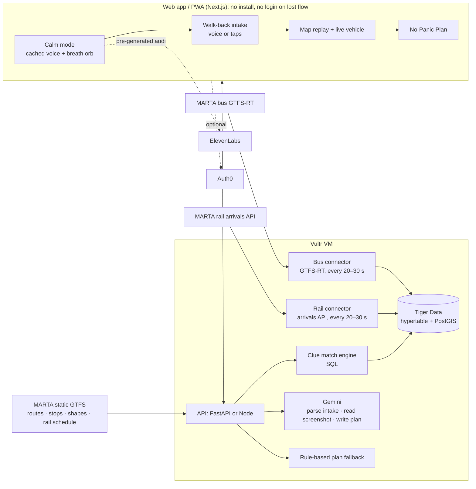

# Backtrack: Hacklanta '26 Project Plan (v3, merged)

Working name. Alternatives: Retrace, Breadcrumb, Rewind. Pick one in 5 minutes, then stop.
**Event:** Hacklanta '26 · Oct 9–11, 2026 · Georgia State University, Student Center East Ballroom · 36 hours · team of 2

> **Changes after kickoff (Oct 9, team decisions). These override anything below.**
> - **Cut:** breathing and calm-mode exercises (the orb, the calm audio clips, "Skip, I'm fine"), and Find My
>   screenshot upload (`POST /api/findmy`, the `read_findmy` stage tool, FindMyUpload, wb_13, the stale-dot buttons and
>   the screenshot hero beat). Riders won't do either. Gemini now has two uses: `/parse` and the report wording.
> - **Product name:** "bring it home" (lowercase, as in the logo), domain bringit.casa. Navy `#14213D`, orange
>   `#EF5B2B`. Internal code names stay `backtrack_*`.
> - **Gemini over REST** with hard deadlines (4 s text), model `gemini-3.5-flash-lite` (measured 0.65 to 0.73 s);
>   no `google-genai` dependency.
> - **Migration 007** gives `vehicle_passes` an `as_of` horizon; 005 and 006 stay reserved.

> **v3 = v2 (friend's plan) + our merge.** Everything verified in v2 is kept. Changes are listed right below
> so you can review them fast.

## What changed from v2 (review this first)

| # | Change | Why |
|---|---|---|
| 1 | **Trains + buses are both core** (MARTA rail moved from stretch to must, *if the rail key and train IDs check out tonight*) | It's our real story, catching a train is actually realistic (fixed tracks, trains behind you on the same line), and rail matching is simpler (4 lines, ~38 stations) |
| 2 | **Both recorders start at hour 1** | Matching only works on history we've recorded. Every hour a recorder is off is lost |
| 3 | **One table, a `mode` column (bus / rail), one connector per data source** | Adding a new city later = one new connector, not a rebuild. Pitch: "Atlanta today, any city with a transit feed tomorrow" |
| 4 | **The pitch opens with our real story** (bag left on a Red Line train at ATL, Find My stuck on "Airport") | A true story beats a generic hook |
| 5 | **"Stale Find My dot" demo beat** | Find My says "Airport, 14 min ago" while Backtrack shows the vehicle moving. The whole idea in one picture |
| 6 | **Added to the plan:** report the unattended bag fast; AirTag "Share Item Location" link on the report card; stand by the right car for trains | Real-world gaps that judges and users would hit |
| 7 | **"Somewhere else" path kept simple** | List places from the walk-back, most recent first, each with a call script. Nothing fancy |
| 8 | **Hero demo is conditional** | Rail key + train IDs OK tonight → train is the hero, bus is demo #2. Otherwise → bus is the hero, trains run on the schedule only |
| 9 | **Scope locked harder** | 2 people + 6 sponsors + 2 vehicle types is a lot. Explicit "never cut" and "cut first" lists (§9) |
| 10 | **Short `CLAUDE.md` added** (separate file) | This doc is the plan. `CLAUDE.md` is just the rules for the coding agent |

---

## TL;DR

**Differentiator:** Every lost-and-found app waits for someone else to find your stuff. Backtrack finds it while it's still moving.

**One-liner:** Backtrack helps with anything you lose, and if you lost it on a MARTA bus or train, it tells you exactly which
vehicle, where it is right now, and whether you can still catch it.

**Pitch line:** *"Find My shows where it was. Backtrack shows where it is."*

| | |
|---|---|
| **Verdict** | ✅ Feasible. Green light, with four conditions (§3.3) |
| **Main track** | Social Good (Cox Automotive): access, safety, mobility, everyday systems |
| **Backup track** | AI/ML (decide once judging criteria are announced at opening) |
| **Sponsor prizes** | Gemini · ElevenLabs · Tiger Data · Vultr · Auth0 · GoDaddy Registry |
| **Technical heart** | Every Atlanta bus and train logged all weekend → match a few remembered clues to one specific vehicle |
| **Hero demo moment** | Map replay: dozens of vehicles move, one locks onto your trip, then jumps to its live position right now |

---

## 1. Hacklanta '26 at a glance

| Item | Detail |
|---|---|
| Dates | Fri Oct 9 – Sun Oct 11, 2026 (36 hours, in person only) |
| Size | 1,000+ college students |
| Team | Up to 4 (we're 2) |
| Prizes | $14,000+ total · $2,500 for 1st in each of 4 tracks · sponsor challenges $800 (5 winners, revealed at the event) |
| Judging criteria | "TBA at Opening Ceremony". Write them down and re-check this plan against them |

**Tracks:** Social Good (Cox Automotive) → best fit · Creative (Adobe) · AI/ML → good fit · Fintech → weak fit.
**MLH challenges:** Gemini API, ElevenLabs, Tiger Data, Vultr, Auth0, GoDaddy Registry domain (all fit) · Solana (skip).

### ⚠️ Rules that matter
- Substantial design and development must happen during the hacking period. This doc is planning, which is fine.
  **Don't write project code (including the recorders) before kickoff.**
- **Disclose** any templates, libraries and tools, including AI coding tools and skill packs (e.g. gstack, frontend-design) if we use them.
- Every teammate must be accepted at hacklanta.dev (Devpost registration alone doesn't count).
- Submission needs: title, description, problem + who it serves, roster, track + sponsor challenges, public repo with a
  useful README, working demo link or run instructions, demo video, tech used, disclosure of pre-existing work, test credentials.

---

## 2. The story and the differentiator

### Our origin story (open the pitch with this)
We landed at ATL, got on a Red Line train, panicked that it was the wrong line, and jumped onto the Gold Line train at
the last second. The backpack stayed on the Red train. Find My kept saying the bag was **at the airport**. It was
actually moving north on the Red train. One of us had to pull up the MARTA map, work out that the Red train was
*behind* us on the same track, get us off the Gold train, and get us onto that exact Red train when it pulled in.
We got the bag back only because one of us stayed calm enough to do transit math under stress.
**Backtrack is that calm friend.**

### Why now (for judges)
MARTA's own lost-and-found process is slow by design:
- The preferred route is an online form, and it can take **up to five business days** for an item to reach the Lost and Found office.
- The office (inside Five Points station) is **appointment-only, Mon–Fri 8:30 AM–5 PM**. Lose something Friday night and nothing moves until Monday.
- Items are held **30 days**, then donated or disposed of. Claiming needs an in-person visit with photo ID.
- Agencies ask for the route, time, where you got off, and the **vehicle number**. Almost nobody knows the vehicle number. Backtrack gives it to you.

So there are two windows: **the first ~15 minutes** (the vehicle is still out there and might be catchable) and
**the slow official path** (a precise report with vehicle number and time makes the item far easier to match).
Backtrack wins both.

### Why Find My isn't enough
An AirTag has no GPS. It only updates when a passing Apple device hears it, and those reports are sparse in tunnels,
stations and moving vehicles. So the dot freezes at the last good fix. **Rule: if the dot is older than the moment you
lost the item, and the item was on a vehicle, trust the vehicle, not the dot.** And most riders don't have a tracker at
all. Backtrack works without one.

### Positioning vs. the crowded lost-and-found category
Devpost is full of lost-and-found hacks (Found N Lost, FoundIt ×2, HoosLost, LossEndFound…). Nearly all are bulletin
boards. **If the demo opens on a list of lost items, we look like them.**

| Typical lost-and-found hack | Backtrack |
|---|---|
| Waits for a stranger to post your item | Acts in the first minutes |
| Static database of posts | Live + historical transit data |
| Ignores the human | Calms you down and helps you remember |
| "Where did you lose it?" (you don't know) | Works from rough clues you do remember |
| Needs a tracker, or nothing | Works with no tracker; reads one if you have it |
| Generic | Hyper-local to Atlanta, generalizes to any city with a transit feed |

**Scope rule:** general for the user, deep on transit. Anything you lose gets calm mode, the memory walk-back, and a
plan. Buses and trains get the superpower.

---

## 3. Feasibility check

### 3.1 What's verified (from v2, Oct 8, 2026)

| Component | Status | Finding | Risk |
|---|---|---|---|
| MARTA bus live positions | ✅ Reachable | Public GTFS-Realtime feed returned binary data with no API key. Trip updates feed also published | Low |
| Vehicle IDs in the bus feed | ⚠️ Not verified | The whole bus idea depends on a stable vehicle ID per bus. Likely present, not yet decoded. **Check tonight** | High until checked |
| MARTA static GTFS | ✅ | Routes/stops/shapes zip (~20 MB), effective 8/22/2026. Includes rail schedules | Low |
| MARTA rail | ⚠️ Needs free key | Rail arrivals API requires a key; responses reportedly include TRAIN_ID and lat/long. **Request key tonight; check train IDs stay the same along a trip** | Medium until checked |
| MARTA lost & found | ✅ | Online form, up to 5 business days, appointment-only weekdays, 30-day hold, photo ID. **Re-verify phone/email before putting them in the app** | — (our "why now") |
| MARTA branding | ⚠️ | No MARTA logo or trademarks in the UI, slides or video without written consent. Refer to the data source in plain text | Medium if ignored |
| Find My | ❌ No API | Apple has no public developer API → screenshot + Gemini vision | Handled |
| Google Maps Timeline | ⚠️ Limited | Export is on-device only. Useless if the phone is what's lost | Stretch only |
| Tiger Data | ✅ | Tiger Cloud trial credits; PostGIS supported. Tiger CLI includes an MCP server for Claude Code | Low |
| ElevenLabs | ⚠️ Small free tier | ~10 min of speech/month. Pre-generate and cache calm-mode audio; browser speech recognition for input. Ask MLH for credits | Low with caching |
| Gemini API | ✅ Rate-limited | Free tier covers Flash with per-minute/per-day limits; free-tier data may be used by Google. Rule-based fallback for 429s | Low |
| Breathing science | ✅ With caveat | Balban et al., *Cell Reports Medicine*, 2023: 5 min/day of cyclic sighing for a month beat mindfulness on mood. Did **not** test a one-off short version. Don't overclaim | Low if honest |
| Memory walk-back | ✅ | Based on the cognitive interview (meta-analysis: Memon, Meissner & Fraser, 2010). More recalled detail, slightly more errors → treat clues as soft evidence | Low |
| Existing "which vehicle was I on" app | ✅ None found | Check the Hacklanta gallery once it's published | — |

### 3.2 Key design choice: match from clues, not from tracking
Almost nobody has an app open before losing something. So: **you don't need the user's history if you have the
vehicles' history.**
- *Bus:* "I got on the 110 near Peachtree Center around 3:10, got off by GSU about 20 minutes later." → which route-110
  vehicles were near that stop ~3:00–3:20 and near GSU ~3:30? Usually one.
- *Train:* "Got on a Red Line train at the Airport around 3:00, northbound." → which Red northbound train was at Airport
  ~2:55–3:05? Usually one or two.
- A GPS trail (Timeline export, the PWA's own logging) is an optional confidence boost, never a requirement.

### 3.3 Verdict: it works if these four things hold
1. **The bus feed has stable vehicle IDs.** If not: stitch by trip ID + position continuity.
2. **The rail key arrives and train IDs are usable.** If not: rail runs on the static schedule only, labeled "schedule only", and the bus is the hero demo.
3. **Both recorders run on Vultr from hour 1 and never stop.**
4. **The payoff is honest.** Always: exact vehicle number + time + a pre-written report in under a minute. When
   physically possible: a catch-it plan. Never promise you'll always catch it.

---

## 4. Holes and fixes

Severity: 🔴 could sink the demo · 🟠 judges will poke it · 🟡 polish.

### Data & technical
| # | Hole | Sev | Fix |
|---|---|---|---|
| 1 | Users don't have location history | 🔴 | Clue-based matching (§3.2). GPS trail optional |
| 2 | Vehicle IDs missing/unstable (bus) or train IDs unusable (rail) | 🔴 | Verify tonight. Bus fallback: trip ID + continuity. Rail fallback: schedule only |
| 3 | Several vehicles fit the clues | 🟠 | Ask direction + where they got off (best tie-breaker). Rank with confidence %. If two remain, plan covers both. Stretch: auto-generate one tie-break question |
| 4 | Bus ends its trip / goes to the garage; train reaches the end of the line | 🟠 | Track the **vehicle**, not the trip. If a bus goes dark → "report now with vehicle # + time". If a train reaches the terminus → "staff at [terminus] can check it; or meet it on its way back" |
| 5 | Feed outages, gaps, cancellations | 🟠 | Retry + gap logging; frequent route for the field test; replay mode on cached data |
| 6 | Time zones: feeds are UTC, users say "3:10" local | 🟠 | Store `timestamptz`; parse user times as America/New_York. Unit-test it |
| 7 | GPS jitter, ping spacing | 🟡 | Match within ~120 m ± a time window; interpolate along the route shape if needed |
| 8 | Catching a **bus** on foot is often impossible | 🟠 | Only offer it when the bus's ETA beats walking ETA by ≥2 min. Otherwise: "Not catchable, here's the fastest report" |
| 9 | Catching a **train** from another train | 🟠 | Only if the bag's train is **behind** you on the same track, before lines split (Red/Gold split at Lindbergh Center). Step off at a station where you arrive ≥2 min before it. If it's ahead → terminus staff or meet it coming back |
| 10 | Train doors are open only ~20–30 s | 🟠 | Ask which car / front or back. Tell the user where to stand on the platform |
| 11 | Free-tier limits | 🟡 | Cache audio; rule-based plan fallback; one Gemini call per step |
| 12 | LLM hallucinating locations, times, numbers | 🟠 | Gemini only parses input and writes plan text. Matching is deterministic SQL. Every card shows its evidence |

### Product & UX
| # | Hole | Sev | Fix |
|---|---|---|---|
| 13 | The lost thing is the phone | 🟠 | Web app, no install, no login on the lost flow → works on a friend's phone |
| 14 | Auth0 adds friction | 🟡 | Login optional, only for saved items. Never gate the lost flow |
| 15 | Calm mode annoys someone in a hurry | 🟡 | Always-visible "Skip, I'm fine". Auto-skip when a vehicle is minutes away |
| 16 | Talking aloud on a loud street | 🟡 | Every voice question has big tap answers |
| 17 | Stressed memory is unreliable | 🟠 | Ask "how sure are you?" and widen time windows. Show alternatives |
| 18 | Lost vs. stolen | 🟠 | Ask "Do you think someone took it?" If yes: freeze cards first, MARTA Police non-emergency (911 if in danger), never confront |
| 19 | Lost & found closed nights/weekends | 🟠 | Time-aware plan: after hours → file the online form now, save the vehicle #, reminder for the next weekday morning |
| 20 | Photo ID needed, and the ID was in the lost wallet | 🟡 | "Ask the office what ID they accept" when the item is a wallet |
| 21 | Not lost on transit → less magic | 🟠 | Walk-back still lists likely places, most recent first, with call scripts. Say so honestly: transit-first, not transit-only |
| 22 | Overclaiming the breathing | 🟠 | Copy says "helps you slow down". Cite the study accurately in Q&A |
| 23 | Tracker users get a stale dot | 🟡 | Find My screenshot → Gemini reads location + "last updated" → explain "this dot is 14 min old, trust the vehicle". Remind AirTag users about "Share Item Location" (iOS 18.2+) for staff |

### Safety & legal
| # | Hole | Sev | Fix |
|---|---|---|---|
| 24 | Chasing vehicles → running into traffic, holding doors | 🟠 | Catch-it only with ≥2 min margin; copy says "walk, don't run". Never hold doors or cross tracks. Prefer staffed stations, not alone at night as a default |
| 25 | Unattended bag treated as a suspicious package | 🟠 | Transit plans always include "report it now: it's yours, here's what's inside" |
| 26 | MARTA trademark | 🟠 | No logo or branding anywhere; plain text "data from MARTA's public feeds" |
| 27 | Location privacy | 🟠 | Session-scoped data, auto-delete after 24 h, no sharing; production would use a paid AI tier that doesn't train on inputs |

### Hackathon
| # | Hole | Sev | Fix |
|---|---|---|---|
| 28 | 2 people, too many MUSTs | 🔴 | Revised MVP (§5.3) + explicit cut order (§9) |
| 29 | Field test fails | 🟠 | Clue matching works without a ride: pick any real past vehicle from the DB. Film a backup ride early Saturday |
| 30 | Venue Wi-Fi dies | 🟠 | Phone hotspot + recorded video + replay mode |
| 31 | "Who pays for this?" | 🟡 | Transit agencies and campuses: better reports (vehicle # + time) = less lost-and-found labor. One sentence |

---

## 5. The product

### 5.1 Core insight
People lose things twice: once physically, then again in the panic. Backtrack calms you down, helps you remember, and
turns what you remember into a precise, time-aware plan.

### 5.2 User flow (one flow, branches automatically)

```
            "I lost something"  (no login)
                    │
          Calm mode (skippable)
                    │
   Walk-back: what, where are you, how did you get here?
                    │
     ┌──────────────┼───────────────┐
   BUS            TRAIN          SOMEWHERE ELSE
     │              │               │
 Match bus      Match train     List places from the
 from clues     from clues      walk-back, most recent
     │              │           first + call scripts
 Live position  Live position       │
 + catchable?   + catch plan        │
     └──────────────┴───────────────┘
                    │
           No-Panic Plan (time-aware)
```

**① Calm mode + walk-back (~60 s)**
- One huge button: "I lost something."
- Breathing orb + cached ElevenLabs voice guides 1–2 cyclic sighs. "Skip, I'm fine" always visible.
- Walk-back, one question at a time, in reverse order (cognitive-interview style):
  1. "What did you lose?"
  2. "Where are you right now?" (auto-filled from location if allowed)
  3. "Where were you right before here? How did you get here?"
  4. If transit: "Bus or train? Which route/line, roughly when did you get on, and where did you get off?" + "How sure are you about the time?"
  5. If train: "Which car, or front/middle/back?"
  6. "Do you think someone took it?"
  7. Optional: "Have a tracker? Drop a Find My screenshot."
- Voice or big taps → Gemini fills a structured schema.

**② The match:** clues → deterministic SQL → ranked candidates with confidence and evidence.
- Bus: "Route 110 · vehicle 1405 · near Peachtree Center 3:08 PM · near GSU 3:29 PM · 92% match."
- Train: "Red Line northbound · train 104 · at Airport 3:02 PM · 88% match."

**③ Map replay + live position (hero screen):** replays every vehicle near your boarding point in that window; the
match lights up, the rest fade. Then jumps to **now**: live position, next stops, catchable or not.

**④ No-Panic Plan (time-aware):** ordered cards with timers and one-tap actions.
- 🚆 **Train catchable:** "Your bag's train is 6 min behind you. Get off at West End. Stand at the front of the platform. It arrives at 3:19."
- 🚌 **Bus catchable:** "Bus 1405 reaches [stop] in 11 min; you can walk there in 7." (≥2 min margin only)
- 📝 **Report:** route/line, vehicle #, time, where you got off, item description, what's inside, AirTag share link if any. Copy in one tap.
- ⚠️ **Unattended bag:** "Tell staff now it's yours," so it isn't treated as suspicious.
- ☎️ **Business hours:** call lost & found (script ready). **After hours:** submit the form now + reminder for the next weekday morning.
- 💳 Wallet: freeze cards first. 📱 Phone: mark as lost in Find My / Google Find Hub from this device.
- 🚓 Stolen: police non-emergency; never confront.
- Calm copy: "Step 1 of 4. You're doing this right."

### 5.3 MVP vs. stretch

| Priority | Feature | Owner |
|---|---|---|
| MUST | Bus recorder → Tiger Data, on Vultr, from hour 1 | A |
| MUST | Rail recorder → Tiger Data, on Vultr, from hour 1 (if key arrives; else load rail schedule from static GTFS) | A |
| MUST | Clue match engine (bus + rail) + confidence ranking | A |
| MUST | Map replay + live vehicle position | B |
| MUST | Time-aware No-Panic Plan (Gemini + rule-based fallback) | A + B |
| MUST | Calm mode + walk-back intake (cached voice + tap fallback) | B |
| MUST | Train catch plan (behind-you-on-the-same-track logic) | A |
| SHOULD | Bus catchability (ETA vs. walking ETA) | A |
| SHOULD | Find My screenshot → Gemini vision + stale-dot explanation | B |
| SHOULD | Custom domain | B |
| SHOULD | Auth0 optional login + saved items | B |
| STRETCH | Auto-generated tie-break question | A |
| STRETCH | Google Timeline JSON upload → co-movement match | A |
| STRETCH | Second city connector (proves "any city") | A |

---

## 6. Architecture



**Stack:** Next.js + Leaflet/Mapbox · FastAPI (or Node) · Tiger Data (TimescaleDB + PostGIS) · gtfs-realtime-bindings ·
Gemini API (Flash) · ElevenLabs (pre-generated clips) + browser speech recognition · Auth0 · Vultr · GoDaddy domain.
**Decide FastAPI vs. Node at kickoff and don't revisit.**

**Connector pattern:** each data source is one small module that turns its feed into rows for the same table
(`mode`, `vehicle_id`, `route_id`, `ts`, `geom`, plus `station_id` for rail). New city = new connector.

### 6.1 Data sources
- Bus vehicle positions: `https://gtfs-rt.itsmarta.com/TMGTFSRealTimeWebService/vehicle/vehiclepositions.pb` (no key)
- Bus trip updates: `https://gtfs-rt.itsmarta.com/TMGTFSRealTimeWebService/tripupdate/tripupdates.pb`
- Static GTFS: `https://itsmarta.com/google_transit_feed/google_transit.zip`
- Rail arrivals: MARTA developer services endpoint with an `apiKey` (free sign-up)
- Rough volume: a few hundred vehicles × a ping every ~30 s ≈ about a million rows/day. Easy for a hypertable.

### 6.2 Schema

```sql
CREATE EXTENSION IF NOT EXISTS postgis;

CREATE TABLE vehicle_positions (
  ts          TIMESTAMPTZ NOT NULL,           -- feed timestamp (UTC)
  mode        TEXT NOT NULL,                  -- 'bus' | 'rail'
  vehicle_id  TEXT NOT NULL,                  -- the physical bus / train: what we track
  route_id    TEXT,                           -- bus route or rail line (RED, GOLD, BLUE, GREEN)
  direction   TEXT,                           -- N/S/E/W for rail; GTFS direction for bus
  trip_id     TEXT,
  station_id  TEXT,                           -- rail only: station it's at / arriving
  geom        GEOGRAPHY(Point, 4326)          -- nullable for rail rows without lat/long
);
SELECT create_hypertable('vehicle_positions', 'ts');
CREATE INDEX ON vehicle_positions (mode, vehicle_id, ts DESC);
CREATE INDEX ON vehicle_positions USING GIST (geom);
CREATE INDEX ON vehicle_positions (mode, route_id, station_id, ts);
```

### 6.3 Clue-based match: bus (from v2)
Inputs (all soft): boarding point + time, optional alighting point + time, optional route, user's confidence → time
window (±10 min if "pretty sure", ±20 min if "not sure").

```sql
-- :b_lon, :b_lat, :b_time, :a_lon, :a_lat, :a_time, :route, :win
WITH board AS (
  SELECT vehicle_id, route_id, ts
  FROM vehicle_positions
  WHERE mode = 'bus'
    AND ts BETWEEN :b_time - :win AND :b_time + :win
    AND ST_DWithin(geom, ST_SetSRID(ST_MakePoint(:b_lon, :b_lat), 4326)::geography, 120)
    AND (:route IS NULL OR route_id = :route)
),
alight AS (
  SELECT vehicle_id, ts
  FROM vehicle_positions
  WHERE mode = 'bus'
    AND ts BETWEEN :a_time - :win AND :a_time + :win
    AND ST_DWithin(geom, ST_SetSRID(ST_MakePoint(:a_lon, :a_lat), 4326)::geography, 120)
)
SELECT b.vehicle_id,
       b.route_id,
       MIN(ABS(EXTRACT(EPOCH FROM b.ts - :b_time)))                AS board_err_s,
       COALESCE(MIN(ABS(EXTRACT(EPOCH FROM a.ts - :a_time))), 600) AS alight_err_s
FROM board b
LEFT JOIN alight a
  ON a.vehicle_id = b.vehicle_id
 AND a.ts > b.ts
 AND a.ts < b.ts + INTERVAL '90 minutes'
GROUP BY b.vehicle_id, b.route_id
ORDER BY board_err_s + alight_err_s
LIMIT 5;
```

Confidence: softmax over negative total error → %. Flag "ambiguous" if the top two are close.
Optional GPS trail: co-movement check (≥3 consecutive pings within ~75 m while moving >15 km/h) as a high-confidence override.

### 6.4 Clue-based match: train (new)
Simpler than bus: fixed lines, fixed stations.
1. Filter `mode = 'rail'`, line (RED/GOLD/…), direction, boarding station, time window.
2. Each distinct `vehicle_id` at that station in the window is a candidate. Rank by time error; use where they got off
   (or where they switched trains) as the tie-breaker.
3. **If no rail key:** use static GTFS `stop_times` for that line/direction → candidate *scheduled* trips, labeled
   "schedule only, trains can run a few minutes late".

### 6.5 "Where is it now?" + catch plans
```sql
SELECT DISTINCT ON (vehicle_id) vehicle_id, mode, route_id, direction, station_id, ts, geom
FROM vehicle_positions
WHERE vehicle_id = :vid AND mode = :mode
ORDER BY vehicle_id, ts DESC;
```
- Project forward along the route shape / static `stop_times` → next 3–5 stops with ETAs.
- **Bus:** for each upcoming stop, walking ETA from the user. Catchable if bus ETA − walking ETA ≥ 2 min.
  No report for 10+ min → "Bus likely out of service; report now."
- **Train (the "catch it" logic from our story):**
  - Where's the user? On a train (match it the same way) or at a station.
  - If the bag's train is **behind** the user on the same line and direction: for each upcoming station *before the
    lines split*, check user arrival + 2 min ≤ bag train arrival. Pick the earliest, preferring staffed stations.
    Output: "Get off at X, stand at [front/back], it arrives at HH:MM."
  - If it's **ahead:** "You can't catch it from behind." → contact staff for the terminus, or meet it on its way back.
- **Reunion planner (built Oct 10, ARCHITECTURE.md 7.9):** every way back to the item, soonest first: walk ahead
  (the meet above), ride on and change platforms, wait for it to come back where you are or nearby, or meet it at
  the end of the line during its layover. Trains come back on the bag train's own run number, timed from the
  schedule's next departure at the terminus once its turn is due, and live once the turn shows; buses come back on
  their block's next trip with the layover absorbing part of the delay. Every constant is measured
  (`docs/reunion-measurements.json`). After 7 PM a train's return is never promised until it turns, and a bus whose
  block ends or continues elsewhere is never waited for. Walking ahead of a bus now needs 5 min to spare and the bus
  at most 10 min away (measured). `POST /api/sessions/{id}/reunion` serves it for polling; the plan carries it too.
- **Tiger Data bonus:** continuous aggregate of last-known position per vehicle per minute, to show off for the prize.

### 6.6 Gemini's role (grounded, with fallbacks)
| Job | Input → Output | Fallback |
|---|---|---|
| Parse intake | Free text/voice → `{item, mode, route/line, stops, times, car, confidence, stolen?}` | Tap answers fill the schema directly |
| Read Find My | Screenshot → `{device, location_text, last_seen_time}` → stale-dot explanation | Manual pin |
| Write the plan | Evidence JSON (match, ETAs, hours, item type) → ordered cards + report text + call script | Rule-based template |

**Gemini never produces a time, vehicle number, station or phone number on its own.** Those come from the database,
the static GTFS, or a hardcoded, verified contact list.

---

## 7. The demo

### 7.1 Hero moment: make the invisible visible
1. Find My screenshot: "Backpack · Airport · 14 min ago." (Our real story.)
2. Map of the city. Dozens of vehicles replay. Enter the clue. Most fade; one locks on: "Match: train 104 · 88%."
3. Jump to now: the vehicle moving live on the projector, with the catch-it card or "not catchable, report ready."

### 7.2 Three-minute stage version
| Time | Beat | What they see/hear |
|---|---|---|
| 0:00–0:20 | **Hook: our story** | "We left a backpack on a MARTA train at the airport. Find My said it was still at the airport. It wasn't." Show the stale screenshot |
| 0:20–0:35 | Why now | "MARTA's official process can take up to five business days. The vehicle is still out there for about fifteen minutes." |
| 0:35–1:00 | Calm + walk-back | Hand a judge the phone. One guided breath, two questions |
| 1:00–1:50 | The match | Map replay → one vehicle locks on → live position now → catch-it card |
| 1:50–2:15 | Proof it's real | 15-second clip from Saturday's ride: bag on the seat, vehicle leaves, app finds it. Live counter: "N positions logged since Friday" |
| 2:15–2:40 | The plan + it's general | Report card with vehicle # pre-filled; card freeze; after-hours reminder. 10 seconds on "lost keys at a café" path |
| 2:40–3:00 | Close | "Find My shows where it was. Backtrack shows where it is. Atlanta today, any city with a transit feed tomorrow." |

### 7.3 Thirty-second table version (expo judging)
Phone in the judge's hand → one breath → type a clue → map replay locks on → live position. That's it.

### 7.4 Don't show
Login screens, settings, long forms, any list of lost items, the MARTA logo.

### 7.5 Backup plan
- Recorded full demo video (Saturday night).
- Replay mode on cached data (no Wi-Fi needed).
- If the field test fails: demo the match on any real past vehicle from the database.
- Bold option: a friend outside the team rides with the bag during judging; show their live position and call them on speaker. Keep the clip as backup.

---

## 8. Prize strategy
| Prize | What judges should see |
|---|---|
| Social Good ($2,500) | Real Atlanta mobility data, the slow official process, safety-first design, works on a borrowed phone, works without a tracker |
| Sponsor challenges ($800) | Revealed at the event; watch for Cox Automotive / mobility prompts |
| Tiger Data | Hypertable + PostGIS time-window joins + continuous aggregate; show the query in the demo |
| Gemini | Three distinct uses (intake parsing, screenshot vision, grounded plan writing) |
| ElevenLabs | Calm voice, spoken questions, read-aloud call script |
| Vultr | Recorders running all weekend; show uptime |
| Auth0 | Optional login + saved items |
| GoDaddy | Register the domain in hour 1 |

---

## 9. 36-hour build plan (2 people)
**Person A: data & backend · Person B: frontend, voice & pitch** (hours from kickoff)

| Hours | Person A | Person B |
|---|---|---|
| 0–1 | Tiger Data instance + schema; **bus recorder running** | Repo, Next.js skeleton, domain, write down judging criteria |
| 1–4 | Move recorder to Vultr; **rail recorder running** (or load rail schedule); gap logging; load static GTFS | Calm mode: generate + cache ElevenLabs clips, breath orb, skip |
| 4–9 | Clue-match SQL (bus + rail) + ranking; time-zone tests | Walk-back intake (voice + taps) → Gemini schema |
| 9–14 (sleep in shifts) | "Where is it now" + next stops + **train catch plan** + bus catchability | Map replay animation + live vehicle layer |
| 14–18 | Plan generator (Gemini + rule fallback, time-aware) | Plan cards, timers, copy-report, tap-to-call |
| 18–21 | 🚆🚌 **Field test together:** ride a frequent train line (and a bus route if time) near GSU; one teammate stays on with the bag | Film everything |
| 21–26 | Fix matcher on real data; Find My screenshot | Polish, mobile layout, Auth0 optional login |
| 26–30 | **Feature freeze.** Replay mode | Record demo video; write Devpost |
| 30–34 | README, architecture diagram, deploy check | Rehearse ×5; Q&A prep |
| 34–36 | Submit; test every link in incognito | Select track + all sponsor challenges |

**Never cut:** both recorders, matching, the map (static highlight is OK), the plan.
**Cut order if behind:** Auth0 → Find My screenshot → bus catchability (just show live position + next stops) →
animated replay (use a static highlight) → spoken input (taps only) → rail live data (fall back to schedule).

**Parallel work:** each person works on their own branch. If one person runs two Claude Code sessions at once, give
each its own git worktree (see `CLAUDE.md`). Merge to `main` at least every few hours.

---

## 10. Judge Q&A prep
| Question | Answer |
|---|---|
| "Doesn't the user need the app open before losing something?" | No. We log every vehicle; the user only needs rough clues. A GPS trail is an optional boost |
| "What if several vehicles match?" | Ranked with confidence; we ask where they got off (best tie-breaker); the plan covers the top two if needed |
| "How accurate is it?" | Real field-test numbers ("correct vehicle in X of Y tests"). Explain the 120 m / time-window rule |
| "Can you actually catch it?" | Trains: often, when the bag's train is behind you on the same line. Buses: sometimes, only with a 2-minute margin. Either way you get the exact vehicle number and a report in under a minute |
| "How do you connect to Find My?" | Apple has no public API, so we read a screenshot with Gemini vision and tell you when the dot is stale. Most riders don't have a tracker; we work without one |
| "Is the breathing science or vibes?" | A 2023 Stanford randomized study found 5 min/day of cyclic sighing improved mood more than mindfulness. We use a short version and only claim it helps you slow down; it doubles as the intake, so it costs no time |
| "Why should MARTA care?" | Their process asks for vehicle numbers that riders almost never know. We hand them a precise report |
| "Privacy?" | Session-scoped, auto-deleted after 24 h, never shared. Only your own item |
| "What if the phone is what's lost?" | Web app, no login on the lost flow; use a friend's phone |
| "Other cities?" | Any agency with a standard transit feed: write one connector |
| "Isn't this just ChatGPT?" | ChatGPT can't see where every Atlanta bus and train was at 3:10 PM. The AI only talks; the match is our data and our SQL |

---

## 11. Devpost submission checklist
- [ ] Title, tagline, description (lead with the story + differentiator line)
- [ ] Problem & who it serves (riders, students, commuters, visitors, people without trackers)
- [ ] Roster (both registered at hacklanta.dev)
- [ ] Main track Social Good + every sponsor challenge used
- [ ] Public repo with a real README (setup, architecture diagram, env vars, data sources)
- [ ] Working demo link (Vultr + domain) and run instructions
- [ ] Demo video with the real ride
- [ ] Tech: Gemini, ElevenLabs, Tiger Data, Vultr, Auth0, GoDaddy, MARTA public feeds
- [ ] Disclosure of anything pre-existing (templates, libraries, AI tools/skills used)
- [ ] Test login for judges (Auth0)
- [ ] All links tested in incognito; no MARTA logo anywhere

---

## 12. Tonight's prep (allowed: no project code)
- [ ] Both: confirm acceptance at hacklanta.dev; join Discord
- [ ] **#1 risk:** open the bus vehicle-positions URL in an online GTFS-Realtime viewer and confirm each entity has a `vehicle.id` (or label)
- [ ] **#2 risk:** request the MARTA rail API key. If it arrives, check a response for TRAIN_ID, line, direction, station and lat/long
- [ ] Call MARTA customer service: "If I know the bus/train number and time, what happens? Can dispatch contact the driver or operator?" Their answer goes into the pitch and plan logic
- [ ] Re-verify the lost-and-found and police non-emergency numbers and hours from MARTA's site (they go in the app hardcoded)
- [ ] Create accounts: Tiger Data, Vultr, Auth0, ElevenLabs, Google AI Studio (Gemini), GoDaddy
- [ ] Download the static GTFS zip
- [ ] Shortlist 3 domain names
- [ ] Pick a frequent train line and a frequent bus route near GSU for Saturday; check cancellations
- [ ] Write the calm-mode script (exact lines to pre-generate)
- [ ] Decide coding tools: Claude Code skills/plugins (frontend-design? parts of gstack?) and MCP servers (Tiger CLI, Playwright, Context7). Install and test them tonight, not tomorrow
- [ ] Sleep

---

## Sources (from v2)
- Hacklanta '26 site: https://hacklanta.dev
- Hacklanta Devpost: https://hacklanta.devpost.com
- Event listing: https://us-hackathons.77-90-0-90.sslip.io/events/hacklanta
- MARTA App Developer Resources: https://itsmarta.com/app-developer-resources.aspx
- MARTA Lost & Found: https://itsmarta.com/lost-and-found.aspx
- MARTA community client: https://github.com/cacheflow/marta-transit
- What agencies ask for in lost-item reports: https://globaltransitguidebook.com/2020/03/07/transit-101-episode-9-lost-found/
- Find My has no direct business API: https://airpinpoint.com/glossary/fmn
- Google Maps Timeline export is on-device only: https://www.mileagewise.com/timeline-exporter/
- Tiger Cloud: https://www.tigerdata.com/docs/getting-started/latest/services · https://www.tigerdata.com/mst-signup
- ElevenLabs free tier: https://dailyaifixs.com/blog/elevenlabs-pricing-2026-is-the-free-plan-enough
- Gemini API free tier: https://flo2.com/blog/gemini-free-tier
- Cyclic sighing (Balban et al., 2023): https://hubermanlab.stanford.edu/publications/brief-structured-respiration-practices-enhance-mood-and-reduce-physiological-arousal
- Cognitive interview meta-analysis (Memon, Meissner & Fraser, 2010): https://repository.royalholloway.ac.uk/items/2f9938b0-c01b-7310-9ec8-e0aee92c9d17/9
- Existing lost-and-found hacks: https://devpost.com/software/found-n-lost · https://devpost.com/software/foundit-5g2wrs · https://devpost.com/software/hooslost · https://devpost.com/software/lossendfound
