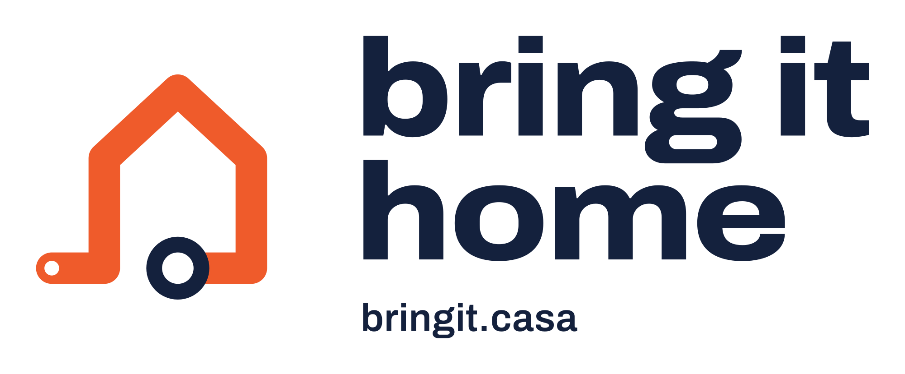
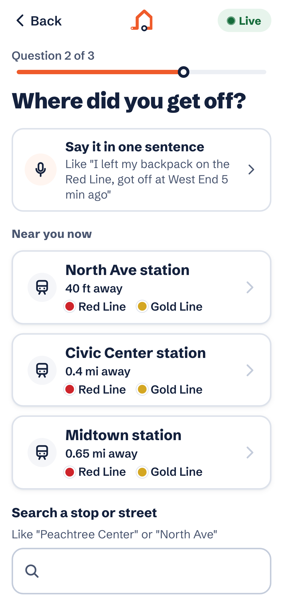
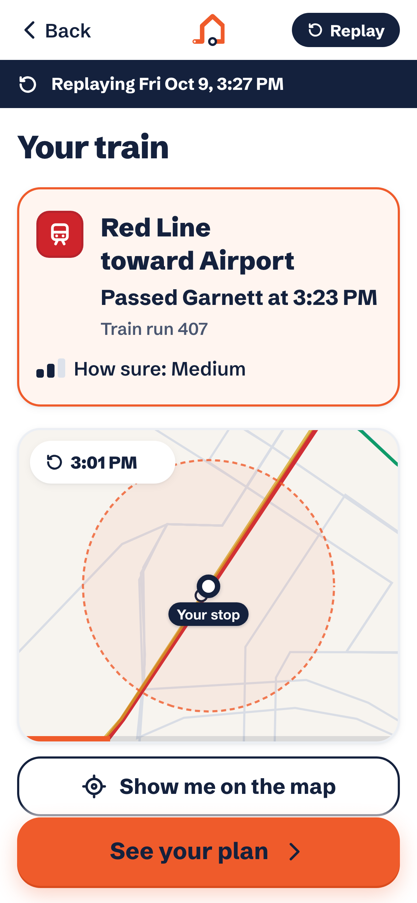
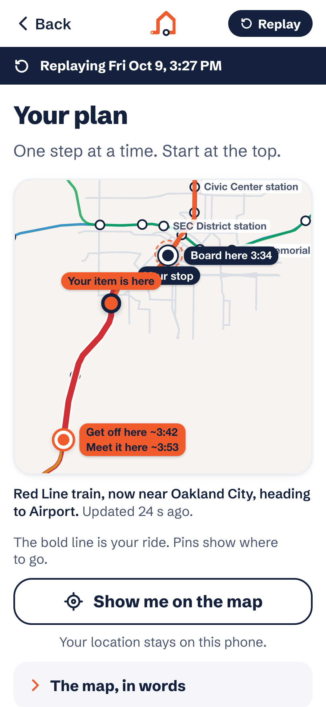
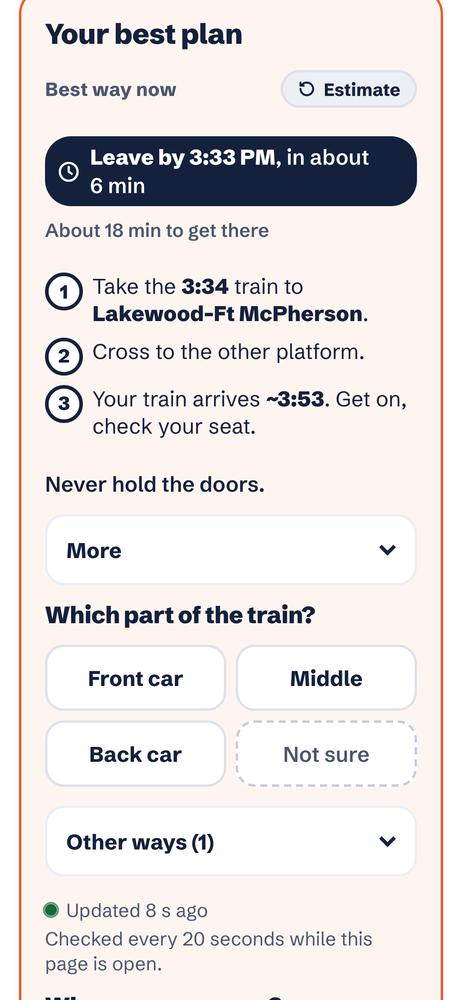
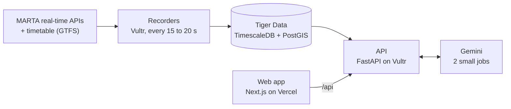

<p align="center">
  
</p>

<p align="center"><b>Left something on a MARTA bus or train? Find the exact one, see where it is right now, and get the fastest way back to it.</b></p>

<p align="center">
  <a href="https://www.bringit.casa"><b>www.bringit.casa</b></a> ·
  <a href="https://www.bringit.casa/?mode=offline&set=hero-rail">Recorded example</a> ·
  <a href="docs/JUDGE-GUIDE.md">Judge guide</a> ·
  <a href="docs/explainer/bring-it-home-explainer.pdf">Architecture slides</a>
</p>

> *Find My shows where it was. bring it home shows where it is.*

> **Live data is paused.** After the hackathon we shut down the recorders and the API to stop server costs, so
> www.bringit.casa now opens the **recorded example**: the full app on a real MARTA ride we recorded. To run it live,
> follow "Run it locally" below.

Built at **Hacklanta '26** (Social Good track).

<p align="center">
  
  
  
  
</p>

## Why

At the Atlanta airport station, two of our teammates, Roshan and Aadi, jumped from a Red Line train to a Gold one,
and Roshan's backpack (laptop, iPad, passport) stayed on the Red. Find My was frozen on "Airport" while the bag moved
down the line. While Roshan panicked, Aadi pulled up MARTA's routes and worked out a plan: the Red train was right
behind them on the same track, so they got off at the next station, waited, and the bag came to them.

Most riders won't have an Aadi. MARTA's Lost and Found is open only on weekdays, items can take up to 5 business days
to arrive, and the report form asks for a bus or train number almost nobody knows. **bring it home is that calm friend
for everyone.**

## What it does

1. **Three taps** (bus or train, where you got off, about when), or say it in one sentence:
   *"got off at five points from the blue line just now"*.
2. **Finds your exact vehicle** from the buses and trains that actually passed your stop at that time.
3. **Live map** with your bag's train or bus moving in real time.
4. **Your best plan:** two or three short steps with times, for example *take the 3:34 train to Lakewood, cross to
   the other platform, your train arrives ~3:53*. It compares every way back (walk ahead, wait for it to come back,
   ride ahead and switch platforms, meet it at the end of the line) and re-checks every 20 seconds.
5. **Didn't find it?** Tell staff, MARTA's lost item report already filled in, Lost and Found hours, call and email.

No account, no download. Works on a borrowed phone. Every time is labeled Live, Estimate or Timetable, and the app
never tells anyone to run or hold doors.

## How it works



- **Record (Vultr).** Two always-on Python recorders poll MARTA's bus feed (GTFS-realtime) every 15 s and the rail
  API every 20 s, save each response to disk first, store every position in Tiger Data, and log any gap.
- **Store and search (Tiger Data).** A TimescaleDB hypertable in 6-hour chunks holds every position (over half a
  million so far). One SQL function, `vehicle_passes`, answers *"which vehicles passed within a quarter mile of this
  stop around this time?"*: TimescaleDB narrows to the time, PostGIS to the place. Older chunks are compressed about
  **9.6x** (lossless, verified on 57,544 real rows).
- **Match.** Each nearby vehicle gets a cost from how far its closest pass was from your time and your stop, plus
  penalties for anything that doesn't match what you said (never a hard filter). Costs become probabilities; one
  clear winner is "Your train", otherwise "Most likely yours" with one tap to confirm.
- **Plan.** MARTA's API only gives one-way arrival times, not how long a train waits at the end of the line or when
  it comes back. We measured that from our own recordings (for example a train turns around in about 34 s and leaves
  about 7 minutes later), built the planner on those numbers, and switch to MARTA's live times once the train has
  turned.
- **AI, two small jobs (Gemini).** Turning a spoken sentence into answers, and wording the report email. Our code
  checks everything it returns, and simple rules take over if it is slow. *The AI is the translator. The decisions
  come from real transit data.*
- **Buses that aren't reporting** (about half on Saturday morning) fall back to the timetable: a "probably about
  here" position and a way back marked as an estimate.

## Proof

- **Replay test:** our API can rewind to any past moment and see only what was known then. We asked the planner at
  thousands of past moments and checked what the train actually did. On trains, its first choice was truly the
  fastest way back about **96%** of the time, and fixing what the replay found cut missed trains from **8.2% to
  1.4%** ([docs/BACKTEST.md](docs/BACKTEST.md)).
- **Live test:** it predicted a Red Line train back at East Point about 8:57; it passed at about 8:57:30.
- **Tests:** 1,399 API tests, 174 web unit tests, and Playwright end-to-end tests at phone and laptop sizes.

## Privacy (zero data)

No accounts, no tracking, no analytics. Your location is used only to make your plan and is never stored or logged.
Your search deletes itself 2 hours after you stop using it (a Tiger retention policy is the 24-hour backstop), and
what you lost never leaves your phone. *We don't track people to find their stuff. We track the buses and trains.*

## Stack

| Part | What we used |
|---|---|
| Web | Next.js (static export, installable), MapLibre, Vercel |
| API | Python, FastAPI, Caddy (HTTPS), on Vultr |
| Recorders | Python, systemd services, on Vultr |
| Database | Tiger Data: TimescaleDB + PostGIS |
| AI | Google Gemini (gemini-3.5-flash-lite) |
| Data | MARTA's public bus, rail and schedule feeds |
| Domain | bringit.casa (GoDaddy Registry) |

## Repo layout

| Folder | What's in it |
|---|---|
| [`web/`](web/README.md) | The app (Next.js), its fixtures and end-to-end tests |
| [`api/`](api/README.md) | The API: matching, live tracking, the plan, Gemini parsing |
| [`worker/`](worker/README.md) | The recorders and the timetable loader |
| `db/migrations/` | Database schema (hypertables, `vehicle_passes`, compression, retention) |
| `deploy/` | Server setup, systemd units, Caddyfile |
| [`docs/`](docs/) | Judge guide, team overview, backtest, demo script, slides, Devpost images |

## Run it locally

You need Python 3.12+, Node 22.18+, a Tiger Data (TimescaleDB + PostGIS) database, and a free MARTA rail API key.
Copy `.env.example` to `.env` and fill it in (`DATABASE_URL`, `MARTA_RAIL_API_KEY`, optionally `GEMINI_API_KEY`).

```bash
# recorders and database
cd worker && python3 -m venv .venv && .venv/bin/pip install -e ".[dev]"
.venv/bin/python -m backtrack_worker migrate        # create tables, hypertables, functions
.venv/bin/python -m backtrack_worker load-static    # load MARTA's timetable
.venv/bin/python -m backtrack_worker record         # start both recorders

# API
cd ../api && python3 -m venv .venv && .venv/bin/pip install -e ../worker -e ".[dev]"
.venv/bin/uvicorn backtrack_api.app:app --host 127.0.0.1 --port 8000 --no-access-log

# web app (proxies /api to :8000)
cd ../web && npm ci && npm run dev
```

The recorded example (`?mode=offline&set=hero-rail`) works without any of this.

## Notes

- Built with help from Claude Code (an AI coding assistant), open-source libraries, and MARTA's public data.
- Not affiliated with or endorsed by MARTA. Data from MARTA's public feeds.
- Code names inside the repo (`backtrack_api`, `backtrack_worker`) are from before the project was named.
